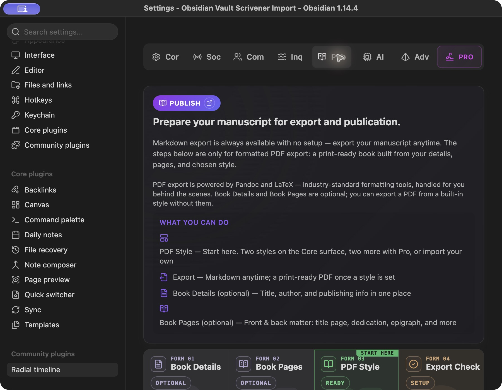
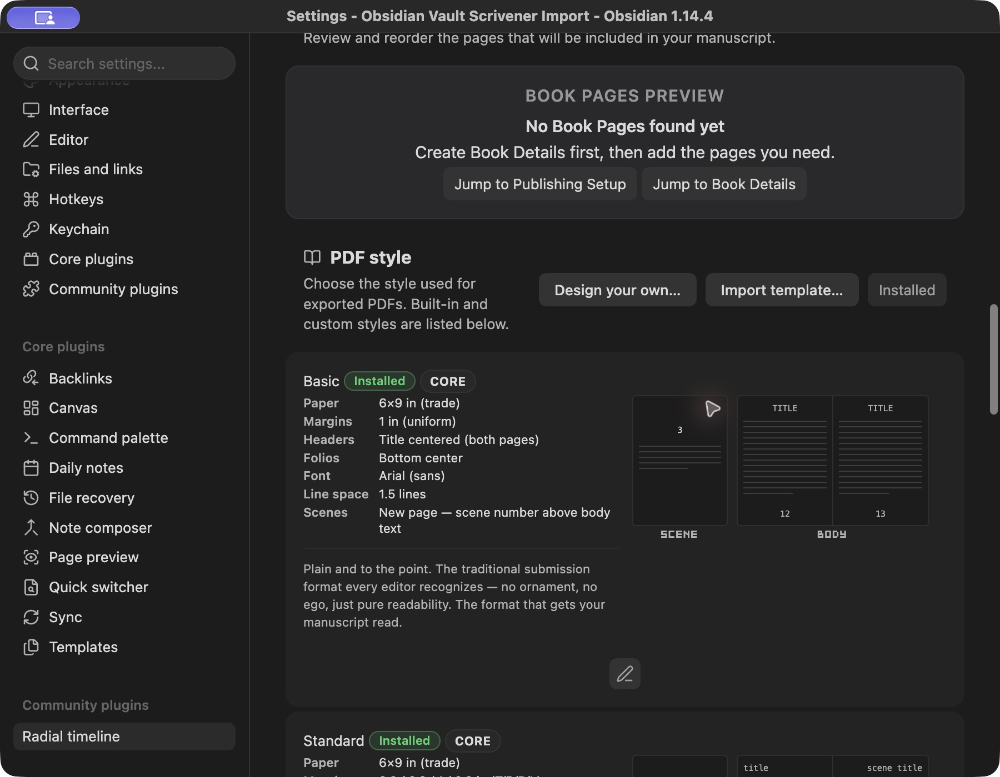
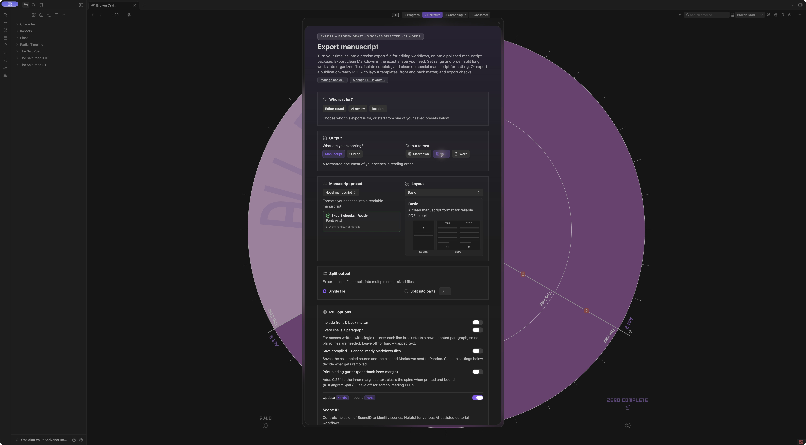
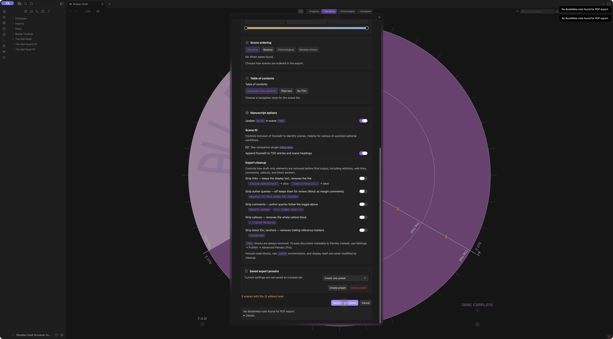

# RT Publish and manuscript export professionalization audit

RT has a substantial formatting engine and a distinctive visual style designer. Professionalization should connect those strengths to one author-controlled export workflow: choose a manuscript, choose its contents, choose the document's purpose, inspect the proof, and save the result. The first work is correcting contradictions between the interface and execution, followed by flexible scope and a document-centered workspace.

**Status:** audit and proposed direction; implementation unchanged. **Date:** October 10, 2026. **Source baseline:** `c72de049` on `main`. **Native surface:** Obsidian 1.14.4, Radial timeline reporting 7.4.0, the existing Scrivener Import test vault, active book Broken Draft (three scenes, 17 displayed words). Screenshots are from this run; historical memory is not audit evidence.

## Answer about PDF scene ranges

**The current normal PDF workflow does not allow an arbitrary scene range.** Markdown and Word expose scope, range, subplot filtering and order. PDF hides those controls, resets the range to the whole book and uses narrative order. PDF can split that whole book into multiple files; splitting is a different capability from choosing an excerpt.

This is deliberate in three places: `ManuscriptOptionsModal.getUiMode()` sets `lockSceneSelectionToFullBook = isPdfManuscript`; `syncExportUi()` resets the range; `CommandRegistrar.handleManuscriptExport()` discards PDF range/order/subplot overrides. Profile comparison also normalizes PDF to `full-book`. Blame dates the modal's lock to September 5, 2026 (`0ebee7f3e`); this does not establish whether every older version allowed PDF ranges.

Sources: [modal mode](../../../../src/modals/ManuscriptOptionsModal.ts#L380), [runner](../../../../src/services/CommandRegistrar.ts#L349), [profile comparison](../../../../src/utils/exportProfileModel.ts#L140).

## Captured journey

Every listed screenshot was saved and opened for inspection. A capture taken during smooth scrolling was rejected and replaced with the settled setup screen. No source prose was edited and no manuscript deliverable was produced by the native attempts: both stopped before assembly/output. Inspecting controls updates some test-vault export preferences by design; the modal was returned to a new-preset Markdown draft and closed. The style draft was cancelled without saving.

| Step | Task and screenshot | Health and observation |
|---|---|---|
| 1 | [Publish entry](2026-10-10-publish-export-evidence/01-publish-start.png) | Needs correction. Large introductory copy promises Markdown without setup and optional Book Details. Word is absent from the overview. |
| 2 | [Book Details and Book Pages](2026-10-10-publish-export-evidence/03-book-details.png) | Mixed. Direct editing and page grouping are useful; the empty state contradicts the export requirements. Populated-page editing/reordering was not exercised. |
| 3 | [PDF style library](2026-10-10-publish-export-evidence/02-pdf-styles.png) | Strong visual foundation. Compact diagrams explain layout. Basic's submission language conflicts with its actual settings. |
| 4 | [Style designer entry](2026-10-10-publish-export-evidence/05-style-wizard.png) and [Basic customization](2026-10-10-publish-export-evidence/05-style-wizard-page.png) | Strong controls, excessive scrolling in the captured settings window. Preview is a schematic, not typeset manuscript pages. |
| 5 | [Export Check](2026-10-10-publish-export-evidence/04-export-check.png) | Needs better task framing. A tool path and technical configuration dominate; Publish's export entry is gated on PDF readiness. |
| 6 | [Markdown export modal](2026-10-10-publish-export-evidence/06-export-markdown.png) | Capable but dense. Purpose, format, document type, splitting, scope, order, cleanup and presets form a long vertical stack. |
| 7 | [PDF mode](2026-10-10-publish-export-evidence/07-export-pdf.png) and [PDF failure](2026-10-10-publish-export-evidence/08-pdf-blocked.png) | Fails the readiness contract. Range controls disappear; checks say Ready, then generation blocks on `Book.title`. |
| 8 | [Markdown failure](2026-10-10-publish-export-evidence/09-markdown-blocked.png) | Confirmed defect. Generate Markdown fails with `No BookMeta note found for PDF export.` |
| 9 | [Word scope](2026-10-10-publish-export-evidence/10-word-range.png) and [Editor round footer](2026-10-10-publish-export-evidence/11-editor-round-footer.png) | Good purpose defaults and retained range UI. Range handles lack keyboard semantics. Previous PDF-named failure remains visible after switching format. Successful native Word output was not exercised. |

### Publish entry

### Visual style controls

### PDF readiness and scope

### Markdown failure

## What should be preserved

- The spec-driven PDF system: bundled `.tex` output, feature lists and diagrams derive from `DesignedStyleSpec`, rather than separately maintained representations.
- Visual choices for page geometry, running heads, folios, chapter/part treatment and scene openers. Authors can see the effect of a choice without learning LaTeX.
- Purpose presets: Editor round, AI review and Readers, including author questions as Word comments and removal of private notes. Keep AI review optional; compilation itself needs no AI.
- Front/back matter resolution, per-book page order and reusable styles. Preserve author-owned source files and custom metadata.
- Assembly blocks deliverables when a source note cannot be read. Font policy also blocks a selected PDF style when its required font cannot resolve.
- Saved presets distinguish modified settings and offer Reload preset. Existing success UI can reveal the output folder and open the file; changing settings invalidates the previous success state.

## Prioritized findings

P1 means fix before presenting the workflow as a dependable general manuscript exporter. P2 means important professionalization work. P3 means subsequent polish. A product limitation is distinguished from a defect; source-only risks are not presented as reproduced failures.

### P1 confirmed defect: Markdown unexpectedly requires BookMeta

**Evidence:** step 8. The runner performs BookMeta, title, author and rights validation before its Markdown branch. Its format label chooses Word for DOCX and PDF for everything else. A book with no BookMeta therefore cannot use the advertised setup-free Markdown export and receives the wrong-format error.

**Target:** Markdown assembly has no title/author or toolchain requirement unless an explicitly selected feature needs it. Require metadata only for the document features using it. For a formatted document requiring title or author, ask for those fields in context and explain their use; avoid making authors create a special note simply to satisfy operational machinery.

**Verification:** a native folder with scenes and no BookMeta exports complete Markdown; PDF/Word requirements are evaluated independently; error labels name the selected format. [Runner metadata block](../../../../src/services/CommandRegistrar.ts#L496).

### P1 confirmed defect: Ready does not mean ready to export

**Evidence:** steps 1, 2 and 7. Publish explicitly says Book Details are optional. The PDF modal shows `Export checks · Ready`, then generating fails with `Missing required publishing metadata: Book.title.` The progress tests assert optional metadata while execution requires it.

The modal's template verdict and the runner's validation are different subsets. Publish also aggregates multiple styles rather than exclusively describing the intended export. Missing LaTeX is a warning in `PublishingValidationService`, although a PDF needs a functioning engine. These additional gaps are source findings, not separate native dependency-failure reproductions.

**Target:** one format- and selection-specific readiness result used by Publish, the modal, preview and execution. Cover selected source, contents, required metadata, selected style/access, fonts, tools and output destination. A missing requirement gets an adjacent fix action. Other unused or broken styles should not block a valid selected style. Font/style compatibility may be shown separately, but must not be labelled overall export readiness.

**Verification:** every native Ready state reaches a valid artifact for the captured inputs; missing tools, missing required fields and inaccessible styles give the same explanation in preview and generation. [Progress model](../../../../src/utils/publishingProgress.ts#L51), [template verdict](../../../../src/modals/ManuscriptOptionsModal.ts#L2390), [validation service](../../../../src/services/PublishingValidationService.ts#L350).

### P1 product limitation: choosing PDF changes the contents

**Evidence:** steps 6, 7 and 9, backed by the mode and runner locks above. Scope is coupled to format. A partial Word/Markdown selection becomes a full book when PDF is chosen, without a persistent explicit contents summary explaining that change.

**Target:** content selection is independent of PDF/Word/Markdown. Support whole manuscript, contiguous range, chosen chapters and selected notes. Preserve inclusion and ordering across format changes. If a particular output cannot express a choice, explain the limitation rather than broadening the manuscript. Retain optional subplot/chronological views for existing RT authors under additional scope controls.

**Verification:** exporting the same chosen excerpt to each format contains the same prose in the same order; chapter/part boundaries are sensible at excerpt edges; page-number restart and title-page inclusion are explicit choices.

### P1 confirmed content mismatch: Basic is not what its description promises

**Evidence:** steps 3 and 4. The archetype entry promises an industry-standard double-spaced submission manuscript. The selected Basic spec actually uses 6×9 trade paper, 11-point system sans, 1.5 line spacing and dedicated scene-opener pages. This is internally contradictory even without applying an external submission standard. Word uses a different bundled reference document, described in the runner as 12-point Times New Roman and double spaced.

**Target:** distinguish submission manuscripts, reading proofs and bound-book layouts. Choose the recipient's actual requirements when available; do not claim one style is accepted by every editor. Use honest purpose descriptors alongside the existing style names. A Submission preset should produce consistently described geometry, typography, spacing, headers and scene breaks in PDF and Word.

**Verification:** exported page dimensions, font size and spacing match the selected preset's displayed specification. Existing saved/custom styles are preserved; changed defaults require a deliberate migration/version decision. [Bundled Basic spec](../../../../src/publishing/bundledStyleSpecs.ts#L32), [Word branch](../../../../src/services/CommandRegistrar.ts#L626).

### P1 source risk: output writes and job results need stronger guarantees

PDF and Word filenames use timestamps with minute precision. Pandoc writes directly to the final output path; the managed Markdown overwrite/archive path is separate. Identical title/format/style exports within a minute can target the same binary file. Pandoc temporary inputs use `Date.now()` names. A failure during a split run can leave completed earlier files while the thrown result loses the accumulated path list.

**Target:** unique job-scoped temporary files; a clear collision policy; render to temporary output, verify it, then promote to the final name; report every completed and failed output in a split job. Keep technical logs expandable. This is source review, not observed data loss.

**Verification:** rapid re-export preserves prior deliverables unless the author explicitly replaces one; two concurrent jobs cannot share temporary inputs; injected failure on part two reports part one accurately and never reports the whole job successful. [Pandoc execution](../../../../src/utils/exportFormats.ts#L1189), [filename construction](../../../../src/utils/exportFormats.ts#L237), [runner output handling](../../../../src/services/CommandRegistrar.ts#L900).

### P2 source risk: freeze the manuscript and export settings for each job

The runner captures a source folder initially but later reads the mutable active book for validation, page order, layout options and saved preferences. Modal scene loads also lack a visible request-generation guard. A book switch or overlapping scope loads could mix identities or let an older result replace a newer selection. No such race was reproduced in this run.

**Target:** resolve one immutable export request at generation: source identity, ordered paths, structural markers, selected pages, metadata, style and output options. Derive preview and output from that same request. Ignore stale scene-load responses and do not persist a completed job's preferences into a different active book.

**Verification:** switch books during an intentionally delayed job; the original job's title, pages, prose and destination remain aligned. Rapid scope/order changes keep the newest choice. Use existing assembly and validation modules; avoid a second export engine or a speculative source-provider framework.

### P2 UX: replace the long settings tour with a document workspace

**Evidence:** steps 1–7. The Publish entry has extensive explanatory copy; the style start point is numbered Form 03 after two optional forms. Book Pages editing and preview occupy separate sections. The export modal requires scrolling through document type, splitting and technical cleanup before the final action. Its hero copy emphasizes turning a timeline into an export. Publish omits Word and hides its export button until the PDF-oriented stage allows it, despite advertising Markdown anytime.

**Target:** put the current manuscript and Export manuscript action at the top. Use Publish for reusable book details, page composition, style library and defaults. Use the export modal for this deliverable's contents, purpose, format, proof and destination. Tool diagnostics are an actionable drawer, not the primary task. Keep advanced options available without requiring a new writer to learn RT's timeline model.

### P2 UX: add a real proof while retaining fast diagrams

**Evidence:** steps 3, 4 and 7. Pictograms are useful schematic explanations, not WYSIWYG manuscript pages. Neither the style designer nor the export modal shows the selected prose's actual pagination.

**Target:** retain diagrams for immediate feedback. Add Generate proof using the same assembler, sanitizer, style and renderer as final export. Show actual pages, page count and scope, with a clear stale-proof state after changes. Use an explicit render action initially to avoid recompiling a long book on every keystroke. Word requires its own truthful preview or sample file; do not imply a PDF proof verifies DOCX pagination.

### P2 accessibility and feedback

**Evidence:** steps 4, 6, 8 and 9. Range endpoints appear as generic containers, not sliders or inputs. Source has pointer handlers and aria-labels, but no tabindex, slider role, current/min/max value or keyboard handlers. Attempting to focus an endpoint and use Right did not change the range. Margin controls appear as anonymous steppers with abbreviated surrounding labels. CSS orders Publish sections separately from creation order, requiring a reading-order check.

**Target:** labelled From/To inputs and selectable chapter/scene lists alongside the visual range; keyboard-operable drag alternatives; fully named margin controls; visible focus; DOM order matching reading order; status announcements for proof/export completion. Keep action and readiness summaries visible while scrolling. Contrast, VoiceOver, focus trapping, light theme and reduced-motion behavior need dedicated verification; screenshots alone do not establish compliance.

The native summary also said `3 scenes with IDs (3 without one)`. Say `3 scenes · 0 IDs · 3 missing IDs` instead. A previous export failure remains visible after choosing another format/purpose; clear or mark it as belonging to the earlier attempt. Tie errors to a fix action rather than a metadata key at the bottom of the modal. [Range handlers](../../../../src/modals/ManuscriptOptionsModal.ts#L2991), [readback](../../../../src/modals/ManuscriptOptionsModal.ts#L1375).

### P2 ownership and persistence

Export can update `Words` in source YAML, and modal close/cancel persists draft settings. Choosing a PDF layout can immediately save the book's layout preference and refresh its timeline. These are existing behaviors, not proof of source prose loss.

**Target:** export reads source by default. Treat word-count maintenance as an explicit author action outside the core delivery task. State whether closing keeps draft options; distinguish keeping options from saving a reusable preset. Saved export presets should include author-visible scope policy and style overrides together. Operational selection/exclusion state belongs in plugin data or sidecars, never newly required scene YAML.

## Proposed UX contract

### Publish home

Show the manuscript's title, source folder, scene/chapter count and a Change manuscript control in the header, followed by a prominent **Export manuscript** action that is available for every supported format. Below it, keep three coherent areas: **Book details**, **Book pages**, and **Styles and export presets**. Put toolchain diagnostics under Export tools with concise format-specific status. Remove repeated introductory prose and printing jargon such as Copy deck/Imposition from essential task navigation.

A writer may select an existing RT book, an ordinary Markdown folder, or a single manuscript file. Show the proposed inclusion and order before export. Do not rename files, duplicate a manuscript folder, infer fiction metadata or require scene classifications to render a document. An unstructured folder needs author-reviewed order/roles; the plugin must not guess an arbitrary folder into a novel. Existing RT structure remains useful when present.

### Export workspace

Use an adaptive two-pane modal when width permits: concise controls on the left, actual proof on the right. At smaller widths, use an explicit Preview view and keep the generation footer visible. This extends the existing ERT shell rather than replacing the product's visual language.

1. **Manuscript:** visible source identity, change action, included/omitted counts.
2. **Purpose and format:** Editor round, Submission, Readers, Custom; PDF, Word, Markdown. Purpose sets sensible defaults; every override stays visible and reversible. AI review remains an optional existing purpose.
3. **Contents:** whole manuscript, range, chapters or chosen notes; explicit order and front/back matter policy. The same selection applies to every format.
4. **Style:** a meaningful starting layout, with the existing visual selectors for geometry, typography and structural treatment. Word exposes its own applicable style controls/reference-document choice.
5. **Proof and readiness:** real content/pages where supported, a final inclusion and cleanup summary, required fields and fix actions. Distinguish schematic preview from compiled proof.
6. **Save:** filename and destination, output count, Generate PDF/Word/Markdown, then Open file/Reveal folder and a complete results list. A saved preset is reusable; a finished file is evidence of an export.

Split output needs an explicit policy: by chapter, by scene count, or another author-chosen boundary. Current equal-scene chunks should be described accurately; they do not promise equal word counts or page lengths. Define whether front matter occurs once, in every part, or is omitted; likewise for back matter and excerpts.

### Design reference lock

**Primary:** RT's current ERT architecture, theme typography, flat surfaces, precise icons, visual layout diagrams and restrained accent roles. Preserve these rather than importing a new palette or generic SaaS skin. Use borders, spacing and hierarchy for workflow surfaces; reserve atmospheric treatment for an intentional hero.

**Bounded external references:** [Craft export flow](https://refero.design/flows/7958) contributes controls beside a proof and an explicit progress/completion sequence. [Hello Ivy export flow](https://refero.design/flows/4519) contributes a short, clear format/action decision. [Missive PDF viewer](https://refero.design/pages/b14045d0-6f3d-4e2e-8a9d-ca581cf66a61) contributes page navigation and thumbnails. Linear and Linear Changelog styles were reviewed for disciplined density and hierarchy; Medium was a contrasting editorial reference. None replaces RT tokens or theme fonts. External references inform recommendations, not current RT findings.

**Reject:** an obligatory linear wizard, a Longform clone, a new binder/editor project, decorative cards replacing actual proof, additional source metadata requirements, and separate preview/export pipelines. Controls should show their effect on a document; detailed machinery remains inspectable when useful.

## Implementation sequence after approval

| Phase | Scope | Acceptance boundary |
|---|---|---|
| 1 Reliability and truth | Correct Markdown metadata gate/error labels; unify readiness; correct Basic copy/intent; fix stale errors and misleading counts; harden output collision/partial-job reporting. | Native no-BookMeta Markdown success; truthful PDF/Word blocking; repeated outputs preserved; injected split failure accurately reported. |
| 2 Flexible manuscript and contents | Accept reviewed plain folders/single files; separate content scope from format; support PDF ranges; label and keyboard-enable range controls; define excerpt/matter/splitting rules. | The same selected prose and order in all formats, without scene YAML rewrites or compulsory timeline setup. |
| 3 Document-centered UX | Compact Publish home; adaptive proof workspace; visual style editing, format-specific typography, saved setup/override clarity, complete delivery results. | Author can prepare a complete book and a sample chapter, inspect proof, export and reopen both through the native UI. |
| 4 Broader publishing | Evaluate EPUB, additional recipient templates and alternate PDF engines only against an actual author requirement. | Validated output and clear supported-format boundaries; no claim based on file extension alone. |

Refactor only where it removes duplicate derivation or hidden ownership. `PublishSection` (2,926 lines), the export modal (3,352) and `CommandRegistrar` (1,608) currently concentrate UI and orchestration; line count alone is not a justification for extraction. Unify request/readiness semantics first, then remove redundant branches and view derivations. Preserve schema compatibility and author custom fields. Follow the engineering doctrine and feature-audit playbook for any approved implementation.

## Verification and limits

| Check | Result |
|---|---|
| `npx tsc --noEmit` | Passed. |
| `npx vitest run` | 383 files passed, 3 skipped; 4,174 tests passed, 7 skipped. |
| `npm run build-only` | Passed; production artifacts copied to the configured targets. No native plugin reload was performed for this audit. |
| PDF smoke using isolated temporary output | Passed: Basic fixture 2 pages, Standard 7, Professional 2, Signature 7. This verifies fixture rendering/text checks, not a finished native manuscript delivery or visual acceptance of every page. |
| Native PDF | Ready shown, then missing-title block reproduced. |
| Native Markdown | Unexpected BookMeta requirement and PDF-named error reproduced. |
| Native Word | Purpose/scope UI inspected; no successful document generated in this run. |

The green tests do not cover the complete UI-to-runner contract demonstrated by the failures. Add integration checks around that boundary, not tests merely repeating the progress model's optional-metadata assumptions. Native scope tests need to check the resulting prose, rather than only visible counts. A long real manuscript, populated matter composition, Windows/Linux, custom/imported templates, concurrent jobs and accessibility remain explicit follow-up acceptance surfaces.

No implementation fixes, refactors, dead-code deletions or migrations were performed. The existing two model-catalog working-tree changes were left untouched. The audit completes with verified findings and a staged design direction; it does not certify the current exporter as release-ready for the broader proposed audience.
