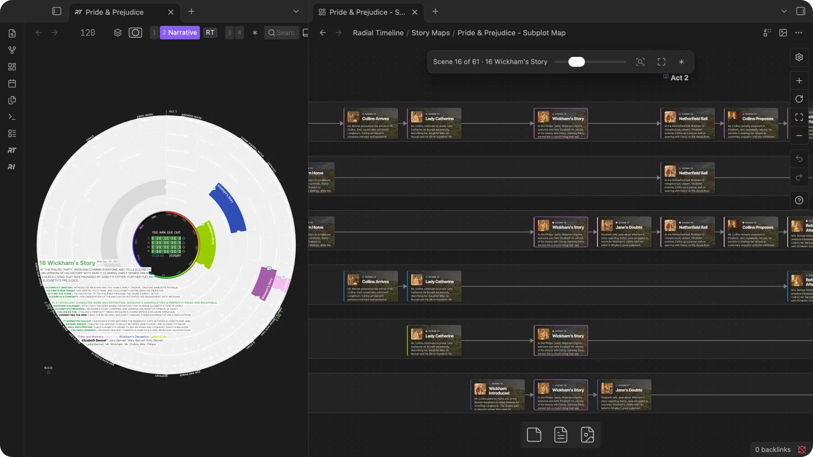
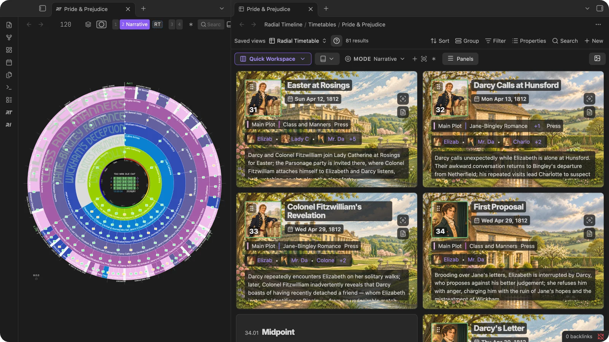
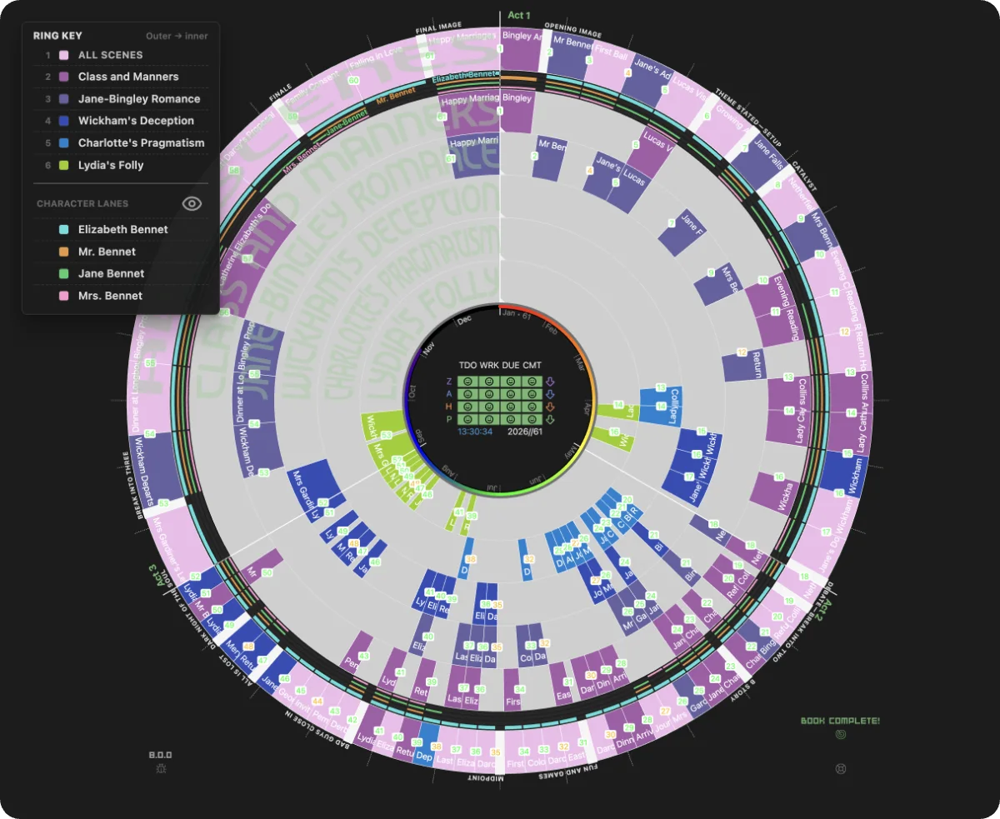

## Radial Timeline 8.0.0

Your book on a Canvas, and a Timetable you can plan in: subplot maps that follow the wheel, Panels with character portraits, an Outline layout that turns planning documents into sketches, and scenes you can place by dragging in the table. On the wheel, character lanes follow your main characters, and every title reads upright.

### Canvas story maps

- **Map your subplots on a Canvas.** **Canvas map** in the Timetable, the Canvas icon in the timeline title bar, or **Canvas create subplot map** lays the book out on a new Canvas: one lane per subplot in **Horizontal lanes** or **Vertical lanes**, or a **Single story line**. Each card links to its scene note, and lines follow each subplot in reading order. Choose an act or subplot, and the third of the book to open on. Moving cards does not reorder your manuscript.
- **The map and the wheel point at each other.** Hold Shift as you hover a scene on the timeline and its cards light up on the map; with **Follow Shift-hover from timeline in Canvas** on, the map travels to it. Click a card to light its scene on the timeline and in the Timetable. A card's menu adds **Radial Timeline: Show in Timetable**, **Radial Timeline: Show on timeline** and **Radial Timeline: Promote to scene**.
- **Find your way around.** The story navigation bar steps scene by scene with a slider (*Scene 16 of 61 · Wickham's Story*), with **Zoom to selection** and **Fit all**. **Canvas card view** shows notes from your books as a **Preview** of the synopsis, the **Title**, or the **Full note**, and can mark overdue scenes. Other notes keep Obsidian's usual look. Double-click a card to edit its note.

- **From a mind map to a timeline in one step.** **Turn Canvas cards into scenes or sketches** makes numbered scenes straight from a Canvas: each card joins its act and its subplot, and the timeline opens. The cards you leave out stay on the map.
- **Color cards by subplot.** Select idea cards and click a swatch on the Canvas bar: your ring colors from Settings, named as they are there. In the dialog, each color gets a row to name a new subplot or pick one of the book's, and a dot shows the color its ring will have. Cards you add to the Canvas later start on the same subplot.
- **Act cards set the acts.** A card named *Act 2* or *Act 2: The Fall* starts that act, and the cards after it join. With no Act cards, scenes spread evenly across the acts, and the dialog shows where each act starts.
- **A key for the map.** The **✱** on the Canvas bar sums up the workflow and the map's marks.
- **Turn Canvas ideas into placed sketches.** Choose **Sketches** for loose ideas: **Place after scene**, or **End of act or unassigned**, with **Move up** and **Move down** to set their order.
- **Sketches promoted together keep their order.** Each takes a scene number at the end of its act.

See [Canvas story maps](https://github.com/EricRhysTaylor/radial-timeline/wiki/Timetable#canvas-story-maps).

### Timetable

- **Panels.** A card for every scene, beat and sketch, with its date, rings, characters and synopsis beside an image: a character's portrait, the place, both, the portrait over a place background, the scene's own artwork, or none. **Character selection** picks whose portrait: the most distinctive character in the scene, the first or second listed, the POV character, or a balanced variety. **Choose card image…** sets any card by hand. Portraits and places are found by name: an image called *Elizabeth Bennet* shows up for Elizabeth Bennet, and an `Image` on the character or Place note comes first. **Place background + character** sets the portrait over the place, with a **Text backing** that keeps the card readable, and **Portrait shape** is Square or Landscape. In a narrow pane, every image choice sits in one **Image settings** menu. **Image sizing** fills or fits, **Set image focus** keeps the right part in view, and **Panel size** is Small, Medium or Large. Click a synopsis to edit it in place.

- **Outline.** The book act by act in reading order, with **Outline documents** on top: notes with `Class: Outline` appear there by themselves, and you can attach any other note. Select text in a document and **Add selection as sketch** puts it where you clicked in the outline. **Create sketches from this document** turns a document's headings into sketches you review first; each links back to its source, and the document stays as it is.
- **Quick Workspace** opens a reference document next to the table: side by side, below, or with the timeline as well, with your pinned tabs kept open. **Timetable above Canvas** puts your book's subplot map under the table.
- **Add any note to the book by dragging it in.** Drag a note from the file explorer onto the Timetable or the timeline, choose **Scene** or **Sketch**, and it joins the book with its text and properties intact. In Narrative or Progress, drop it on a scene on the timeline and it becomes the next scene, in that scene's act and the subplot you dropped it on.
- **Drop text to make a sketch.** Drag a selection from any note onto the timeline or Timetable, and **Create sketch** keeps a link back to its source. In Outline, drop it on a row and the sketch lands right there.
- **Place scenes and sketches from the table.** Drag a scene's grip onto another scene to place it just before it, with no timeline open. In Narrative this reorders the manuscript; in Chronologue it places the scene in time. Sketches drag to sit after a scene, beside another sketch, or at the end of an act, and empty acts accept drops. When a scene with sketches after it moves to another act, **Move attached sketches?** asks whether they follow it.
- **A toolbar of its own.** Switch the layout between **Table**, **Panels** and **Outline**, switch books, and pin a mode from the **Mode** menu; a lock marks a pinned mode. **Restore Radial Timetable view**, beside **Saved views**, adds a fresh view if yours was deleted. New Timetables name their views **Radial Timetable** and **Spreadsheet**.
- **Promote into place.** A sketch placed after a scene is promoted into that spot with a number that fits between its neighbors, and **Open scene** takes you to it.
- **Color by a column in one click, and search from the key.** Right-click a column header and the timeline takes its colors at once; **Edit key** chooses others. Buttons in the key set how the names you pick combine: **Both present**, **Either present**, **Neither present** or **Alone together**, and **With** or **Without** for one name. A scene takes the color of its rarest name, so a character in nearly every scene leaves room for the others. The key is see-through and spans the timeline's pane, so the top of the timeline stays in view.
- **Due coloring keeps up with the calendar.** Color a Timetable by **Due** or a date range and every group colors as scenes reach it: a scene that turns Overdue or due Today takes that group's color on the wheel and in the key, and each group keeps its own color. **Edit key** lists every group, empty ones included. Coloring by day, month, or year shows the eight busiest periods, or the ones you pick. Views you colored by date in 7.7.0 color every group again; choose groups in **Edit key** to narrow them.
- **Promote lists each scene once, in reading order.** When you promote a sketch, its **Position** menu offers every scene of the book once, from the first scene to the last.
- **Commands are grouped by what they act on.** Each name starts with what it works on, so related commands sit together in the Command Palette: **Timeline open**, **Inquiry open**, **Note create**, **Manuscript import**, **Timetable open**, **Timetable reset columns to recommended**, **Timetable restore a Radial Timetable view**, **Scene promote note**, **Canvas create subplot map**, **Canvas convert cards to scenes or sketches**, and **Community timeline share export**. Hotkeys you set keep working.

See [Timetable](https://github.com/EricRhysTaylor/radial-timeline/wiki/Timetable).

### Timeline

- **Character lanes in Narrative mode.** Turn them on with the eye button in the ring key, or **Settings → Core → Point of view → Character lanes**, to follow your main characters through the book. Up to four thin lanes sit inside the outer ring, one for each of the characters who are POV in the most scenes. Each lane has its own color. A tall mark is a scene told from their point of view; a short mark is a scene they're in. Gaps show how long a character is gone. Hover a mark to outline it, light its scene and show the character's name right beside it. The ring key (layers icon, or hold Shift) lists the lanes below the rings, each name beside its color, and, while open, shows the names on the wheel too; hovering a name lights every scene that character is in.

- **Scene titles read right side up all the way round.** Titles across the bottom half of the wheel now run left to right instead of upside down, in every ring and while you hover a scene to show its full title. Chronologue's dates around the edge of the wheel read the same way, each beside its tick.
- **The rotate toggle is gone.** The arrow beside the outer ring turned the wheel so the lower titles could be read. With every title upright, its job is done, so the wheel always opens with Act 1 at 12 o'clock.
- **Help in the title bar.** **Help** sits with the title-bar actions, and **Settings** opens from the gear.
- **Stage milestones live in Settings.** **Settings → Core → Progress and status** marks each stage you finish, and the wheel stays clear for your book.

See [Character lanes](https://github.com/EricRhysTaylor/radial-timeline/wiki/Narrative-Mode#character-lanes).

### Inquiry

- **Read a briefing beside Inquiry.** The **Open beside Inquiry** icon in a Briefing Article moves it into a side panel next to Inquiry, so you can read its findings while you work through the book. **Open full briefing** brings it back to the full-size view.

### Manuscript export

- **A saved range keeps up with the book.** A scene range that runs to the last scene now stays open-ended, so scenes you add later are included in the next export. A range that stops earlier is kept as you set it.

### Writing Session

- **Desk Lamps help.** A **?** beside Desk Lamps in the session panel explains that lamps share live sessions with the friends you choose, at any sharing level, Private included. The line under the checkboxes says what ticked friends see.
- **Give each scene its share of a session.** Saving a session can split its minutes and words across the scenes you worked on, and add that time to each scene's **Total Time**. **Total Time** is now a core scene property, so the audit lists it on your existing scenes and **Insert missing fields** adds it.

### Story Vaults

- **Story Vaults live under Settings → Resources.** The **Res** tab replaces the Pro tab: the Story Vaults, then **Learn more** links to Getting started, the wiki and the video tutorials.
- **Story Vaults know their edition.** When a newer edition of a story is ready, the Welcome screen and **Settings → Resources** offer it as a separate download, and your current vault stays as it is.
- **Portraits and places in Pride & Prejudice.** The Pride & Prejudice Story Vault has a portrait for each of its 29 characters, from Hugh Thomson's and C. E. Brock's illustrations of the 1890s, and notes for its nine places. Open its Timetable in **Panels** to see them beside every scene.

### AI

- **Gemini requests opt out of Google's request storage.** Radial Timeline sends every Gemini request with `store: false`. Google turned request storage on by default for new paid projects on October 26; your manuscript text stays out of it.

### Fixes

- **No more `{{Character}}` in your scenes.** **Insert missing fields** and **Fill empty values** add empty fields instead of copying the template's placeholders, such as `{{Character}}` or `{{When}}`, into a scene.
