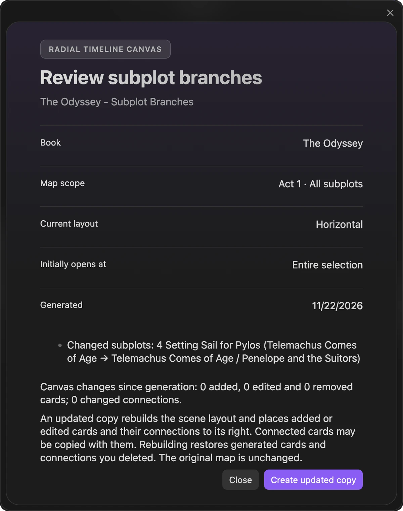

## Radial Timeline 8.1.1

Canvas subplot branches keep their review details on every device, Story Vaults you add to your vault keep their narration setting, Keep timeline updated waits for your notes, and a fix for Import template.

### Improvements

- **Canvas subplot branches on every device:** Canvas subplot branches you create now keep their review details in a small file beside the Canvas, so **Map out of date — review updates** and text drops work on every device that syncs the vault. The details follow the Canvas when you rename it or its folder.

- **Command name:** the command that builds a book's subplots on a Canvas is now called **Canvas create subplot branches**.

- **Story Vaults keep their narration setting:** a Story Vault you add to your vault now opens each of its books with the narration setting the book was made with, as a downloaded Story Vault already does.
- **Keep timeline updated waits for your notes:** while Obsidian is still opening the vault, or a note in the book has not been read yet, the update waits and goes out with the next one, so Community always gets your whole timeline.

### Fixes

- **Import template:** closing the dialog during the last step of **Save**, while the picture of the test page is being drawn, cancels the import, and no style is saved.
