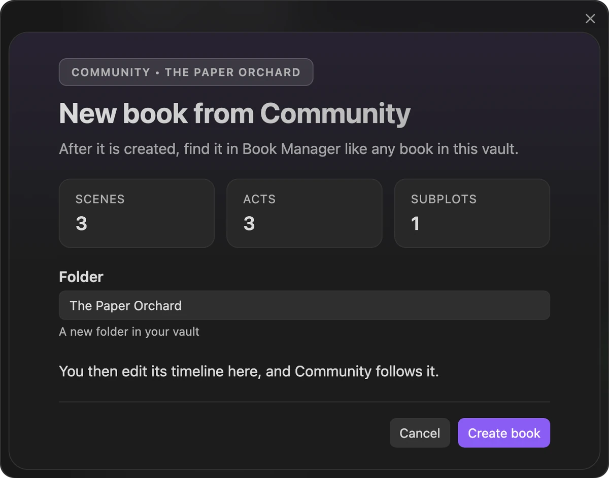
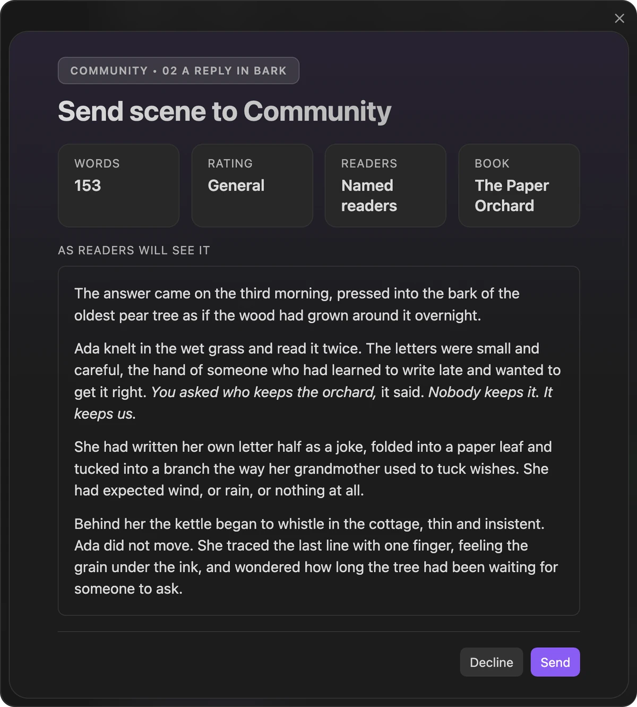
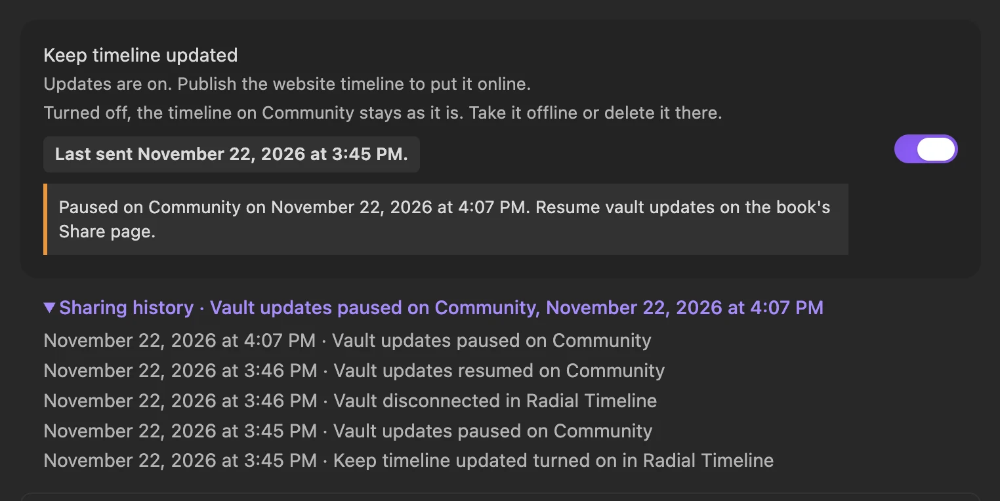
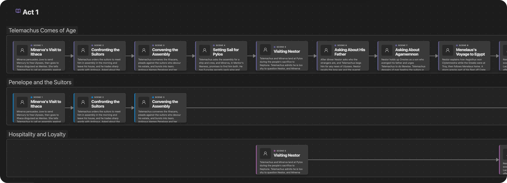
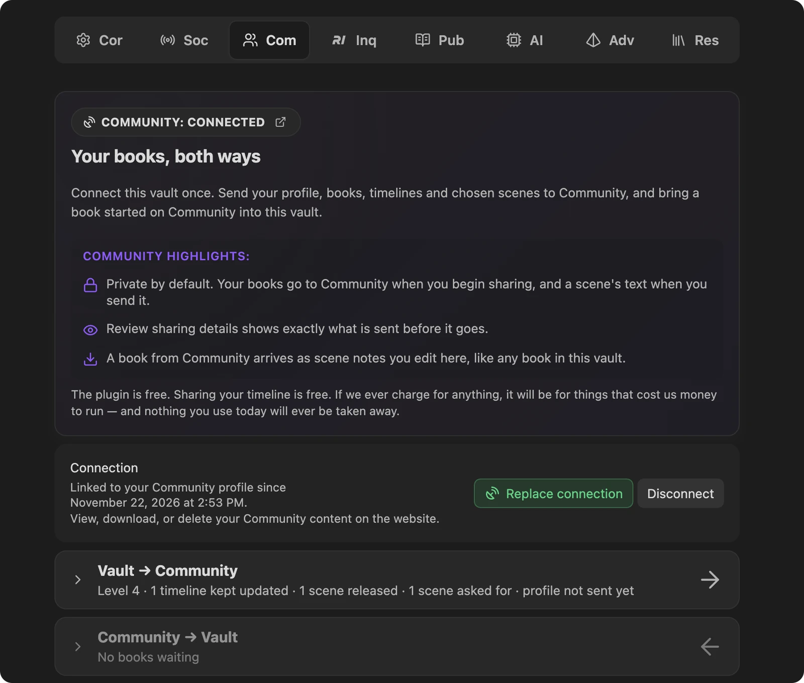

## Radial Timeline 8.2.0

Your books now travel both ways between your vault and the Community website: bring a book you started on Community into your vault, and send a scene's text when Community asks for it. Canvas subplot branches go with you to every device.

### Book from Community

- **A book from the Community website, in your vault.** On the book's Share page on Community, choose **Add to my vault**, and select **Include released text** to bring your released scenes' text into their notes. In Radial Timeline, the **Community → Vault** row in **Settings → Community** says "1 book waiting" and opens by itself. Choose **Review**, or **Open in Obsidian** on the website.
- **Review, then Create book.** **New book from Community** shows the book's scenes, acts and subplots, and the new folder Radial Timeline creates for it, which you can rename. Choose **Create book**, and Radial Timeline writes a scene note for each scene, named with its scene number and title. Each note holds the scene's act, story date, synopsis, subplots, cast, narration, publish stage and status under your own property names, with the rest of your scene template ready to fill in. Released text becomes the note's body.

- **From then on, you edit the timeline in Obsidian.** The new folder joins Book Manager with **Keep timeline updated** on, and Community follows the timeline as you edit it. Readers, released scenes, questions and answers stay with their scenes, because each note keeps its scene ID.
- **Picks up where it stopped.** If Obsidian closes partway, the row shows **Continue**, and Radial Timeline carries on from the last note it wrote. Community keeps a copy of the book's timeline from before it came to your vault, under **Recovery** on its Share page.

### Scenes asked for on Community

- **Level 4: Everything above, plus scene text you send.** A new sharing level adds the text of each scene you send when Community asks for it.
- **Ask on Community, send from your vault.** On Community, open a scene on its book's Share page, choose its rating and readers, and choose **Ask Radial Timeline for this scene**. In Radial Timeline, the **Vault → Community** row shows "1 scene asked for" and opens by itself. Choose **Review** beside the scene.
- **See exactly what readers will see.** **Send scene to Community** shows the scene's word count, its rating and readers, the book, and the text as readers will see it. Choose **Send** to release it, or **Decline** to answer the request. **Released scenes** lists each scene you have sent, and marks one whose text has changed in your vault since.

- **Shorter release terms.** The first time you choose Level 4, Radial Timeline shows the release terms, version 2026-11-22: a reader can report a scene for someone's private information or for material that isn't yours to share, a person reviews each report while the scene stays up, and a scene's text goes to an AI provider only when you ask for a summary of its feedback. If you agreed to the earlier terms, you see the shorter ones once.

See [Scenes asked for on Community](https://github.com/EricRhysTaylor/radial-timeline/wiki/Settings-Community#scenes-asked-for-on-community) and [A book from Community](https://github.com/EricRhysTaylor/radial-timeline/wiki/Settings-Community#a-book-from-community).

### Who paused sharing, and when

- **Both sides say who and when.** **Pause sharing**, **Resume sharing** and **Keep timeline updated** each tell Community that they changed and when, and nothing more. In Radial Timeline, the sharing row reads "Paused in Radial Timeline on" with the date. A book paused on Community says "Paused on Community on" with the date, and how to resume it.
- **Community: Disconnected.** When the vault is disconnected on Community, the badge says so, with who and when, and the Connection code row is ready for a new code.
- **Sharing history.** Each book's block lists its latest sharing changes, newest first, folded under one line.

See [Who paused, and when](https://github.com/EricRhysTaylor/radial-timeline/wiki/Settings-Community#who-paused-and-when).

### Canvas subplot branches

- **On every device.** Canvas subplot branches now keep their review details in a small file beside the Canvas, so **Branches out of date — review updates** and text drops work on every device that syncs the vault. The details follow the Canvas when you rename it or its folder.
- **A clearer name.** The command that builds a book's subplots on a Canvas is now **Canvas create subplot branches**, and each subplot becomes a branch. New ones are saved in a **Canvas** folder as *Book - Subplot Branches*; the ones you already have keep their names and keep working.

### Improvements

- **Settings → Community in two directions.** The tab opens on your connection, with **Replace connection** and **Disconnect** side by side, then two rows: **Vault → Community** for your sharing level, your book's timeline and the scenes asked for, and **Community → Vault** for books waiting. Each row sums itself up in one line and opens by itself when it needs you.

- **Story Vaults keep their narration setting.** Each book in a Story Vault opens with the narration setting it was made with, whether you add the story to your vault or download it as its own vault.
- **Keep timeline updated waits for your notes.** While Obsidian is still opening the vault, or a note in the book is still being read, the update goes out with the next one, so Community always gets your whole timeline.

### Fixes

- **Import template:** closing the dialog during the last step of **Save**, while the picture of the test page is being drawn, cancels the import cleanly.
