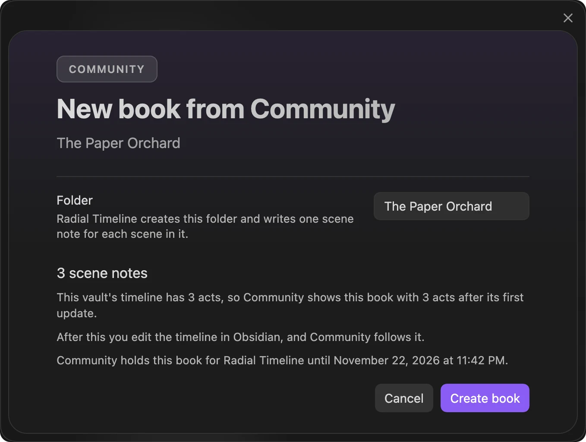

## Radial Timeline 8.2.0

A book you made on the Community website can now become a book in your vault, Canvas subplot branches keep their review details on every device, and fixes.

### Book from Community

- **A book from the Community website, in your vault.** On the book's Share page on Community, choose **Add to my vault**, and tick **Include released text** if you want your released scenes' text in their notes. Then, in Radial Timeline, open **Settings → Community**: the **Book from Community** card shows the book's title and scene count. Choose **Review**. On the website, **Open in Obsidian** opens the same preview.

- **Review, then Create book.** **New book from Community** shows the folder Radial Timeline will create, which you can rename, and how many scene notes it will write. Nothing is written until you press **Create book**. Radial Timeline then writes a scene note for each scene in the new folder, named with its scene number and title. Each note holds the scene's act, story date, synopsis, subplots, cast, narration, publish stage and status under your own property names, with the rest of your scene template added empty. If you chose released text, it becomes the note's body.

- **From then on, you edit the timeline in Obsidian.** The new folder joins Book Manager with **Keep timeline updated** on, and Community follows the timeline as you edit it. Readers, released scenes, questions and answers stay with their scenes, because each note keeps its scene ID.
- **Picks up where it stopped.** If Obsidian closes partway, the card shows **Continue**, and Radial Timeline carries on without writing any note twice or over a note already there. If the book is canceled on Community first, the notes stay in their folder and the card says where they are.

See [A book from Community](https://github.com/EricRhysTaylor/radial-timeline/wiki/Settings-Community#a-book-from-community) in Community settings.

### Improvements

- **Canvas subplot branches on every device:** Canvas subplot branches you create now keep their review details in a small file beside the Canvas, so **Map out of date — review updates** and text drops work on every device that syncs the vault. The details follow the Canvas when you rename it or its folder.
- **Command name:** the command that builds a book's subplots on a Canvas is now called **Canvas create subplot branches**.
- **Story Vaults keep their narration setting:** each book in a Story Vault opens with the narration setting it was made with, whether you add the story to your vault or download it as its own vault.
- **Keep timeline updated waits for your notes:** while Obsidian is still opening the vault, or a note in the book has not been read yet, the update waits and goes out with the next one, so the Community always gets your whole timeline.

### Fixes

- **Import template:** closing the dialog during the last step of **Save**, while the picture of the test page is being drawn, cancels the import, and no style is saved.
