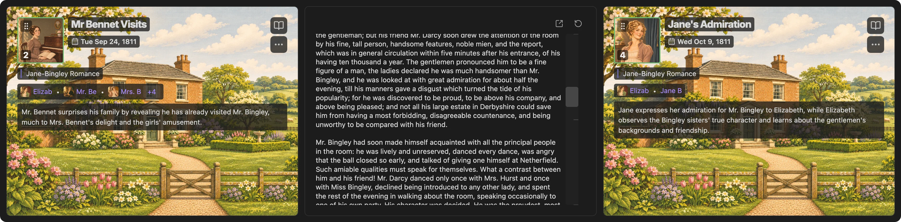
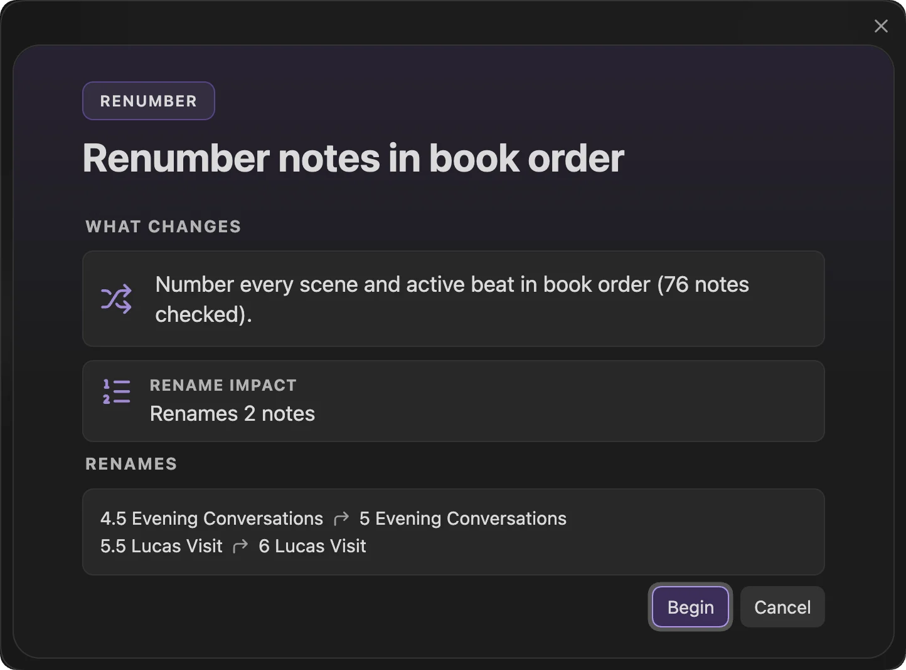

## Radial Timeline 8.3.0

Read your whole book in one place, see your chapters in the Timetable, read a scene on its Timetable panel, and renumber your scene notes whenever you like.

### Writing Studio

- **Read your book from start to finish.** Writing Studio shows the active book as one continuous text, every scene in order. Beside the text are a small wheel, the book's contents and the details of the scene you are reading. Open it with the open-book button at the start of the timeline's title bar.

- **It keeps your place.** As you scroll, the wheel lights the scene you are reading, and the contents and details move with you. Click a scene on the wheel or in the contents to go to it.
- **Read as much as you want.** Choose the whole book, one chapter or one scene. The arrows step a scene or a chapter at a time.
- **Contents in outline form.** Acts, then chapters with their scene counts, then scenes and beats. Click a chapter's arrow to fold it.
- **Edit while you read.** Click **Open source note** to open the scene beside the studio. When you scroll on and stop, the note switches to the next scene. While you type, it stays put. Your edits show in the studio as you make them.
- **Works in a narrow pane.** The scene details move behind a button, and the wheel and contents move into a strip above the text.

### Chapters

- **Choose where chapters come from.** For each book, pick the **Chapter** property on your scenes, or a level of folders inside the book's folder. Every chapter view uses your choice: the timeline, the Timetable, Writing Studio and export. Find it in **Settings → Advanced → Chapter source**.
- **Chapter headings in the Timetable.** In Narrative, each chapter now has a heading above its scenes, with its scene count. Click the arrow to fold a chapter. Click **Read chapter** to read it in Writing Studio.

- **One chapter title, one chapter.** Give the first scene of a chapter its **Chapter** title, and the scenes after it belong to that chapter until the next title. If you put the same title on several scenes, they now stay in one chapter. Before, each of them started a new chapter in the timeline and the export.

### Timetable Panels

- **Read a scene on its panel.** In the Panels layout, click **Read scene**, the book button in a panel's top-right corner. The panel turns over to show the scene's text, with a scale beside it that shows where you are. Click a passage to open the scene in a pop-out window at that spot.

- **One menu for each panel.** The **⋯** button under **Read scene** holds **Open note**, image focus and the panel's image choices.
- **Move a beat in the Timetable.** In Narrative, drag a beat by its grip onto the top or bottom half of a scene to place it before or after that scene. A beat stays in its act and between its neighboring beats. The confirmation shows its new number.

### Renumber your scenes

- **Renumber now.** Number every scene and active beat in book order whenever you like. Use it, for example, after **Add scene** gives a new note a number like 4.5. It lists every rename and waits for you to click **Begin**. Find it in **Settings → Advanced**, in the export window when a scene number has a decimal point, and as the command **Book renumber scene and beat notes**.

- **Faster moves.** When you move a scene or beat, each note is now renamed once, straight to its new name. Obsidian asks about updating links once per note.
- **A beat that can't go there says why.** Drop a beat outside its order, on the timeline or in the Timetable, and a notice explains the order. Its link opens **Settings → Core → Story beats**, where you can change it.

### Export

- **Export to PDF, Word, Markdown.** The exporter has a new name that says what it makes. Every Markdown note's menu now offers it, with that note ready to export.
- **A simpler export window.** It has three groups: **What to export**, **How to format it** and where to save it. The first two start with your saved choices. If a title or author is missing, the message points you to **What to export**.

### Improvements

- **Act labels in Narrative** sit in the middle of their act, and beat titles are larger.
- **Runtime in the timeline's center** opens the Runtime Estimator when a book has no runtimes yet.
- **Menus name Radial Timeline once.** Radial Timeline's items in Obsidian's menus show its logo. With native menus, the default on a Mac, they start with "Radial Timeline:" instead.
- **A calmer time notation bar.** A scene's duration is a quiet gray line beside the text. Where the prose runs past it, a small yellow mark appears. The mark is hollow until the times you have confirmed run past the duration on their own.

### Fixes

- **Writing sessions in pop-out windows:** scrolling in a pop-out window that was already open when Obsidian started now keeps your writing session going.
- **Story beats:** when you change the range of several beats in a row, each change is kept.
- **Beats with a number in their title,** such as "1st Pinch Point", now match their beat.
- **Timetable panels:** the line of subplots shows only subplots. The color of the portrait's frame shows the publish stage, as the Timetable key explains.
