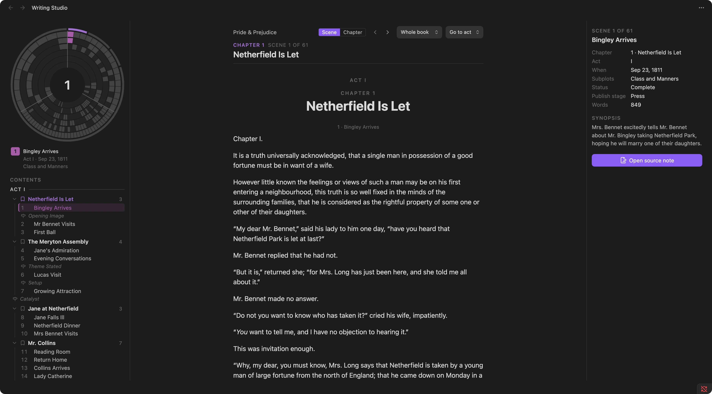
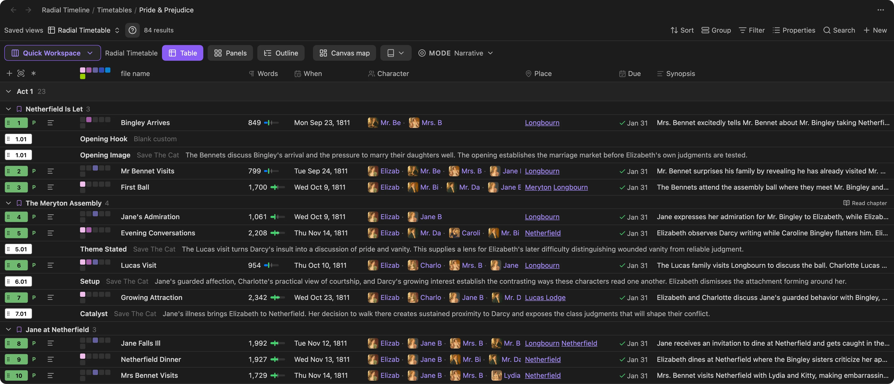
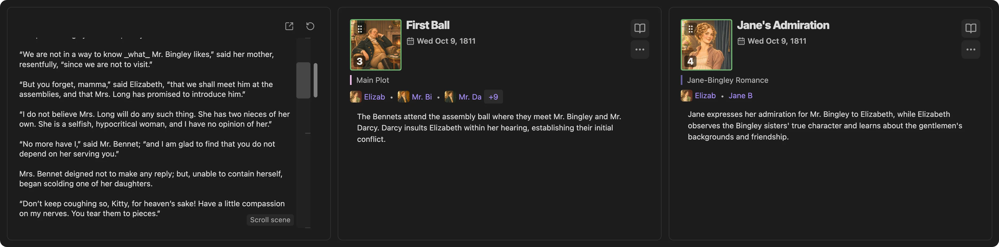

## Radial Timeline 8.3.0

Read your whole book in one place with Writing Studio, see your chapters in the Timetable, read a scene on the back of its card, and renumber your scene notes whenever you like.

### Writing Studio

- **Your book as one continuous text.** Writing Studio shows the active book as a manuscript, every scene's text in order, with a compact wheel, the book's contents and the details of the scene you are reading beside it. Open it from the open-book button at the start of the timeline's title bar, the command **Writing Studio open**, or **Read in Writing Studio** on a scene's right-click menu.

- **Everything follows your reading.** As you scroll, the wheel lights the scene you are reading, and the contents and scene details move with you. Click a wedge or a contents entry to go there. Read the whole book, one chapter or one scene, and step by scene or by chapter.
- **Contents as an outline.** Acts, chapters with their scene counts, scenes and beats, each in its place. Chapters fold.
- **Edit beside it.** **Open source note** opens the scene you are reading next to the studio. From then on that note follows your reading and switches scenes once you stop scrolling. Typing holds it on its scene. Your edits appear in the studio as you make them.
- **Fits narrow panes.** Scene details fold behind a button, and the wheel and contents become a strip above the text.

### Chapters

- **Choose where chapters come from.** Each book takes its chapters from the **Chapter** property on its scenes, or from a level of folders inside the book's folder: **Settings → Advanced → Chapter source**. Chapter markers, Publish, Writing Studio and the Timetable all use it.
- **Chapter headings in the Timetable.** In Narrative, each chapter's scenes sit under a heading with the chapter's scene count, and the heading folds. A chapter that runs past an act divider shows again after it, marked as continued. **Read chapter** opens Writing Studio at the chapter's first scene.

- **A repeated Chapter value continues its chapter.** Scenes that carry the same Chapter title form one chapter everywhere, as the Publishing guide describes. Until now, Publish and the timeline started a new chapter at every scene with a Chapter value.

### Timetable scene cards

- **Read a scene on the back of its card.** **Read scene**, in each scene card's top-right corner, turns the card over to the scene's text. A scale beside the text shows where you are in the scene. Click a passage to open the scene in a pop-out at that spot.

- **One Scene options menu.** Under **Read scene**, the **⋯** menu holds **Open note**, image focus and the scene's image choices.
- **Move a beat in the Timetable.** In Narrative, drag a beat by its grip to just before or after a scene, within its act and between its neighboring beats. The confirmation shows the beat's new number.

### Renumber and reorder

- **Renumber now.** Give every scene and active beat a number in book order at any time, for example after **Add scene** left a note numbered 4.5. Find it in **Settings → Advanced**, under the ripple rename setting, where the button says how many notes need renaming; in the export window, beside the note about decimal scene numbers; and as the command **Book renumber scene and beat notes**. It lists each rename before you choose **Begin**.

- **Each note renamed once.** Moving a scene or beat, ripple rename and Renumber now rename each note straight to its new name, in an order where that name is free. Obsidian asks about updating links once per note.
- **A beat drop outside its order says why.** On the timeline or in the Timetable, a notice explains the beat order and links to **Settings → Core → Story beats**, where you change it.

### Export

- **Export to PDF, Word, Markdown.** The exporter's new name says what it makes. Every Markdown note's menu offers it, with that note as the source.
- **A clearer export window.** Three groups, **What to export**, **How to format it** and the destination, each opening with its save strip. The wording fits a note, a folder or a book, and a missing title or author points you to **What to export**.

### Improvements

- **Narrative act labels** sit centered on their act, and beat titles are larger.
- **Runtime in the timeline's center** opens the Runtime Estimator when a book has no runtimes yet.
- **Menus** show the Radial Timeline logo, or with native menus (the default on a Mac) the name, beside each Radial Timeline item.
- **Time notation bar:** a duration's marker is a small yellow cap where the prose runs past it, hollow until confirmed time alone runs past it, on a quiet gray line.

### Fixes

- **Pop-out windows, writing sessions:** scrolling a scene in a pop-out window that was already open when Obsidian started now keeps your writing session going, as it does in a pop-out you open later.
- **Story beats:** editing the ranges of several beats in a row keeps every edit.
- **Beat titles with an ordinal,** such as "1st Pinch Point", match their beat.
- **Timetable scene cards:** the subplot line lists subplots only. The portrait frame's color shows the publish stage, as the Timetable key explains.
