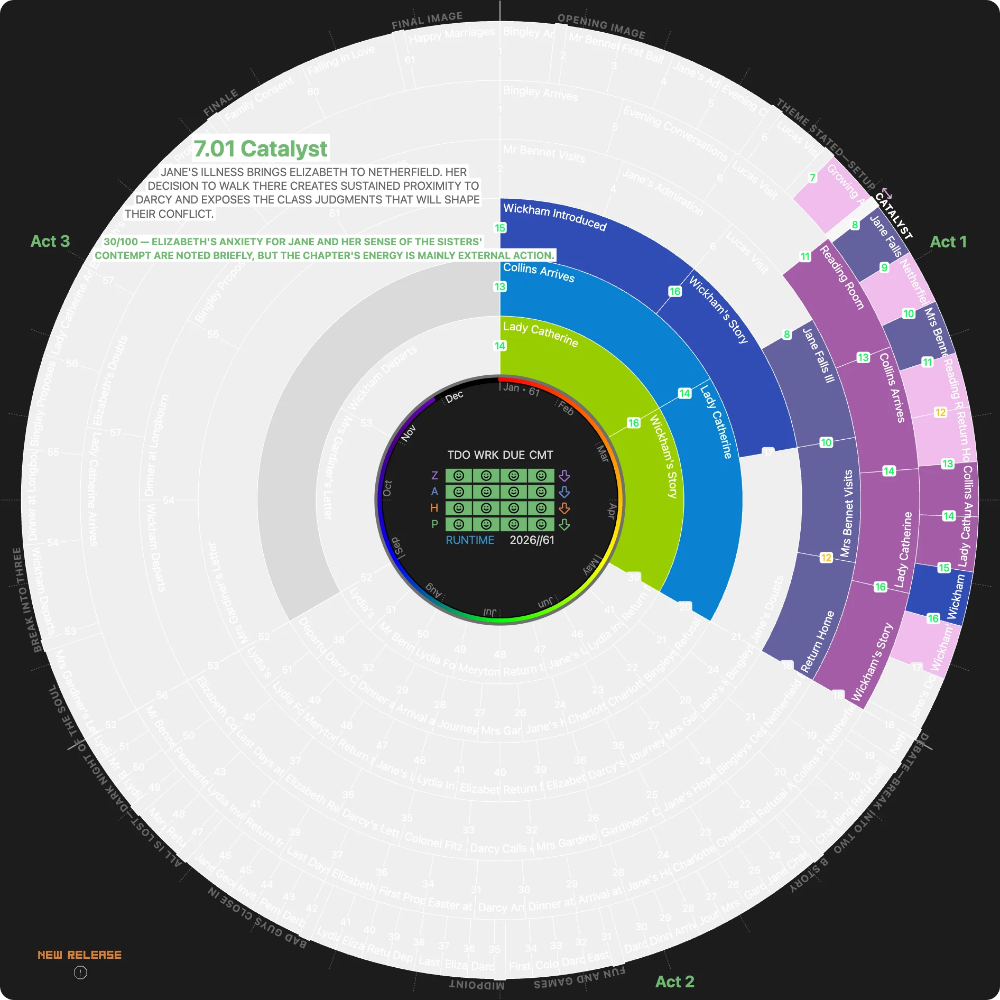
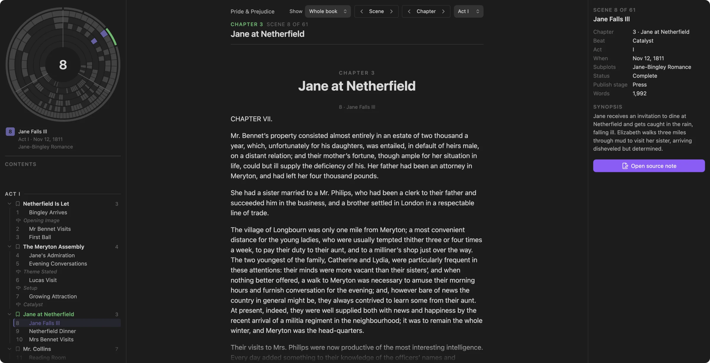

## Radial Timeline 8.4.0

See each beat's stage of the story, find your way around Writing Studio more easily, and keep your confirmed time cues while you write.

### Story beats

- **Hover a beat to see its stage.** In Narrative, hover a beat on the timeline. The scenes in its stage light up on every ring they appear on, and the rest of the book dims. A stage runs from the beat's own scene up to the next beat's scene.

- **A beat belongs to the scene it follows.** A beat is a moment in your story, so its note sits right after the scene where that moment happens. Beat 7.01 Catalyst belongs to scene 7. The Timetable and Writing Studio's contents now list each beat in the chapter of the scene before it.

### Writing Studio

- **The Beat line.** Scene details now show the scene's beat: the beat it carries, or the stage of the story it's in.

- **Labeled controls.** The bar above the text now reads **Show** with **Whole book**, **This chapter** or **This scene**. Then come **‹ Scene ›** and **‹ Chapter ›** to step through the book, and a menu that shows the act you are in. Choose another act to go to its first scene.
- **The wheel stays put.** Only the contents list scrolls, and it keeps the scene you are reading in view.
- **Softer edges.** The text fades out at the top and bottom of the page, so you can see where it scrolls.

### Timetable Panels

- **Places behind the portraits.** Panels now show the character's portrait over a picture of the scene's place. A scene with no place picture shows its character alone. Change it in the Panels layout with **Image**.

### Fixes

- **Scene time:** a time cue you confirm or exclude now stays that way while you keep writing around it. If you change the sentence the cue is in, that cue asks again. The decisions you have already made come across with the update.
- **Recent moves:** turning off the recent moves overlay in **Settings → Advanced** now removes it from the timeline straight away.
