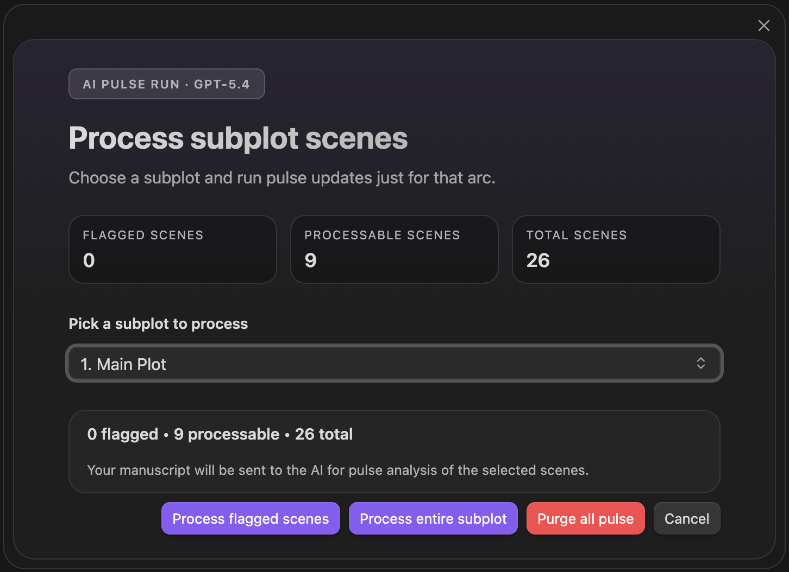
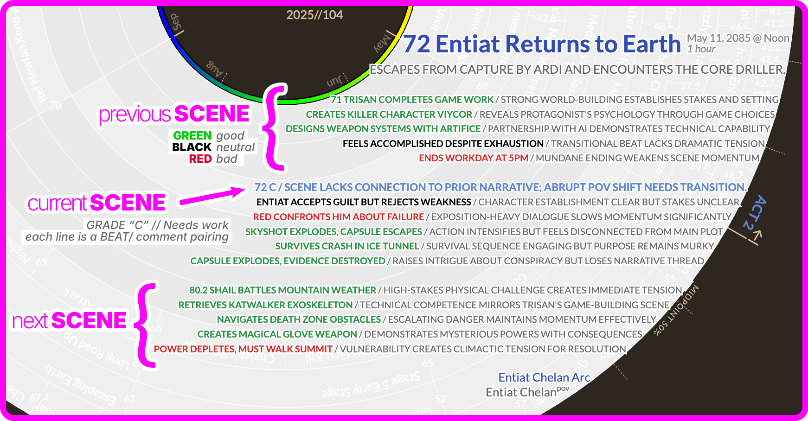

Pulse analyzes each scene with its previous and next scenes, then saves grades and editorial feedback in scene properties for hover review.

*   **Manuscript or subplot order**: Evaluate the reading sequence or follow one subplot.
*   **Scene feedback**: Review strengths, continuity, and opportunities to improve scene flow.
*   **Compact hover**: Turn off **Pulse context** in Settings → AI to show the current scene’s feedback alone.

**Modes**: Progress mode (key `1`), Narrative mode (key `2`), Chronologue mode (key `3`)
**Command**: `Scene pulse analysis (manuscript order)`, `Scene pulse analysis (subplot order)`
**Settings**: [Settings → AI](Settings-AI) — enable **Enable AI LLM features** and choose a provider

AI Pulse Triplet Analysis

Pulse triplet output — previous, current, and next scene grades surfaced in hover

## Supported Providers

Pulse works with all supported AI providers:

*   **Anthropic Claude**
*   **OpenAI GPT**
*   **Google Gemini**
*   **Local LLM** (Ollama, LM Studio, and OpenAI-compatible servers)

Local LLM setup is documented under [Settings → AI → Local LLM](Settings-AI#local-llm). Local runs are validated before analysis starts and results are written with the same safeguards as hosted providers.

When a Pulse batch finishes, its card shows the batch's total cost. Cache use and per-scene costs are under **AI prompt & context**.

For the command-specific batch workflows, see:

*   [Scene pulse analysis (manuscript order)](Commands#scene-pulse-analysis-manuscript-order)
*   [Scene pulse analysis (subplot order)](Commands#scene-pulse-analysis-subplot-order)
*   [Summary scene refresh](Commands#summary-refresh)
