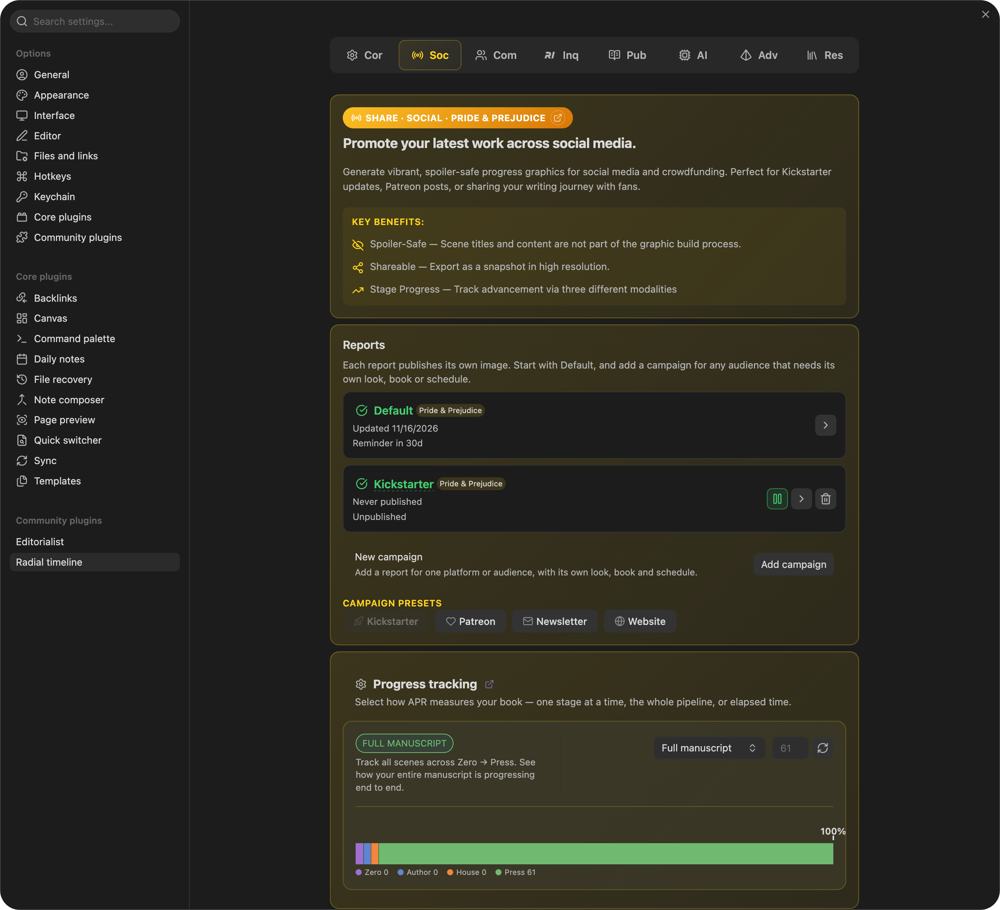
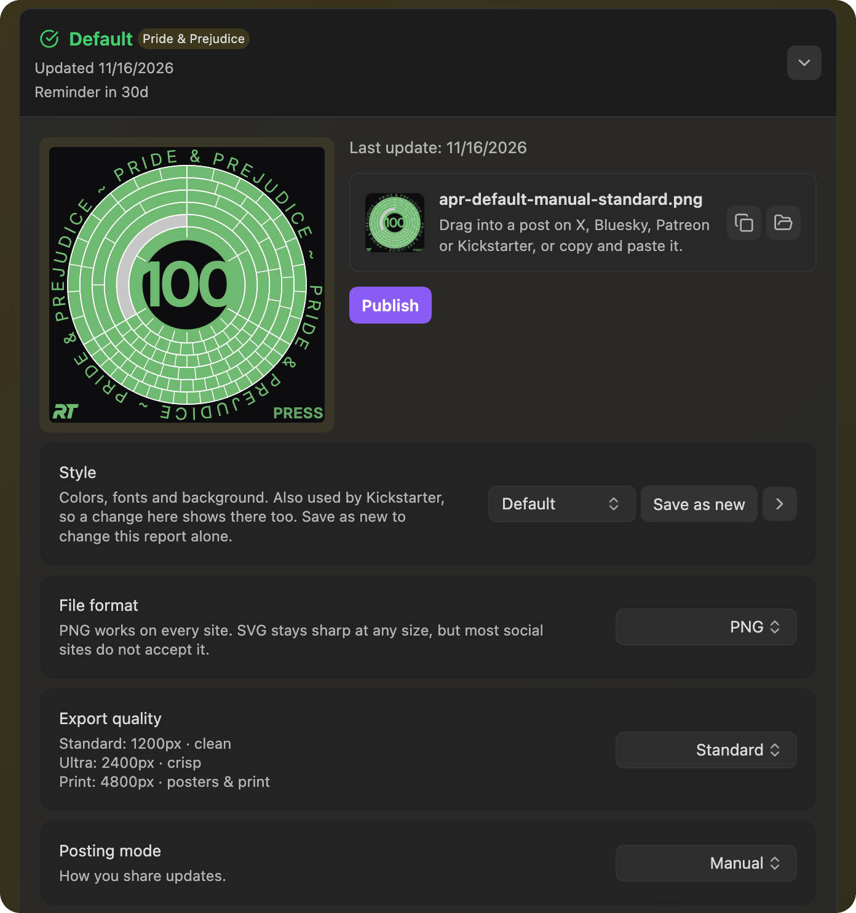

Settings → Social

The Author Progress Report (APR) creates a spoiler-safe progress graphic for newsletters, social posts, Patreon, and Kickstarter updates.

An open report — preview, share file, Publish, style and settings

## Reports

Settings → Social lists your reports. Every vault has the **Default** report, and you can add a **campaign** for any audience that needs its own look, book or schedule. They work the same way and have the same settings.

Open a report with the arrow at the right of its row. One report is open at a time, and it shows:

- **Preview**: the report exactly as it will be published.
- **Share file**: the image the report last published, ready to drag into a post.
- **Publish**: writes the image file now.
- **Style**: the saved style the report is drawn with, and the designer that edits it.
- **Book**, **File format**, **Export quality**, **Posting mode**, **Send to Community** and **Teaser reveal**.

## Progress Tracking

APR can measure progress in three ways:

| Mode | How It Works | Best Use |
|------|--------------|----------|
| **Stage Tracking** | Tracks one stage at a time against a scene goal. | Zero drafting, focused revision passes, or any stage-specific sprint |
| **Full Manuscript** | Tracks all scenes across Zero → Press. | End-to-end public progress across the full pipeline |
| **Date Goal** | Tracks elapsed time between a start date and a target date. | Deadline-driven campaigns and schedule-based updates |

### Stage Tracking

Stage Tracking focuses on one stage at a time. Choose the tracked stage, then set a scene goal when you want a fixed denominator. This is especially useful in **Zero** when you know the target scene count for the draft and want APR to reflect that specific push.

### Full Manuscript

Full Manuscript measures the book across the full revision path from **Zero** to **Press**. Use it to show overall manuscript progress.

### Date Goal

Date Goal measures progress through a date range. Set a start date and target date, and APR will show how far you have moved through that range.

> [!NOTE]
> APR tracking is separate from the timeline's Estimated Completion feature, which projects pace inside the working manuscript view.

## Teaser Reveal

Turn on **Teaser reveal** for a report to show more detail automatically as your book progresses. New campaigns start with it on; the Default report starts with it off.

Reveal stages:

| Stage | Shows |
|-------|-------|
| Teaser | Progress ring only |
| Scenes | Scene cells (no colors) |
| Colors | Scene cells with status colors |
| Full | Complete timeline with subplots and acts |

Preset schedules:
- **Slow**: 15%, 40%, 70%
- **Standard**: 10%, 30%, 60% (default)
- **Fast**: 5%, 20%, 45%
- **Custom**: Set your own thresholds (1-99%)

You can click the middle stages in the preview (Scenes, Colors) to skip them and jump to the next stage.

With Teaser reveal off, **View** sets how much the report always shows: Complete, Color, Scenes or Ring.

## Export Quality

Each report is published at one of three pixel sizes, chosen with its **Export quality** setting:

| Quality | Output | File Size | Best For |
|---------|--------|-----------|----------|
| Standard | 1200 px | ~150 KB | Web posts, social media, newsletters |
| Ultra | 2400 px | ~400 KB | Crisp embeds on high-DPI displays |
| Print | 4800 px | ~1.2 MB | Print-quality graphics, large banners |

## Styles

Every report is drawn with a saved **style**: its colors, fonts, background and borders. A new vault has one style, **Default**. Choose a report's style from the **Style** list, and open the designer with the arrow beside it.

- Changes in the designer are saved to the style as you make them, and show in every report that uses that style. The Style row names the other reports that share it.
- **Save as new** copies the style under a new name and switches the open report to the copy. Use it to change one report without changing the others.
- Deleting a style sends the reports that used it back to Default. The Default style cannot be deleted.

The designer has these controls:

- **Choose Palette**: Applies curated colors across the text elements, seeded from the Title color.
- **Title**, **Author**, **% Number**, **Stage / RT**: Font, weight, and color for each text element. The Radial Timeline logo follows the Publish Stage color. The author name is shared by every report.
- **Transparent mode**: No background fill, so the graphic adapts to any page. Bluesky and some other sites show a transparent background as black; the share file warns you when a published image is transparent.
- **Background color**: Bakes in a solid background for social posts, email newsletters, Kickstarter, PDF exports, or platforms that rasterize SVGs.
- **Borders**: Scene borders and act division lines in white, black, none, or a custom color.

## Publish And Share

Each report publishes a **PNG or SVG** file, chosen with **File format**. The file's name and folder follow the report's settings and its book, under `Radial Timeline/Social/`.

- **Publish** in the open report writes the file. The **Author progress report** command opens a dialog that does the same for any report.
- The **share file** card shows the published image. Drag it into a post or onto your desktop, choose **Copy image** to paste a PNG, or choose **Show in file manager** to find the file.
- **Posting mode**: Manual, Daily, Weekly, or Monthly. A Daily, Weekly or Monthly report republishes itself when it is due.
- **Reminder** (Manual only): days before the report shows a refresh reminder in the Radial Timeline View.

## Campaigns

Add a campaign with **Add campaign**, or start from a preset:

- **Kickstarter**: 7-day refresh reminders
- **Patreon**: 14-day refresh reminders
- **Newsletter**: 14-day refresh reminders
- **Website**: 30-day refresh reminders

Each campaign has its own style, book, file format, export quality, posting mode and teaser reveal. Pause a campaign to skip its schedule, or delete it; the Default report can be neither paused nor deleted.

### Send A Report To Community

Community sharing is available when this vault is connected and **Level 2 — Profile, books + APR** or **Level 3 — Profile, books + writing activity** is selected in Community settings.

For each report:

1. Choose the report's book.
2. Enable **Send to Community**.
3. Click **Send now** to upload the current APR directly to your private My Share area, or use the report's Daily, Weekly, or Monthly posting mode.
4. Review the exact image on **My Share**, then activate it when you are ready. Its book must be public first.

**Publish** writes the report's PNG or SVG file and, with Send to Community on, uploads it too. **Send now** renders and uploads without writing the local file. A scheduled report does both when it becomes due.

Community uploads always land privately first. Level 2 permits the visual APR but does not share writing-day, streak, minutes, inactivity, or session statistics. Level 3 is the separate opt-in for broader writing activity.

Schedules run while the plugin is open. Due reports are checked on plugin startup and hourly while the vault is open. If an update is missed while Obsidian is closed, it runs on the next startup.
