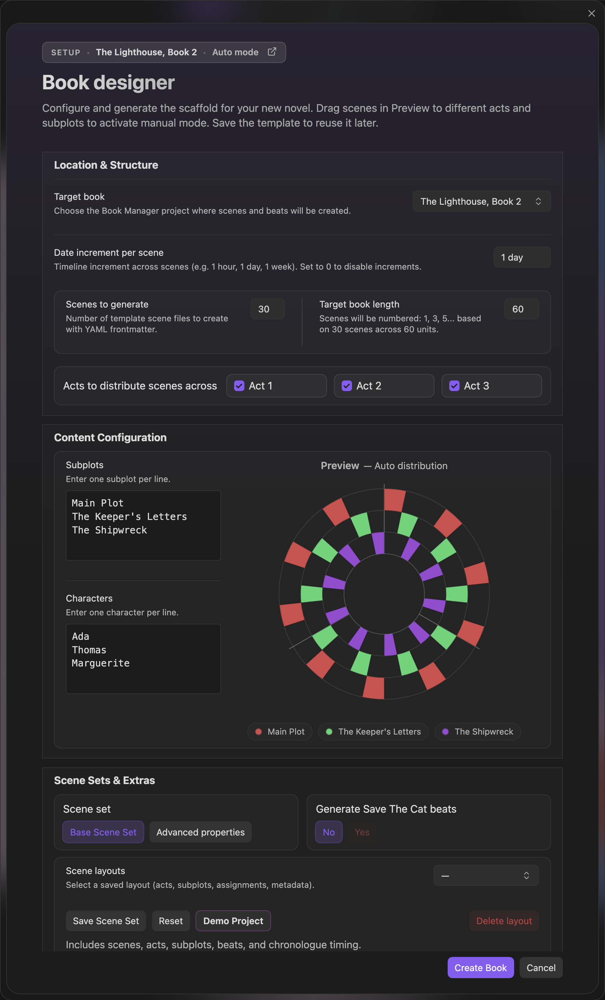

The **`Book designer`** command opens a guided setup panel that generates a manuscript scaffold for your project: scene files, act distribution, subplot rotation, characters, and optional beat notes.

Book Designer walkthrough · Full video on YouTube

## Open Book Designer

You can open Book Designer in two ways:
1.  **Command Palette**: Open the Command Palette (`Cmd + P` on Mac, `Ctrl + P` on Windows/Linux) and search for **`Radial timeline: Book designer`**.
2.  **Welcome Screen**: Under **Set Book Project**, choose **→ or open Book Designer**.

Book Designer — configure structure, subplots, and scene sets with a live preview you can drag scenes in

## Workflow

The panel is organized into three main sections:

### 1. Location & Structure
*   **Target book**: The Book Manager project where scenes and beats will be created. Add the book in Book Manager and set its folder first.
*   **Date increment per scene**: How far story time advances from one scene to the next (e.g. 1 hour, 1 day, 1 week). Set it to 0 to disable increments.
*   **Scenes to generate**: The total number of scene files to create.
*   **Target book length**: Used for numbering distribution. For example, if you generate 10 scenes with a target length of 60, scenes will be numbered 1, 8, 14 … 60, leaving gaps for future scenes.
*   **Acts to distribute scenes across**: Choose which acts (1..N) to populate, where **N** comes from your **Settings → Core → Acts → Act count**. Scenes are distributed evenly across the selected acts.

### 2. Content Configuration
*   **Subplots**: Enter your subplots, one per line. Scenes will be assigned to these subplots in a round-robin fashion. Each scene will belong to only one subplot.
*   **Characters**: Enter your main characters, one per line. These will be added to the YAML frontmatter of the generated scenes.

### 3. Scene Sets & Extras
*   **Scene set**: Choose between the **Base Scene Set** (core properties) and **Advanced properties**. The advanced properties profile can be customized in settings.
*   **Generate beats**: Named after your active beat system (e.g. **Generate Save The Cat beats**). Choose **Yes** to create beat notes alongside the scenes.
*   **Scene layouts**: **Save Scene Set** keeps the current layout (acts, subplots, assignments, metadata) to reuse later; pick a saved one from the list. **Reset** returns to auto distribution. **Demo Project** builds a sample book with scenes, acts, subplots, beats, and chronologue timing.

## Visual Preview
As you adjust the settings, the **Preview** donut chart updates in real time to show how scenes will be distributed across acts and subplots. This lets you inspect the structure before any files are generated. Drag a scene in the preview to another act or subplot ring to place it by hand; the header switches from **Auto mode** to **Manual mode**. If you want a different shape afterward, reopen Book Designer and regenerate.

## Generate the Manuscript Scaffold
Once configured, click **Create Book**. The plugin will:
1.  Create the book's folder if it doesn't exist yet.
2.  Generate individual markdown files for each scene, populated with the correct YAML frontmatter (scene number, act, subplot, characters, date).
3.  (Optional) Create beat sheet notes if selected.

You'll see a notification confirming the number of scenes and files created. Your Radial Timeline will immediately update to display your new story structure.

## Customizing Scene Properties

Book Designer supports two built-in scene property profiles:
1.  **Core properties**: A minimal profile with the essential fields required for Radial Timeline.
2.  **Advanced properties**: A richer profile with analysis, stats, and additional workflow fields.

### Adding Custom Properties

To track fields beyond the built-in keys, such as Dramatica signposts or your own labels, add them as advanced properties with **Show advanced properties editor** under **Settings → Core → Scene properties**, then choose **Advanced properties** in Book Designer. Check the built-in fields first: `Status`, `Publish Stage`, `POV` and many others are already tracked. See [Advanced properties editor](YAML-Frontmatter#advanced-yaml-editor).

## Custom Beat Systems

To use a structure that isn't in the built-in list, set up a **Custom** system in [Settings → Core → Story beats system](Settings-Core#story-beats-system), then set **Generate … beats** to **Yes** in Book Designer to create its beat notes.
