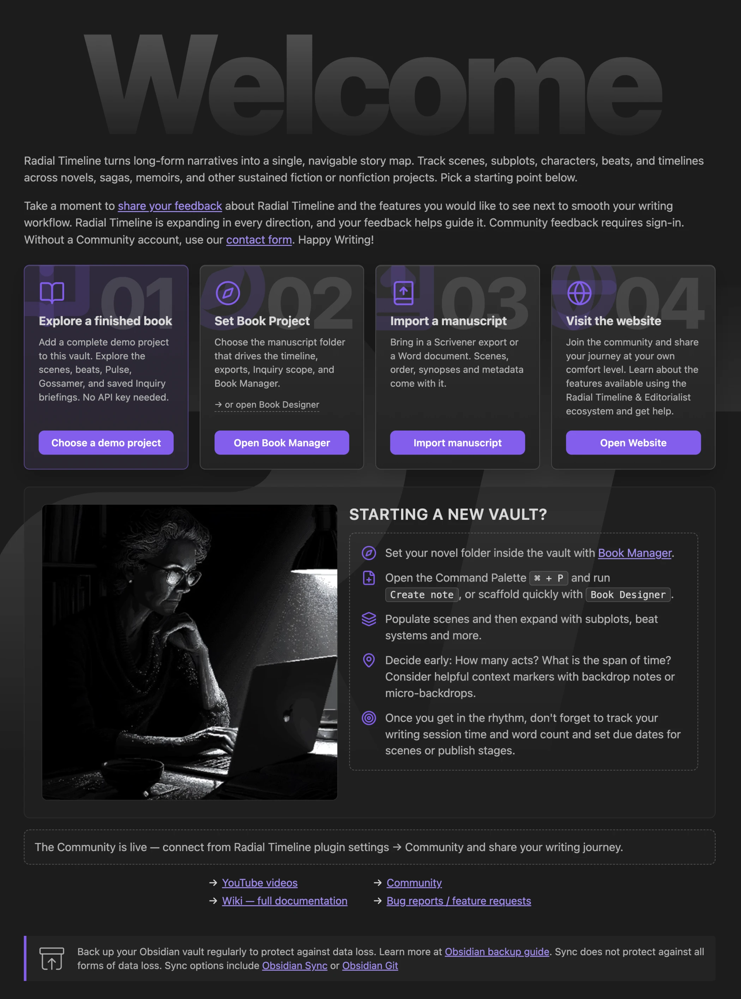

Radial Timeline transforms your manuscript into a live visual map of your story. It works with any Obsidian vault — fresh or existing — by reading and writing scene metadata as note properties (YAML frontmatter) at the top of each note.

You get two workspaces: the **[Radial Timeline View](Radial-Timeline-View)** for scenes, structure, and chronology, and the **[Inquiry View](Inquiry)** for corpus-level analysis. Inquiry, along with Pulse, Gossamer AI analysis, and Summary scene refresh, requires AI to be turned on first — see the optional step below.

Welcome screen — quick-start guide for new vaults

The Welcome screen offers these starting points:

1.  **Explore a finished book** — add a free, fully analyzed demo such as [Pride & Prejudice](Sample-Vault) or [The Odyssey](Odyssey-Demo-Vault) to this vault from the demo chooser. No API key needed to explore it.
2.  **Set Book Project** — choose the manuscript folder that drives the timeline, exports, Inquiry scope, and Book Manager. Use this when starting scene notes yourself, or follow **→ or open Book Designer** to plan the book first.
3.  **Import a manuscript** — bring an existing draft in from a [Scrivener export, a Word document, or one big file](Onboard-Existing-Manuscript), with **Structure only — no AI** as the default.
4.  **Visit the website** — [radialtimeline.com](https://radialtimeline.com) for support docs and the [Community](Settings-Community), where you can share your writing journey at your own comfort level.

> [!TIP]
> **Coming from Scrivener, Word, or another tool?** [Import a manuscript](Onboard-Existing-Manuscript) lets you select an export directly and review scene notes before writing them. A supplied Scrivener outline CSV determines import order; without one, numbered filenames determine it. You map exported metadata once during import. See [Scene Properties (Core + Advanced)](YAML-Frontmatter) for the full schema.

---

## Setup

Choose a vault layout and stick with it: a single-book vault, a single vault with a dedicated Manuscript folder, or a multi-book vault with one folder per book.

**1. Install and add a book profile.** Install Radial Timeline from Community Plugins, open **Settings → Core → Books**, add a profile, and link its **Source folder** to your manuscript folder.

**2. Bring in scenes.**

*   *Fresh vault:* run **Radial timeline: Book designer** to generate a scaffold (acts, subplots, optional beats), or run **Radial timeline: Create note… → Scene → Core scene** to start with a single scene.
*   *Existing vault:* your scene notes should use `Class: Scene`. The main scene properties are `Act`, `Synopsis`, and `Subplot`. Chronologue uses `When` and `Duration`; Progress uses `Status` and `Publish Stage`. If your vault uses different property names, enable **Remap frontmatter field keys** under **Settings → Advanced → Configuration**.

**3. Choose a beat system (optional).** Pick from the built-in systems (**Save the Cat**, **Hero's Journey**, **Classic Dramatic Structure**, plus podcast, video, documentary, romance, and thriller arcs) or build a **Custom** system in [Settings → Core → Story beats system](Settings-Core#story-beats-system). Use **Create beat notes** to generate beat notes, and **Repair beat notes** to realign existing ones after changes.

**4. Enable AI (optional).** New installs ship with AI off. Turn it on under **Settings → AI → Enable AI LLM features** — this is required to run new [Inquiry](Inquiry) questions, [AI Pulse Triplet Analysis](AI-Pulse-Analysis), Gossamer AI analysis, and Summary scene refresh. Inquiry itself opens with AI off, so you can read saved sessions without an API key. Configure a cloud provider key or a [Local LLM](Settings-AI#local-llm), then check model readiness before running analysis.

---

## Daily Workflow

The four modes in the Radial Timeline View — switch with `1`/`2`/`3`/`4` or the navigation cluster:

*   **Progress** (`1`) — writing status and revision-stage tracking
*   **Narrative** (`2`) — manuscript order; drag scenes on the outer ring to reorder
*   **Chronologue** (`3`) — story-world time, duration, and gaps
*   **Gossamer** (`4`) — beat-level scoring across Momentum, Tension, Activity, Interiority

**Day to day:** write scenes, keep `Synopsis` current, update `Status` from Todo → Working → Complete. Use **Timeline search** to find scenes across metadata. See [How to](How-to) for task recipes (reordering, subplots, search).

**When you're ready to share:** run **Radial timeline: Manuscript export** to compile to Markdown, an outline, Word (DOCX), or PDF. Word requires Pandoc; PDF requires [Pandoc](https://pandoc.org/installing.html) and a LaTeX distribution; configure under **Settings → Publish**. See [Publishing](Publishing) for templates and Signature setup.

**Optional next steps:** [AI Pulse Triplet Analysis](AI-Pulse-Analysis) for scene-level editorial feedback, [Inquiry](Inquiry) for corpus-level analysis, [Author Progress Report](Author-Progress-Report) for shareable spoiler-safe progress graphics.

---

> [!IMPORTANT]
> **Protect your work.** Keep regular vault backups alongside sync. See Obsidian's [backup guide](https://help.obsidian.md/backup), [Obsidian Sync](https://obsidian.md/sync), or the [Obsidian Git plugin](https://obsidian.md/plugins?id=obsidian-git).
