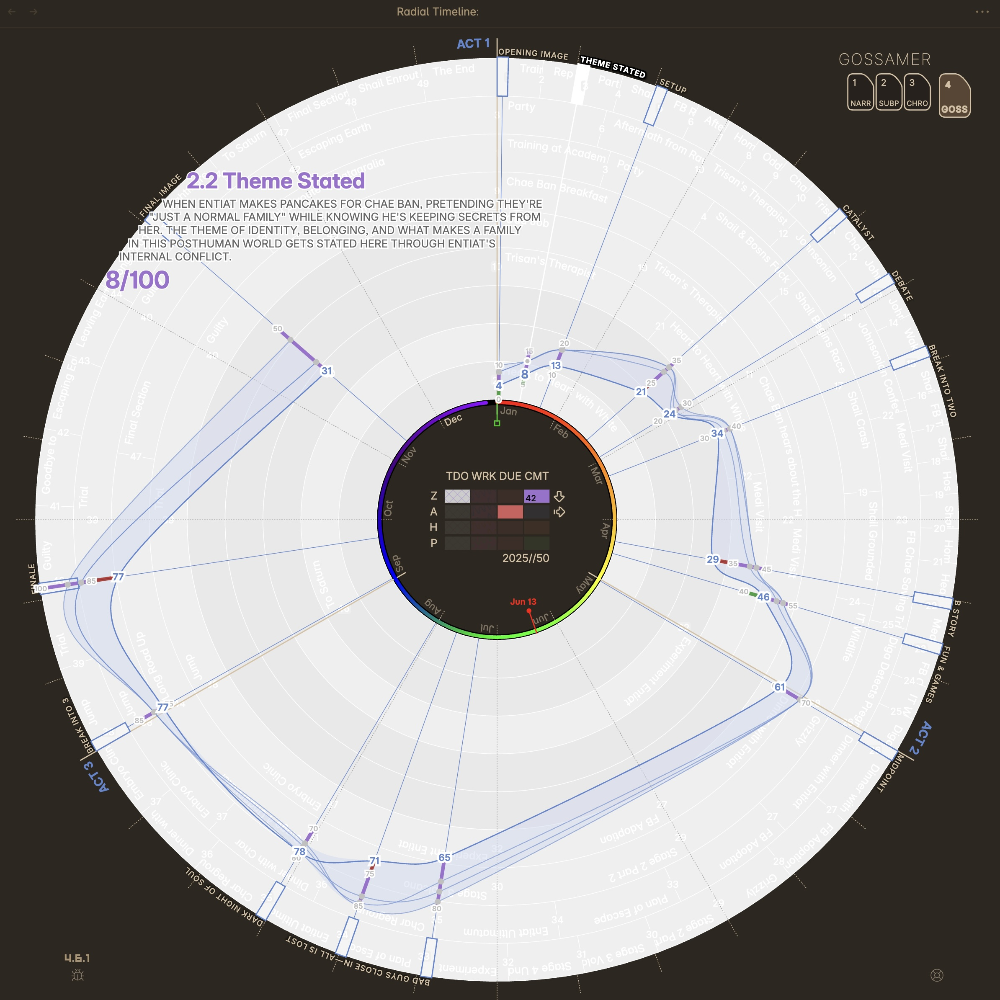
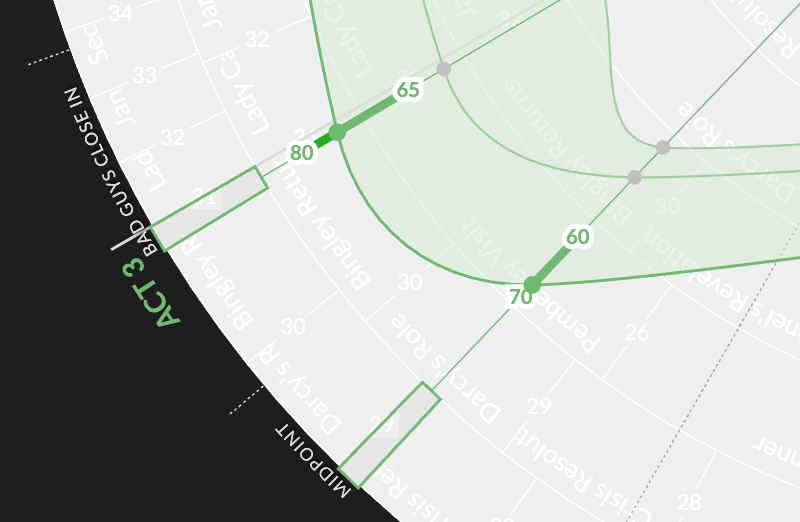
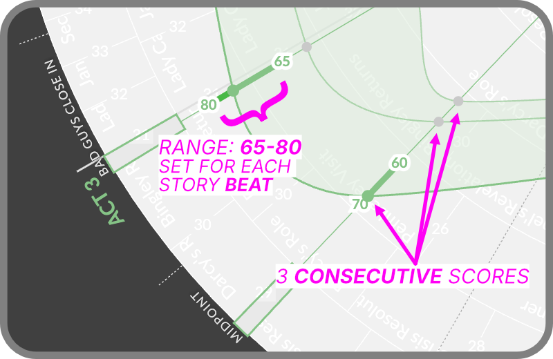
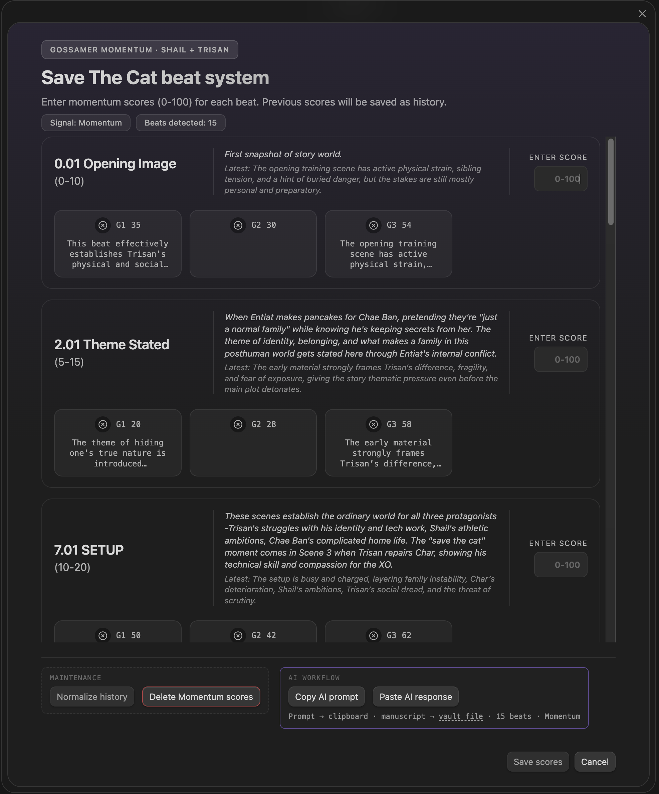

Gossamer Mode visualizes beat-level scoring across your active story beat system. Each saved scoring pass draws a **trace** — a line connecting your beat scores around the timeline. It supports four signals — **Momentum**, **Tension**, **Activity**, and **Interiority** — to compare story movement, pressure, visible action, and inner experience.

*   **Four signals**: Score **Momentum**, **Tension**, **Activity**, or **Interiority** against the same beat system.
*   **Trace history**: Compare saved traces across up to 30 slots per beat to track how the shape changes over time.
*   **Top-left traces panel**: Switch signals, show **LATEST** or all traces, and toggle individual saved traces on or off.
*   **Ideal Range**: Beat `Range` values provide a visual target for **Momentum** only. They are not sent to the AI.
*   **Manual score entry**: Enter scores for the current signal yourself, with or without external AI assistance.
*   **Justification capture**: Each score line records a brief justification so you know what the score was based on.
*   **Normalize & repair**: Use **Normalize history** inside the score manager panel to compact gaps and repair orphaned entries.

**Timeline mode**: Gossamer (key **4**)
**Command**: `Gossamer score manager`
**Settings**: [Story beats system](Settings-Core#story-beats-system)

Gossamer — saved traces, signal switching, and beat-level scoring

<table>
<tr>
<td width="50%"> Ideal ranges for story beats</td>
<td width="50%"> Callouts showing score details</td>
</tr>
</table>

Gossamer score manager — manual entry for the active signal

## Subplot Alignment

The **alignment chip** at the left of the mode row switches subplot rings between **Fill** (scenes spread evenly across each act) and **Sequence** (every scene sits at its true position in the full manuscript, with empty cells where a thread is dormant). See [Subplot Alignment in Narrative Mode](Narrative-Mode#subplot-alignment-fill-vs-sequence) — the same control applies here.

## Signals

*   **Momentum**: How strongly the story pulls the reader toward what happens next.
*   **Tension**: How much unresolved pressure, uncertainty, or conflict the reader carries forward.
*   **Activity**: How much is physically or visibly happening on the page.
*   **Interiority**: How intense the character's inner experience is on the page.

## Manual Entry

Use **Gossamer score manager** to enter your scores and justifications for the active signal, or paste scores prepared with an external AI tool.

## AI Analysis

Use **Gossamer analysis** to run the built-in AI evaluation for the active signal. AI scores the supplied manuscript material independently of your visual Momentum ranges.

## Story Beats Configuration

Gossamer scores the beats of the active beat system. Choose a built-in system or build your own, then create, audit, and repair its beat notes in [Settings → Core → Story beats system](Settings-Core#story-beats-system).
