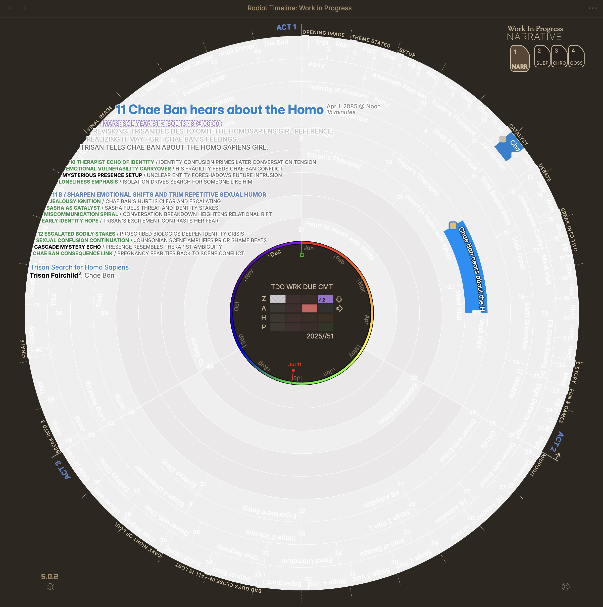
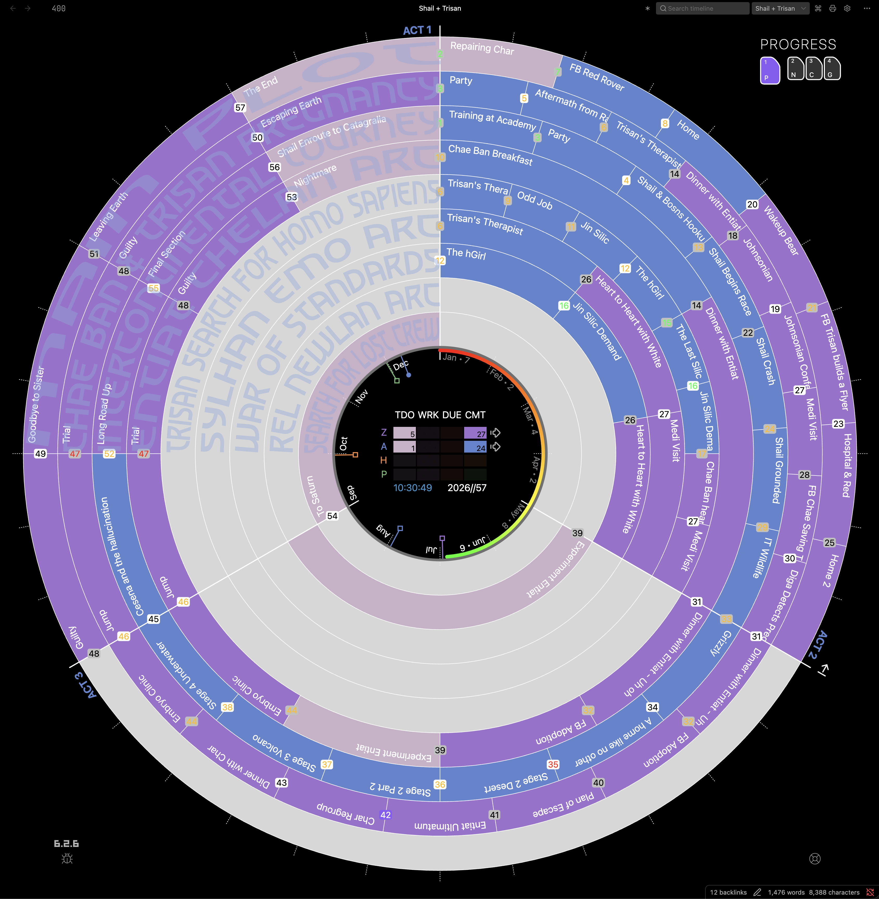
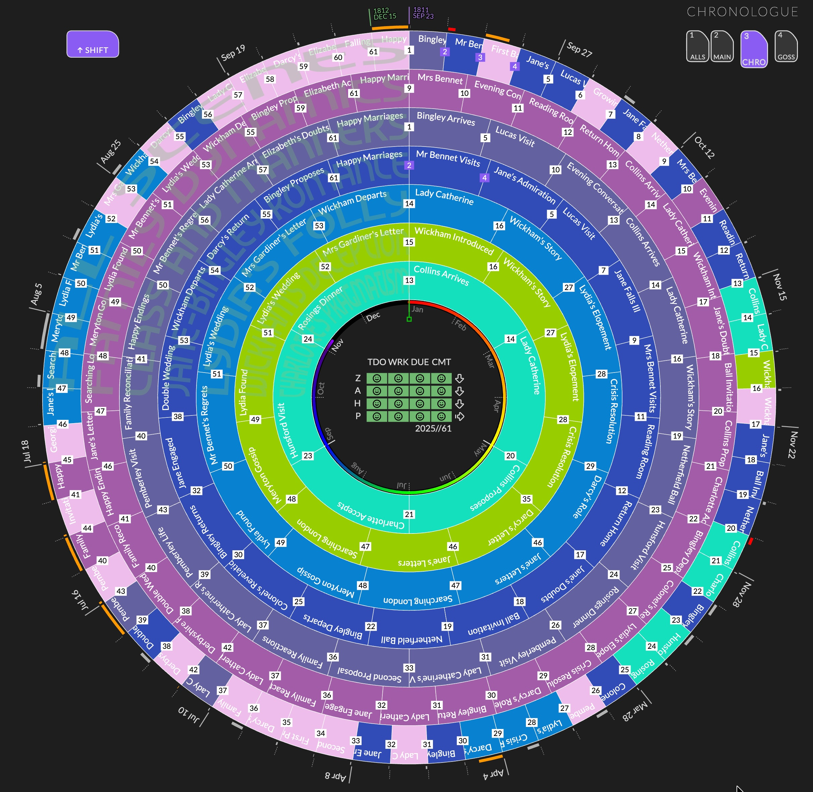
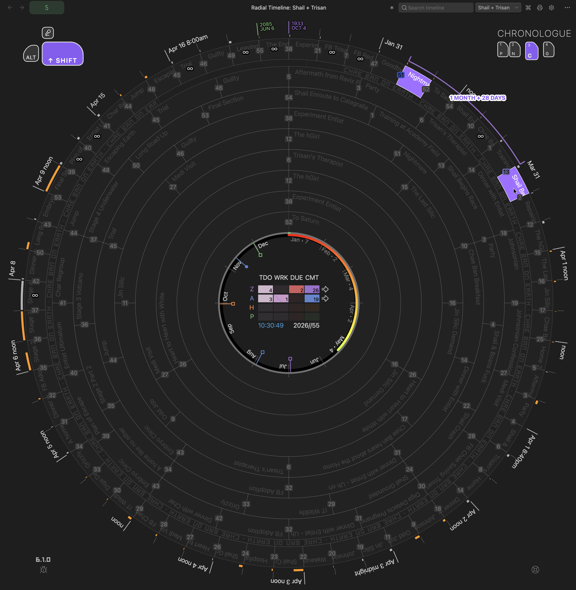

Radial Timeline maps your manuscript in Obsidian. Explore scenes, subplots, story time, and revision progress in four timeline modes, and use Inquiry for AI-assisted analysis across a book or saga.

Quick Start · Volume 10

## YouTube Video Suite

| Volume | Video | Guide |
|---|---|---|
| 2 | [Chronologue Mode](https://youtu.be/5DsKdFLLeOU) | [Chronologue Mode](Chronologue-Mode) |
| 3 | [Release 6 Overview](https://youtu.be/YO6hWevwSWc) | |
| 4 | [Inquiry View](https://youtu.be/xfX0rP4-Hv4) | [Inquiry](Inquiry) |
| 5 | [Author Progress Report](https://youtu.be/euJ2qOUZgco) | [Author Progress Report](Author-Progress-Report) |
| 6 | [Gossamer Mode](https://youtu.be/DOUVYXFwigM) | [Gossamer Mode](Gossamer-Mode) |
| 8 | [Radial Timeline Community](https://youtu.be/2srEjNRs6X4) | [Community](Settings-Community) |
| 9 | [Turn Your Editor's Notes Into a Revision Schedule](https://youtu.be/uoGUkF6RQ2E) | |
| 10 | [Quick Start](https://youtu.be/n53fYUejH44) | [Getting Started](Getting-Started) |
| 11 | [Turn Your Notes into a Finished Manuscript](https://radialtimeline.com/go/wiki-manuscript-export-video) | [Manuscript export](Manuscript-Export) |
| 13 | [Writing a Novel This November? Come Write With Me](https://radialtimeline.com/go/wiki-november-video) | [Community](Settings-Community) |
| Short | [Build Your Novel Structure Instantly](https://youtu.be/0vkLaI_LewM) | [Book Designer](Book-Designer) |
| Short | [Watch a Novel Progress Across Scenes & Subplots](https://youtu.be/tBErpewO1wQ) | |

## What It Does
Arrange scenes by act, subplot, and manuscript or chronological order. Hover for a synopsis and saved Pulse feedback; highlight a scene across its subplots to follow connected story threads.

The [Timetable](Timetable) opens beside the wheel: review scene properties, write sketches, and promote notes to scenes. [Manuscript export](Manuscript-Export) also publishes folders and standalone Markdown files.

## The 4 Critical Timelines
Radial Timeline™ captures and visualizes all 4 critical timelines:
*   **Narrative time**: the sequence you reveal events to readers.
*   **Chronological time**: when events happen in your story's world.
*   **Author time**: your scene writing progress with target due dates tracking Todo, Working, Complete and Overdue.
*   **Progress stages**: manuscript revision stages from Zero draft through Press-ready.

[Narrative](Narrative-Mode) and [Chronologue](Chronologue-Mode) use subplot colors to show story structure. [Progress Mode](Progress-Mode) gives each subplot its own ring and colors scenes by writing status and revision stage.

---

## Visual Overview

<table>
<tr>
<td width="50%"> <b>Narrative Mode</b> — story beats + subplot rings (dominant subplot shown via folded corners)</td>
<td width="50%"> <b>Hover synopsis</b> — information-dense metadata + pulse triplet feedback</td>
</tr>
<tr>
<td width="50%"> <b>Progress Mode</b> — schedule/status + progress stage view</td>
<td width="50%"> <b>Chronologue Mode</b> — story chronology with duration arcs and overlaps plus adaptive time scale</td>
</tr>
<tr>
<td width="50%"> <b>Chronologue Shift</b> — compare elapsed time between scenes and surface discontinuity gaps</td>
<td width="50%"> <b>Gossamer Mode</b> — compare Momentum, Tension, Activity, and Interiority across beats</td>
</tr>
</table>

## Getting Started

*   **[Getting Started](Getting-Started)** — fresh vault setup, existing vault setup, migrating from Scrivener, and the core workflow.
*   **[Book Designer](Book-Designer)** — instantly generate a manuscript set with acts, subplots, and beats.
*   **[Demo vaults](Sample-Vault)** — explore *Pride & Prejudice*, [*The Odyssey*](Odyssey-Demo-Vault), and *Sherlock Holmes*, fully analyzed, with no API key needed.
*   **[Radial Timeline View](Radial-Timeline-View)** — the four modes at a glance: Progress, Narrative, Chronologue, Gossamer.
*   **[Community](Settings-Community)** and **[Desk Lamps](Desk-Lamps)** — share your progress with other writers, and see when your writing friends are at their desks.
*   **[How to](How-to)** — task recipes for reordering scenes, managing subplots, search, and rotation.
