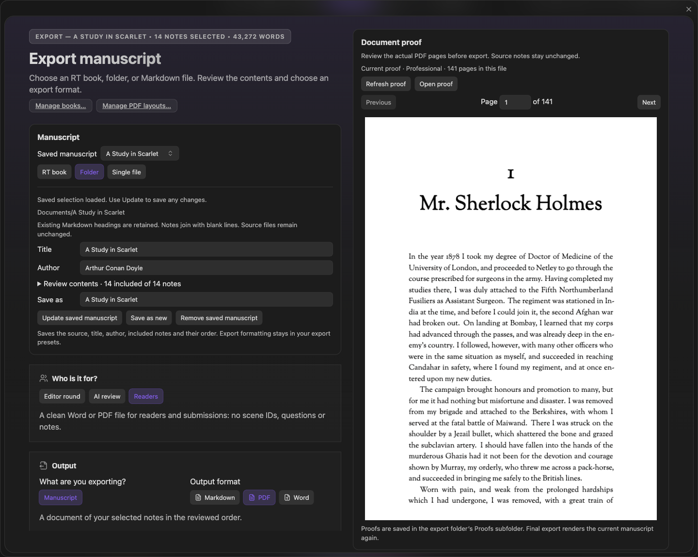

**Manuscript export** opens the export panel for a Radial Timeline book, a folder of Markdown notes, or a single Markdown file. Publish a novel, an essay, a report, or another document without first turning every note into a timeline scene.

## What It Can Export

Choose from:

*   compiled Markdown manuscripts
*   PDF manuscripts (typeset via Pandoc + LaTeX)
*   Word (DOCX) manuscripts in standard submission format
*   outline-style exports
*   filtered or ranged exports by order and subplot

Export includes compiled Markdown, Word submission export, and Pandoc PDF export with the Basic, Standard, Professional, Signature, Screenplay, and Podcast Script layouts, plus custom Pandoc metadata and a custom LaTeX preamble. You can also make a PDF style of your own from any of the four novel layouts: see [Design Your Own PDF Style](#design-your-own-pdf-style). To use a LaTeX template you already have, see [Import Your Own LaTeX Template](#import-your-own-latex-template).

The panel supports ordering, selection range, output presets, and publishing-oriented layout decisions in one place.

## Exporting a Manuscript

**Command Palette → Manuscript export**

The export panel lets you:
- Select the output format (Novel, Screenplay, Podcast Script)
- Choose the template for that format
- Select which scenes to include (all, or filtered by act/subplot)
- Choose Markdown, PDF, or Word (DOCX) output
- Review export checks for missing templates, missing fonts, template compatibility, and layout-specific warnings
- Preview the selected layout's page structure before generating a PDF

Files land in `Radial Timeline/Export/` by default, or in whatever vault folder you set under **Settings → Advanced → Configuration → Export folder**. Use the checks in the export panel to catch missing Pandoc, LaTeX, templates, or fonts before rendering.

## Choose and Review the Source

Choose **Radial Timeline Book**, **Folder**, or **Single file**. For a Radial Timeline book, use the book’s scene order, subplot filters, and range controls. For a folder, review the included Markdown notes, remove unwanted entries, move notes earlier or later, then choose **Use this order and selection**. A single Markdown file is ready as one source. Plain sources retain existing Markdown headings and join notes with blank lines; they do not need scene YAML or Book Manager registration.

For a folder or file, enter **Title** and **Author** in the panel. Save a named manuscript to reuse its source, metadata, included notes, and reviewed order. **Update saved manuscript** stores changes, **Save as new** creates another selection, and **Remove saved manuscript** removes the saved choice without deleting notes. Formatting remains in export presets, separately from the source selection.

Your source files stay unchanged. Recheck the included notes when returning to a saved selection, especially after moving or deleting files.

## Who Is It For?

The panel opens by asking who the export is for. Each choice is a built-in preset that sets the format, scene IDs, and cleanup for that reader, and keeps your order, range, and layout:

*   **Editor round** — a Word file for your editor. Scene IDs in headings, your author queries as margin comments, your private `%%notes%%` stripped.
*   **AI review** — Markdown for an AI reviewer. Scene IDs, author queries, and formatting kept; private notes stripped.
*   **Readers** — a clean Word or PDF file for readers and submissions. No scene IDs, queries, or notes.

Change any setting afterwards and the preset shows as changed: **Reload preset** restores it, and **Save as preset** keeps your version under **Saved export presets**. The panel reopens on the last preset you chose.

A line above the Export button reads back what the file will carry before you make it, for example "34 scenes with IDs · 3 questions as margin comments · your notes stripped". It warns in orange when private notes would appear, when a PDF would print author queries as text, or when a Readers export still has queries or scene IDs.

## Table of Contents

Under **Table of contents**, choose **Contents** for a document TOC, then choose how many **Heading levels** to include. This option works with PDF, Word and Markdown, including folder and single-file manuscripts. **No TOC** leaves it out. The older scene indexes remain available for Markdown book exports.

* **PDF** — searchable text, clickable contents with final page numbers, and nested navigation bookmarks. Contents can span multiple pages. Generate a fresh proof after changing contents or depth.
* **Word** — real heading styles and an updateable TOC field. Open the document in Word and update the entire table to populate its final page numbers and links. Check pagination in Word before sharing.
* **Markdown** — linked headings with unique block targets for Obsidian and matching HTML anchors for other Markdown viewers. Repeated titles get distinct destinations. Generated navigation is added after cleanup, so stripping source links or block IDs does not remove the new contents.

Radial Timeline books use authored **Part** boundaries, resolved **Chapter** markers and scene headings. With all three present, level 1 includes parts, level 2 adds chapters, and level 3 adds scenes. With fewer structural layers, levels start at the first available layer. PDF layouts retain their own opener styling; layouts that omit printed part/chapter pages can still include those divisions in navigation, pointing to the associated opener.

For a printed act division, use an authored part title such as `Part: Act II`. The analytical scene `Act` field does not create publishing boundaries. Folder and single-file manuscripts instead use their existing Markdown heading hierarchy, such as `# Act I`, `## Chapter One` and `### Scene One`; they need no scene YAML.

Saved export presets retain contents mode and depth. Each split output has contents for the material included in that file. Existing custom PDF templates with custom opener commands may need regeneration in the style designer before they can place navigation correctly; export reports this rather than producing misleading links.

## Word (DOCX) Submission Export

The **Word** format produces a `.docx` in standard manuscript format — the layout agents and editors expect for queries and submissions: Times New Roman 12 pt, double-spaced, 0.5" first-line indents, centered chapter headings that start on a new page. Styling comes from a bundled Word reference document installed into your Pandoc folder (`reference-manuscript.docx`); configure Pandoc under **Settings → Publish** to use it.

Front & back matter Book Pages can be included, and the export cleanup toggles (comments, links, callouts) apply the same way they do for PDF. Highlighted words print as plain text in both, without their `==` marks or color.

Pages are US Letter with 1" margins, and Word opens the file as a current document rather than in Compatibility Mode. A scene break written as `---` or `***` becomes a centered `#`.

If you write scenes with a single return between paragraphs, turn on **Every line is a paragraph**: each line break then starts a new indented paragraph, in Word and PDF. Leave it off for hard-wrapped text.

### Author queries as Word comments

When **Strip author queries** is off, each Editorialist author query (`%%query: Is this scene too slow?%%`, or the older `%%ai:` spelling) becomes a Word margin comment at the spot you asked it, signed with the book's author. Your editor sees the questions where they belong and can answer each one in its comment thread. A query on a line of its own attaches to the end of the paragraph above it.

Bring the returned file to Editorialist the same way as the editor's first round: copy the formatting instructions from the review launcher and give them, with the file, to the AI of your choice. Each answer comes back on its question.

## Paperback Binding Margin (PDF)

PDF options include a **Paperback binding margin** toggle. When on, exports add 0.25" to the inner margin so text clears the spine of a printed, bound paperback (KDP/IngramSpark). Leave it off for PDFs meant to be read on screen — it changes the page geometry. The setting persists across exports.

## PDF Layouts

For PDF exports, choose a novel PDF layout from the layout selector. The selected layout controls the page style, required font checks, chapter opener behavior, and whether the export prints Part pages.

The preview cards show the expected chapter, part, and body-page structure before export. Export checks report missing Pandoc, LaTeX, bundled fonts, and layout-token problems before you generate the PDF.

The selected novel PDF layout is remembered per book. Narrative Mode uses that same setting for chapter and part placards on the timeline. See [Narrative Mode](Narrative-Mode#chapter-and-part-placards).

## Design Your Own PDF Style

**Settings → Publish → PDF style → Design your own…** opens the style designer. You start from one of the four built-in layouts (Basic, Standard, Professional, or Signature) and make it yours; there is no blank page to fill in. The pencil beside a built-in layout opens the same designer with that layout already chosen.

Use the **Category** menu to move through the settings:

*   **Page** — paper size (6×9 trade, US Letter, A4, or a custom size), margins, and mirrored margins for a bound book
*   **Body** — font, size, line spacing, and paragraph indent
*   **Headers** — the running header style and what each corner prints
*   **Folio** — where the page number sits and its numeral style
*   **Parts**, **Chapters**, **Scenes**, and **Epigraph** — how each division opens

The preview on the left redraws as you change settings. **Save style** adds your style to the PDF style list, where you can choose it for any export. The built-in layouts stay as they are, and the pencil beside your own style opens it again for editing.

Each numeric setting stays inside a range that has been printed from all four layouts: margins from 0.75 to 1.25 in, type from 10 to 13 pt, line spacing from 1.0 to 2.0, and so on. A value typed outside its range moves to the nearest end. A style you saved earlier with a value outside these ranges keeps printing as before; the designer points the value out and changes it only if you do.

### Fonts

The **Font** menu lists only fonts this computer can print with:

*   **Included with Radial Timeline** — Sorts Mill Goudy and Source Serif 4. Saving a style that uses one copies the font files into your vault's Pandoc folder.
*   **Included with LaTeX** — Latin Modern Roman, TeX Gyre Pagella, and TeX Gyre Heros (a sans-serif).
*   **On this computer** — Arial, EB Garamond, and Crimson Text when they are installed, and **Custom (system font)** for any other installed font you name.

A style cannot be saved with a font that is not installed. The designer shows the same install steps as the export panel's checks.

The Basic layout uses Arial, which comes with macOS and Windows but not with most Linux systems; its card in **Settings → Publish** reads "Uses Arial from this computer". To print Basic's design without Arial, start a style from Basic and choose TeX Gyre Heros.

## Import Your Own LaTeX Template

**Settings → Publish → PDF style → Import template…** turns a Pandoc LaTeX template you already have (a `.tex` file) into a PDF style. Use it for a design the style designer's settings cannot reach. An imported style is your own template, used exactly as written: Radial Timeline has not tested it, and it is marked **Imported template** in Settings and in the export dialog.

The dialog has four steps:

1.  **Choose** — pick the `.tex` file from your vault, or drop one in from anywhere on your computer.
2.  **Check** — Radial Timeline builds a short test PDF with the template, using Pandoc and LaTeX on this computer. The template is **Ready** once that PDF is built. If LaTeX stops, the step shows what LaTeX reported; correct the file and choose it again.
3.  **Set up** — name the style, choose which manuscript preset lists it (Novel, Screenplay, or Podcast), and add a description if you like.
4.  **Save** — the summary, then **Save template**.

The Check and Save steps, and the style's card in **Settings → Publish**, show what was read from your file and measured from the test PDF:

*   **Test PDF** — its page count, page size, and the day it was built, with a picture of the page where the sample manuscript starts
*   **Class**, **Fonts**, and **Packages** — as the template names them. Anything inside a Pandoc `$if(...)$` block is listed as depending on that variable.
*   **Book Details** — whether the template prints the title and author
*   **Other variables** — Pandoc variables the template reads that Radial Timeline does not fill. Pandoc sets some itself; add any your template needs under **Custom Pandoc metadata** in **Settings → Publish → Advanced Pandoc**.
*   **Structure** — how scenes, chapters, and parts reach the template (see below)
*   **Saved as** — where Radial Timeline's copy is

### Your file and Radial Timeline's copy

Radial Timeline saves its own copy of the template in your Pandoc folder, under `imported/`, and exports with that copy. A picture of the test PDF's page is saved beside it. Your original file is left as it was.

To change the style, edit the copy. Its card then reads **Changed**, and exports with it wait until you choose **Check again**, which builds a new test PDF. If the copy is deleted, the card reads **File missing**: remove the style and import the template again. Removing a style from the list leaves its files in the `imported` folder.

### What your template receives

*   The manuscript arrives at `$body$`. A template without `$body$` cannot be imported.
*   `$title$` and `$author$` come from Book Details.
*   Each scene arrives as a second-level heading (`\subsection` in the `book` and `article` classes), with the scene number and title. To print headings without LaTeX's section numbers, add `\setcounter{secnumdepth}{-1}` to the template.
*   Chapters and parts print only when the template defines `\rtPart`, `\rtChapter`, and `\rtSceneSep` itself, as the built-in Signature layout does. A copy of that layout's `.tex` file is a working starting point.
*   The paperback binding margin and the custom LaTeX preamble reach the template through `$header-includes$`. Include that line in the preamble to use them.
*   If the template loads other files (a `.sty` file, an image, a font file), give their full paths. LaTeX runs in the export folder, so a path relative to the template is not found.
*   Front and back matter pages use `\pagestyle{fancy}`, so load the `fancyhdr` package if your book has them.
*   A font that comes with LaTeX is loaded by file name (`\setmainfont{texgyrepagella}[Extension=.otf, UprightFont=*-regular, …]`); a font installed on the computer is loaded by its family name.

The test PDF is built from a short sample manuscript with a part, two chapters, three scenes, a block quote, and a scene break. It shows that the template prints on this computer. Your own book can still use something the sample does not, such as front matter or a contents page; if an export stops, the export dialog shows what LaTeX reported under **Details**.

### What Radial Timeline does and does not control

A LaTeX template is a program that your LaTeX installation runs. Radial Timeline builds imported templates with LaTeX's shell access switched off, builds the test PDF in a temporary folder outside your vault, and never writes to your original file. It does not read or change what the template itself does: import only templates you wrote or trust.

## Review the Actual PDF

For PDF output, use **Generate proof** to render the current manuscript, then inspect its actual pages in the **Document proof** workspace. Move between pages and refresh the proof after changing the manuscript or export options. Proofs are saved under the export folder’s `Proofs` subfolder; final export renders the current manuscript again.

After export, the delivery review lists the files saved to the destination, and **Open file** is the main button. Open those final files to check the result, particularly split outputs. **Save compiled + Pandoc-ready Markdown files** also keeps the assembled and cleaned source beside the export for inspection.

## Recent Exports

**Recent exports**, in the export panel's header and beside **Destination**, lists your last five exports with their dates, formats, and files, each with **Open file**. Split exports list every file. **Details** shows the automatic file checks for that export. Under **Optional sign-off** you can record that you inspected the final files; the sign-off stays with that export, and opening a file never marks it reviewed. Recent exports opens the files you delivered; it does not regenerate an earlier export.

## Related Docs

*   [Publishing](Publishing)
*   [Publishing → Setting Up Signature](Publishing#setting-up-signature)
