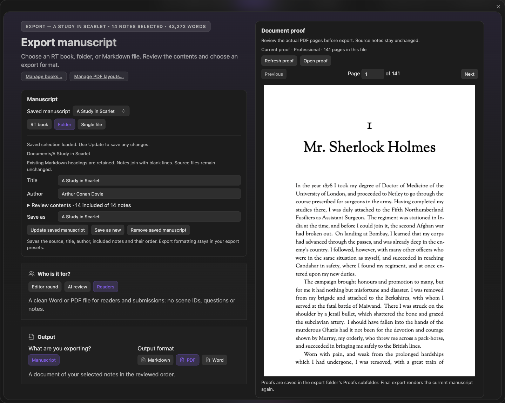
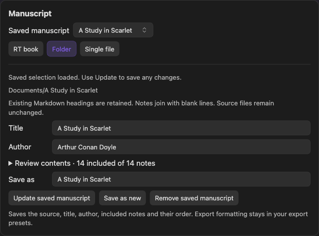

**Manuscript export** opens the export panel for an RT book, a folder of Markdown notes, or a single Markdown file. Publish a novel, an essay, a report, or another document without first turning every note into a timeline scene.

> **Available in 7.5.0:** folder and single-file sources, saved manuscript selections, and the PDF proof workspace.

## What It Can Export

Choose from:

*   compiled Markdown manuscripts
*   PDF manuscripts (typeset via Pandoc + LaTeX)
*   Word (DOCX) manuscripts in standard submission format
*   outline-style exports
*   filtered or ranged exports by order and subplot

Core includes compiled Markdown, Pandoc PDF export with the Basic and Standard layouts, and Word submission export. Pro adds the Professional, Signature, Screenplay, and Podcast Script layouts plus deeper publishing customization (custom Pandoc metadata, custom LaTeX preamble, the PDF style designer).

The panel supports ordering, selection range, output presets, and publishing-oriented layout decisions in one place.

## Choose and Review the Source

Choose **RT book**, **Folder**, or **Single file**. For an RT book, use the book’s scene order, subplot filters, and range controls. For a folder, review the included Markdown notes, remove unwanted entries, move notes earlier or later, then choose **Use this order and selection**. A single Markdown file is ready as one source. Plain sources retain existing Markdown headings and join notes with blank lines; they do not need scene YAML or Book Manager registration.

For a folder or file, enter **Title** and **Author** in the panel. Save a named manuscript to reuse its source, metadata, included notes, and reviewed order. **Update saved manuscript** stores changes, **Save as new** creates another selection, and **Remove saved manuscript** removes the saved choice without deleting notes. Formatting remains in export presets, separately from the source selection.

Your source files stay unchanged. Recheck the included notes when returning to a saved selection, especially after moving or deleting files.

## Who Is It For?

The panel opens by asking who the export is for. Each choice is a built-in preset that sets the format, scene IDs, and cleanup for that reader, and keeps your order, range, and layout:

*   **Editor round** — a Word file for your editor. Scene IDs in headings, your author queries as margin comments, your private `%%notes%%` stripped.
*   **AI review** — Markdown for an AI reviewer. Scene IDs, author queries, and formatting kept; private notes stripped.
*   **Readers** — a clean Word or PDF file for readers and submissions. No scene IDs, queries, or notes.

Change any setting afterwards and the preset shows as changed: **Reload preset** restores it, and **Save as preset** keeps your version under **Saved export presets**. The panel reopens on the last preset you chose.

A line above the Export button reads back what the file will carry before you make it, for example "34 scenes with IDs · 3 questions as margin comments · your notes stripped". It warns in orange when private notes would appear, when a PDF would print author queries as text, or when a Readers export still has queries or scene IDs.

## Word (DOCX) Submission Export

The **Word** format produces a `.docx` in standard manuscript format — the layout agents and editors expect for queries and submissions: Times New Roman 12 pt, double-spaced, 0.5" first-line indents, centered chapter headings that start on a new page. Styling comes from a bundled Word reference document installed into your Pandoc folder (`reference-manuscript.docx`); configure Pandoc under **Settings → Publish** to use it.

Front & back matter Book Pages can be included, and the export cleanup toggles (comments, links, callouts) apply the same way they do for PDF.

Pages are US Letter with 1" margins, and Word opens the file as a current document rather than in Compatibility Mode. A scene break written as `---` or `***` becomes a centered `#`.

If you write scenes with a single return between paragraphs, turn on **Every line is a paragraph**: each line break then starts a new indented paragraph, in Word and PDF. Leave it off for hard-wrapped text.

### Author queries as Word comments

When **Strip author queries** is off, each Editorialist author query (`%%query: Is this scene too slow?%%`, or the older `%%ai:` spelling) becomes a Word margin comment at the spot you asked it, signed with the book's author. Your editor sees the questions where they belong and can answer each one in its comment thread. A query on a line of its own attaches to the end of the paragraph above it.

Bring the returned file to Editorialist the same way as the editor's first round: copy the formatting instructions from the review launcher and give them, with the file, to the AI of your choice. Each answer comes back on its question.

## Print Binding Gutter (PDF)

PDF options include a **Print binding gutter** toggle. When on, exports add 0.25" to the inner margin so text clears the spine of a printed, bound paperback (KDP/IngramSpark). Leave it off for PDFs meant to be read on screen — it changes the page geometry. The setting persists across exports.

## PDF Layouts

For PDF exports, choose a novel PDF layout from the layout selector. The selected layout controls the page style, required font checks, chapter opener behavior, and whether the export prints Part pages.

The preview cards show the expected chapter, part, and body-page structure before export. Export checks report missing Pandoc, LaTeX, bundled fonts, and layout-token problems before you generate the PDF.

The selected novel PDF layout is remembered per book. Narrative Mode uses that same setting for chapter and part placards on the timeline. See [Narrative Mode](Narrative-Mode#chapter-and-part-placards).

## Review the Actual PDF

For PDF output, use **Generate proof** to render the current manuscript, then inspect its actual pages in the **Document proof** workspace. Move between pages and refresh the proof after changing the manuscript or export options. Proofs are saved under the export folder’s `Proofs` subfolder; final export renders the current manuscript again.

After export, the delivery review lists the files saved to the destination. Open those final files to check the result, particularly split outputs. **Save compiled + Pandoc-ready Markdown files** also keeps the assembled and cleaned source beside the export for inspection.

## Related Docs

*   [Publishing](Publishing)
*   [Publishing → Exporting a Manuscript](Publishing#exporting-a-manuscript)
