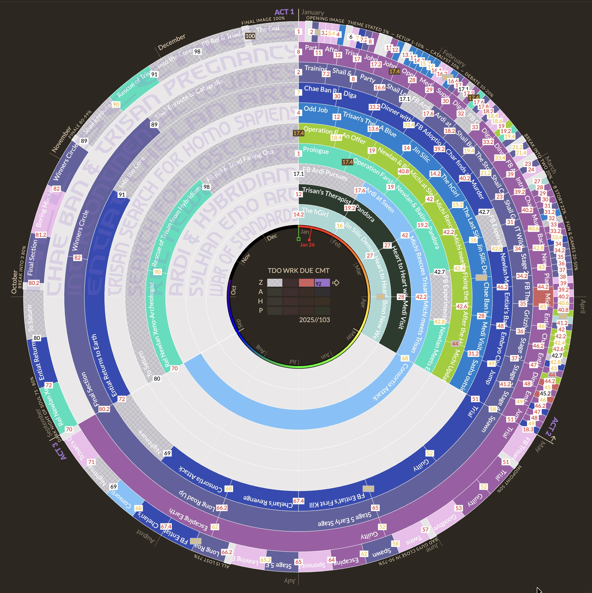
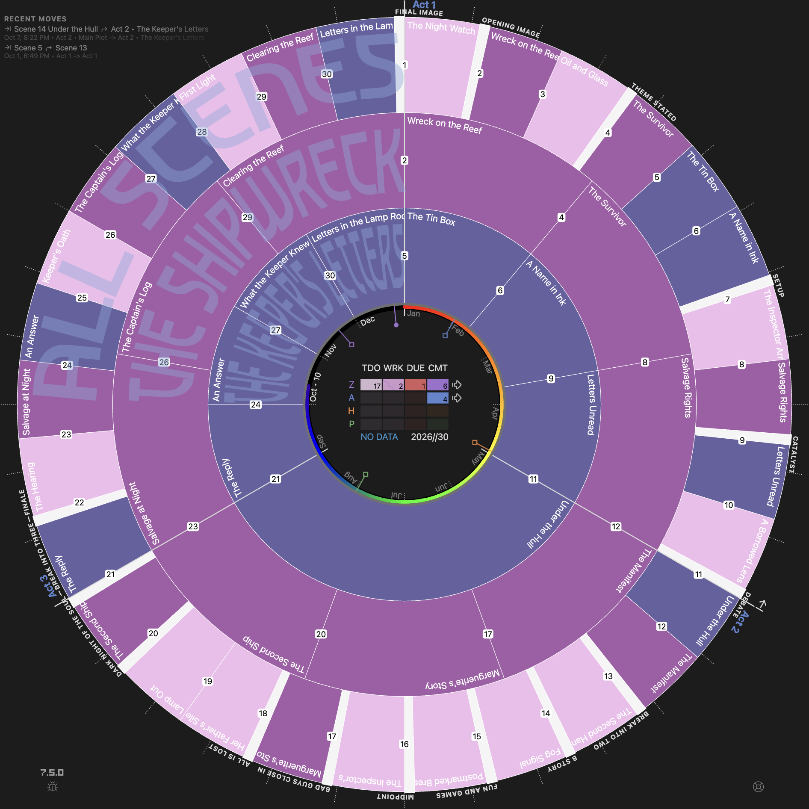
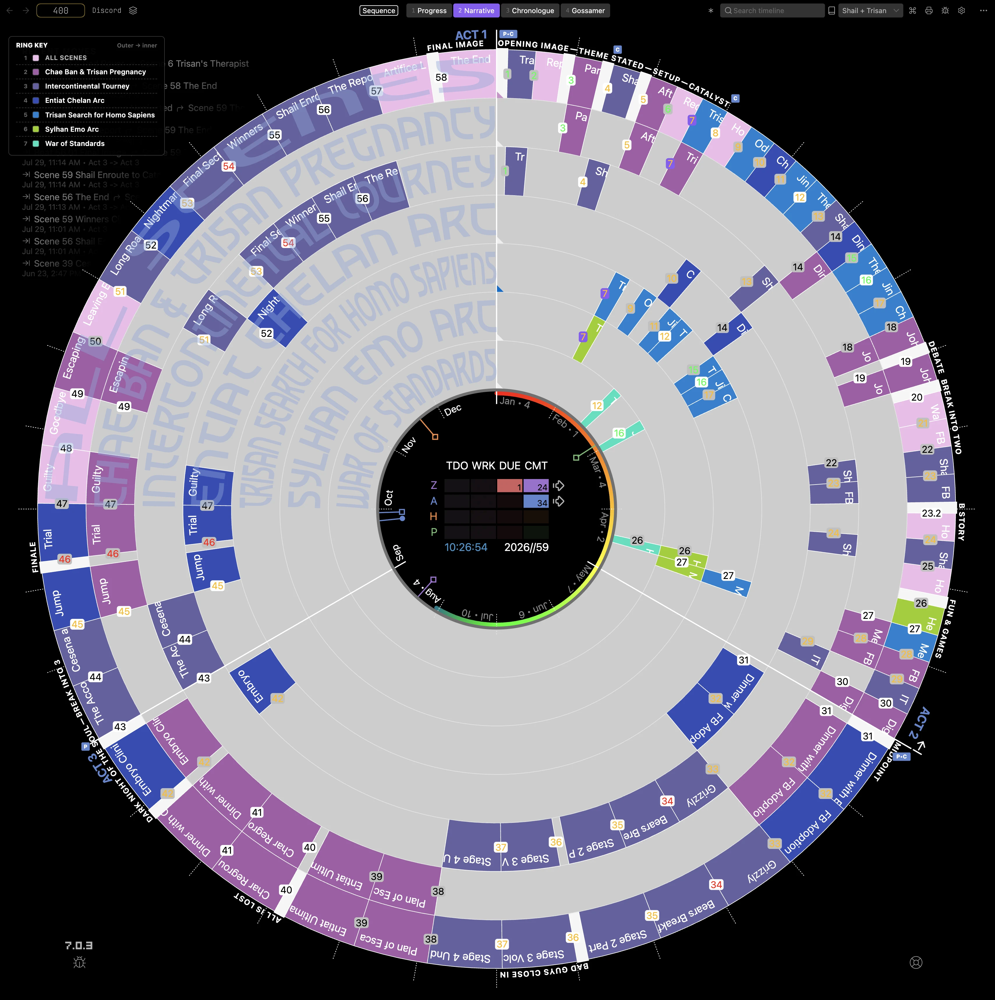
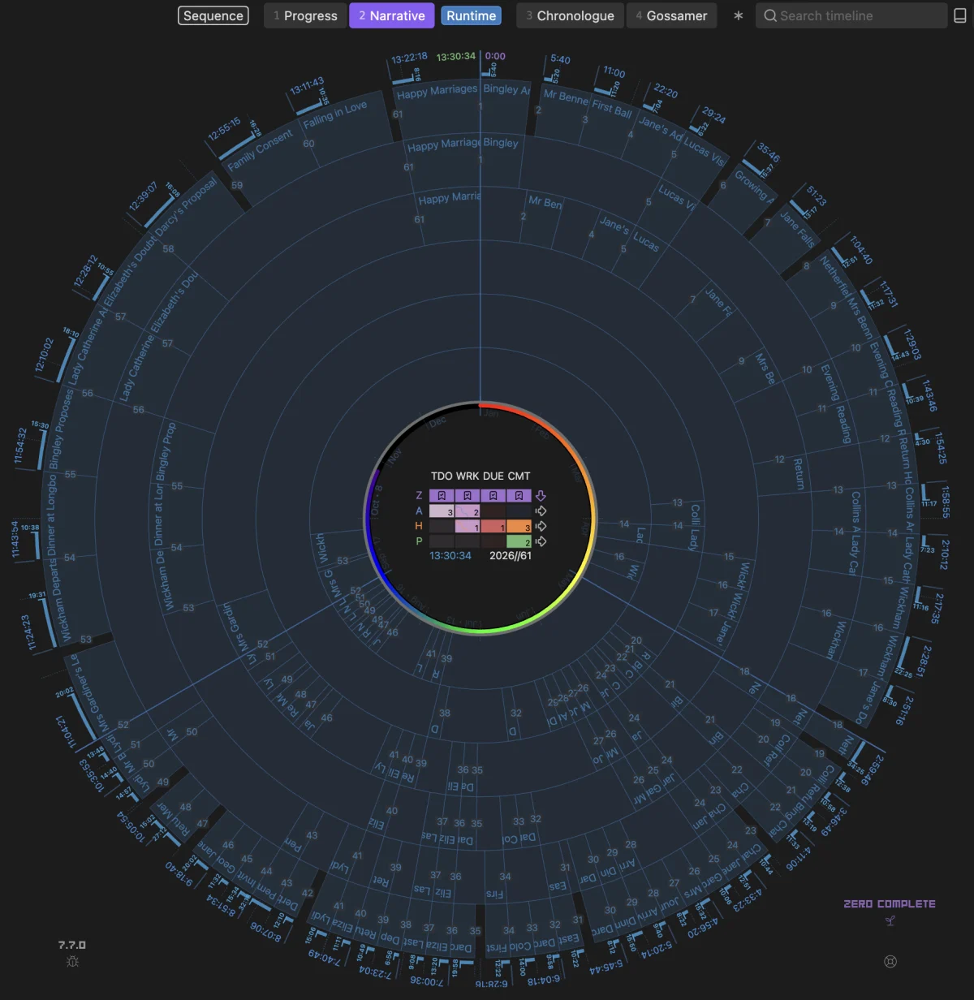
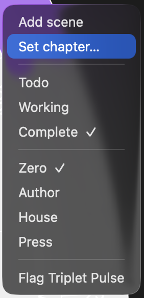
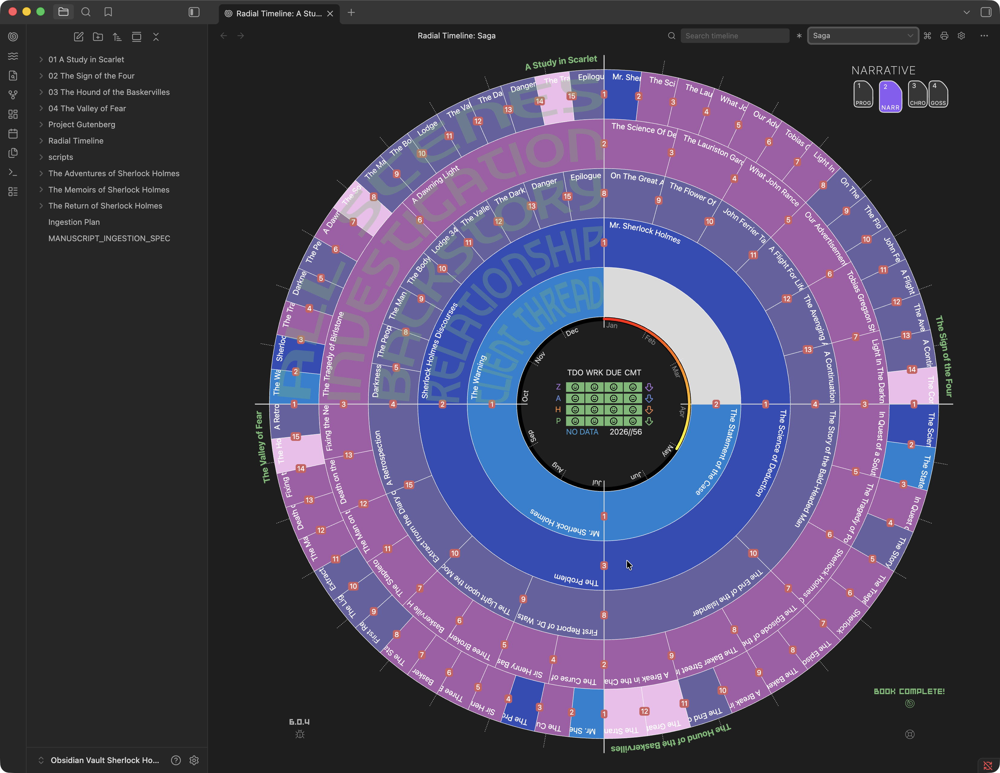
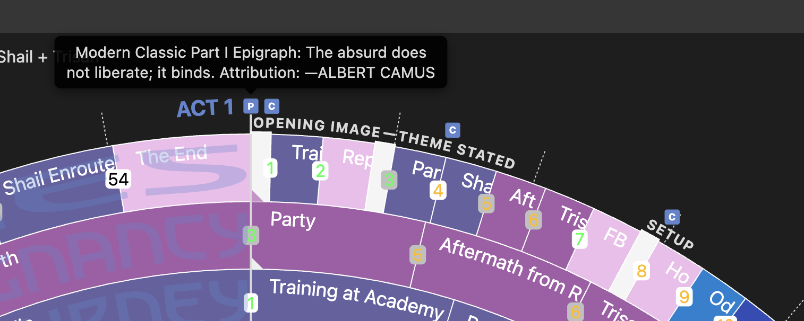

**Keyboard Shortcut**: `2`

Narrative Mode is your primary manuscript-order workspace. It displays all scenes from all subplots on the outer ring, organized by **act divisions** (default 3 acts, configurable in **Settings → Core → Acts**). Each act spans an equal segment of the 360° circle. This view emphasizes **Narrative time** (the order readers will experience the story). Subplot colors show story structure and balance.

## Key Features

*   **Structure**: Scenes are distributed across Act 1..Act N (based on your **Settings → Core → Acts → Act count**).
*   **Book or Saga scope**: Switch between one active book and a combined Saga view.
*   **Subplot Colors**: The outer ring segments are colored by their subplot. This lets you quickly visualize which plot threads are dominant in each section of the book.
*   **Publishing markers**: Optional outer-ring placards show the part and chapter markers you have placed on scenes.
*   **Story Beats**: Displays story beats (like Save the Cat) along the timeline, helping you pace your narrative structure.
*   **Beat names in your book's terms**: Hold **Shift** to swap the beat labels to each beat's [In This Book](YAML-Frontmatter#beat-notes-yaml) name — "Debate" becomes "The Flight from Detection". Shift also shows the subplot ring key.
*   **Interactive Reordering**: You can drag scenes on the outer ring to reorder them. See [Reorder Scenes](How-to#reorder-scenes) for details.
*   **Scene right-click menu**: Add a scene after the current one, set a chapter marker, change Status, change Publish Stage, or flag it for Pulse — see below.
*   **Recent moves overlay**: Narrative Mode can show a top-left list of recent committed scene and beat moves. Toggle it in [Settings → Advanced → Configuration](Settings-Advanced#configuration).
*   **Runtime view** ✦ Pro: Click **RT** to see how long each scene runs and the running time of the book in reading order. See [Runtime view](#runtime-view).

Save the Cat beats around the outer ring, with the recent moves overlay at top left

## Subplot Alignment: Fill vs Sequence

The **alignment chip** at the left of the mode row switches how subplot rings lay out their scenes. It applies in Narrative, Chronologue, and Gossamer modes.

*   **Fill** (default) — subplot scenes spread evenly across each act, so every ring uses its full arc. Best for reading each thread on its own.
*   **Sequence** — every subplot scene sits at its true position in the full manuscript, aligned with the outer ring. Empty cells mark where a thread is dormant, so you can see at a glance where each subplot is active, where it disappears, and how the threads interleave across acts.

Sequence alignment — each subplot ring aligned to manuscript position; empty cells show where a thread is dormant

## Runtime View ✦ Pro

Runtime follows **narrative order** — the order a reader, listener, or audience meets your scenes. The Runtime view shows how long each scene runs and how the minutes add up across the book.

- Turn it on with the `RT` keycap at the top left of the timeline, or the **Runtime** chip beside **Narrative** in the mode row. Click either again to turn it off.
- Every scene keeps its equal slice of the ring. Inside each slice, a blue arc grows with that scene's runtime, measured against the longest scene, with the scene's runtime at the arc's tip.
- A scene with no `Runtime` value shows a short red stub, so you can see which scenes still need an estimate.
- Around the perimeter, each tick shows the running time when that scene begins: `0:00` at the first scene, and the book's total at the end of the last.
- Click any two scenes to see the runtime from the first through the second, both scenes included. Click a selected scene again to release it.
- The book's total runtime appears at the center of the timeline.

Runtime view — each scene's arc and the running time around the book

While the Runtime view is on, clicks select scenes for comparison; turn it off to open scenes or drag them into a new order. Act labels, beat labels, and chapter placards rest while the running totals use the perimeter.

**Use cases:**
- **Screenplay pacing** — Check act timing and scene balance in screen time
- **Audiobook planning** — See where each chapter starts in the listening time
- **Podcast structure** — Plan episode segments with time awareness

**How to use:**
1. Enable Runtime Estimation in **Settings → Core**
2. Configure a runtime profile matching your content type (Novel or Screenplay)
3. Run **Runtime estimator** from the command palette to fill each scene's `Runtime`
4. Switch to Narrative mode (`2`) and click `RT`

> [!NOTE]
> Runtime estimates appear in scene hover tooltips when Runtime Estimation is enabled. See [Settings → Runtime estimation](Settings-Core#runtime-estimation) for configuration and [Pro](Pro) for full Pro documentation. With a [Timetable](Timetable) open, the Runtime view adds a **Running time** column.

## Scene Right-Click Menu

Right-click any scene on the timeline to open a context menu that lets you add a scene or update scene frontmatter without opening the note. The current value in each group is marked with a checkmark.

Scene right-click menu — Add scene, chapter markers, Status, Publish Stage, and Pulse actions

**Add scene** — inserts a new scene after the selected one, using that scene as the anchor for placement and context.

**Set chapter** — adds, edits, or clears the `Chapter:` marker on the selected scene. The panel previews current chapter containers so you can see how the marker affects the manuscript structure.

**Status** — set `Status` to **Todo**, **Working**, or **Complete**. When you mark a scene **Complete**, the `Due` date is automatically set to today, keeping the [Progress Mode](Progress-Mode) completion estimate and pace tracker accurate.

**Publish Stage** — set `Publish Stage` to **Zero**, **Author**, **House**, or **Press**. Useful for moving scenes through revision tiers without leaving the timeline.

**Flag Triplet Pulse** — sets `Pulse Update: Yes` on the scene so the next [Scene pulse analysis](Commands#scene-pulse-analysis-manuscript-order) run will reprocess it.

**Remove from timeline** — takes the scene off the timeline and out of the manuscript without moving or deleting the note. Only its `Class` property is removed; the note stays in its folder with its text, ID and every other property. The [Timetable](Timetable) keeps listing it in place as a note with no Class, and **Promote to scene** puts it back as the same scene.

The timeline refreshes immediately to reflect the change.

## Book and Saga Scope

The title-bar book selector controls which manuscript the timeline shows.

*   Choose a book to inspect one Book Manager profile.
*   Choose **Saga** to combine all configured books into one multi-book Narrative timeline.
*   Saga scope is available when more than one Book Manager profile is configured.
*   Saga scope displays the combined manuscript order in Narrative Mode.

Saga view in Narrative Mode — multiple books combined into one manuscript-order timeline

## Chapter and Part Placards

Narrative Mode can show publishing-aware placards on the outside of the scene ring:

*   **C** — a `Chapter:` field starts a chapter at that scene.
*   **P** — a `Part:` field starts a part at that scene.
*   **P/C** — a scene that opens both.

Placards show the markers you place on scene notes. Set them from the scene right-click menu (**Set part…**, **Set chapter…**) or by editing the field directly.

Placards appear whether or not the selected PDF layout prints them — the marker is your structure, and the layout only decides what reaches the page. Hovering a **P** tells you what the current layout will do with it, including when that layout prints no Parts at all.

Turn placards on with **Settings → Advanced → Configuration → Show part and chapter markers**.

Publishing markers on the perimeter — chapter starts, part boundaries, and combined Part/Chapter breaks

## Dominant Subplots

When a scene belongs to multiple subplots, the outer All Scenes ring must choose one color. You control which subplot wins:

*   **Click a scene**: Sets its dominant subplot. That subplot's color is used for the scene on the outer ring, taking precedence over all others.
*   **Folded corner indicator**: Each subplot ring shows a small folded corner motif at its start. The corner has three states:
    *   **Missing** — the subplot is not assigned to this scene.
    *   **Gray** — the subplot is assigned but is not dominant.
    *   **Darker hue** of the subplot ring color — this subplot is dominant and expressed on the outer ring above all others.
