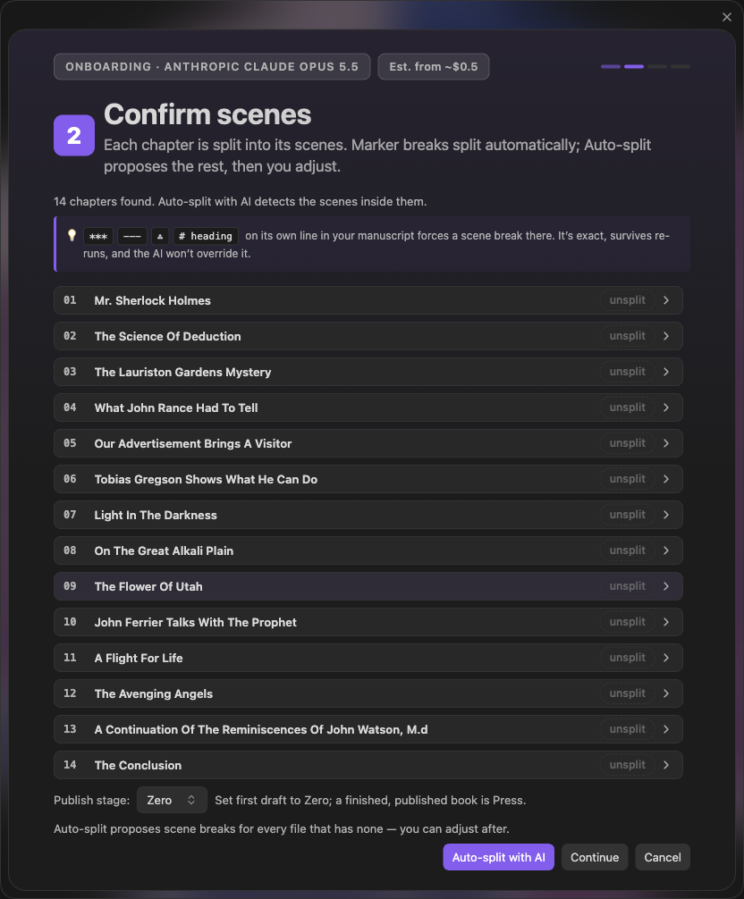
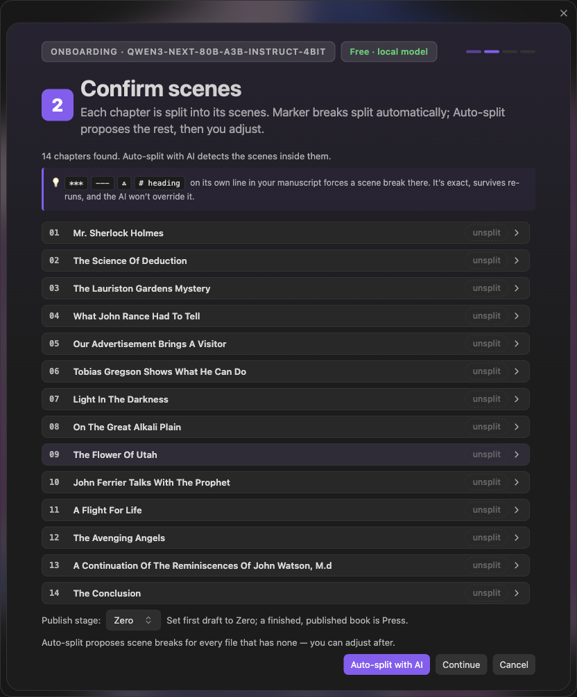
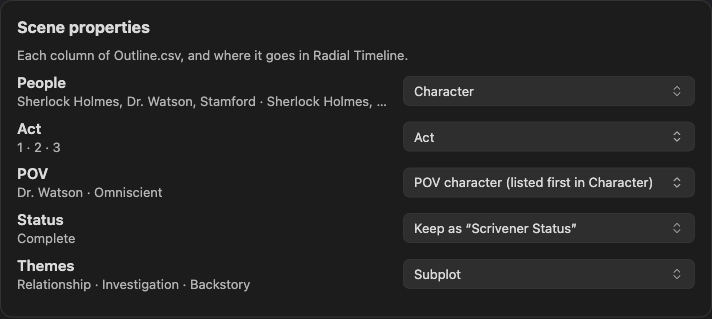

Onboarding imports your draft as scene notes with frontmatter. Review scene boundaries, narrative order, and metadata before creating the imported book. Your source manuscript stays untouched.

Start from **Manuscript onboarding** on the Welcome screen or **Radial timeline: Manuscript onboarding** in the Command Palette. The Welcome flow lets you choose an export directly; you do not need to configure Book Manager first.

> **Available in 7.5.0:** the direct source chooser, export discovery, and CSV-first ordering described here require 7.5.0 or a later release.

## Import sources

* **Scrivener export:** export one text or Markdown file per scene using **File → Export → Files**. Preserve the binder hierarchy and enable numbered filenames. Export **Outliner Contents as CSV** with Title, Synopsis, and the metadata columns you want to carry, covering the same manuscript selection. Put the CSV beside the exported files or in their parent folder, then copy the export into your vault. Raw `.scriv` projects and RTF exports are not supported.
* **Word document:** use one `.docx` for the manuscript. Heading 1–3 and Title styles supply its chapter structure. Combine per-scene Word files before importing.
* **One big file:** use a text, Markdown, or HTML manuscript. Its divisions and scene markers supply the starting structure. Convert PDFs before importing.

Onboarding detects the source type; you can override it during **Prepare**.

## Find and check a Scrivener export

Choose a suggested export or select its folder yourself. Suggestions are local, read-only checks for potential manuscripts, not proof that an export is complete. Book Manager scans automatically when no configured book folder is usable; established vaults can use **Scan for exports** or **Choose manuscript**.

When a CSV is supplied, **its row order determines narrative order**, even if filename numbering differs. Rows match scene files by document title. Without a CSV, numbered filenames supply the order.

Missing scene files, duplicate-title ambiguity, and scene files absent from the supplied outline appear in the export review. Inspect the scene and outline lists, correct the export in Scrivener, and choose **Recheck export**. When the review offers **Continue anyway**, you can proceed with the available material after reading the reported problems. Without a CSV, scene-only import is supported with a warning. Some unmatched outline rows may be folders or empty placeholders; check them against the binder. A Word Count column can help identify missing prose documents, but it is not required metadata to manage.

## Import without AI

**Structure only — no AI** is the default. No model or API key is required, and onboarding makes no AI requests in this mode. It uses document structure and scene markers, carries exported synopses and metadata, and leaves missing synopses for you to write.

Choose **AI assisted** explicitly if you want AI splitting or generated summaries. Configure an available provider under [Settings → AI](Settings-AI) before using that mode.

### Cloud or Local AI for a Single File

With **AI assisted** selected, choose a validated **Local model — no API cost** or your configured cloud provider under **Run AI with**. Review the detected chapters and scene boundaries before using **Auto-split with AI**. The review panel names the selected model and shows a cloud estimate or **Free · local model**.

 

## Review and apply

1. **Prepare:** choose the source type and import mode, check export readiness, and confirm how narrative order is determined.
2. **Confirm scenes:** review boundaries and titles, choose the book's Publish Stage, and map exported metadata. The mapping table proposes fields and shows example values. Map a column to a Radial Timeline property, keep it as a custom field, or ignore it. For a column representing a subplot, choose **Mark scenes with this subplot (column name)**.
3. **Review and apply:** inspect the proposed scene notes before approving their creation. Onboarding writes a separate `<Book> RT` folder and registers the imported book.

Metadata mappings are applied once when the imported notes are created. They do not change the [Settings key remapper](Settings-Advanced), and you do not repeat them every time the plugin runs. ACT folders determine acts when present; otherwise the import allocates acts by position. Review the proposed acts and subplots before applying.

**Scene markers:** a separator such as `***`, `---`, `⁂`, or a heading on its own line can force a scene break. Review the resulting boundaries before applying.

You can close and resume a review while Obsidian remains open. Restarting Obsidian clears the in-memory review session.

The imported notes use the [scene properties](YAML-Frontmatter) that drive the timeline. Review dates and durations for Chronologue and add beat notes for Gossamer. To explore a finished example first, open the [Pride & Prejudice sample vault](Sample-Vault).
