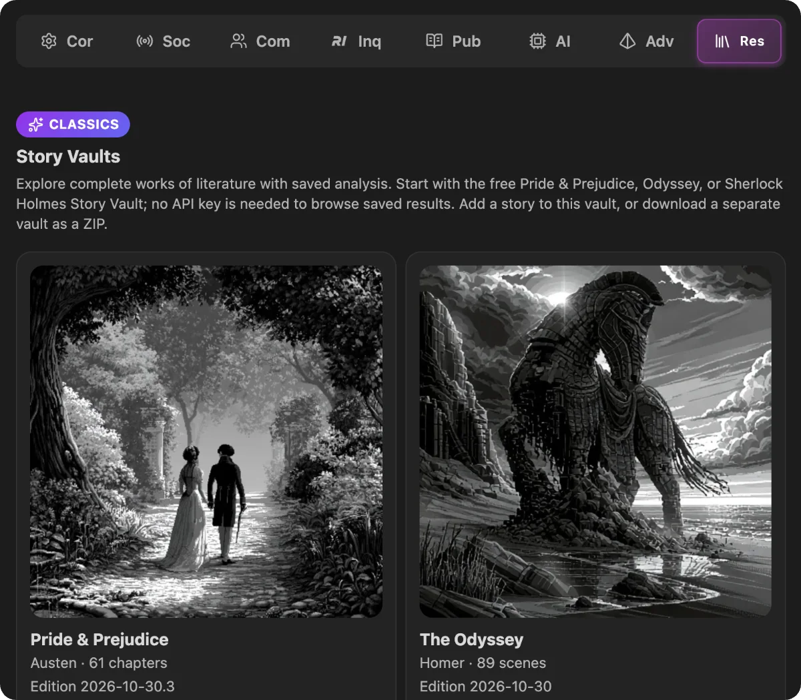

Everything the plugin does is free to use right now — Pro included.

Pro labels advanced workflows for Inquiry questions, runtime estimates, publishing layouts, multi-book timelines, and APR campaigns.

Pro workflows appear throughout Radial Timeline in magenta.

---

## Pro workflows

*   **Inquiry+** — the extended question set and a higher custom-question ceiling per zone. See [Settings → Inquiry](Settings-Inquiry) and [Inquiry](Inquiry).
*   **Runtime estimation** — screen time, audiobook duration, and manuscript-length analysis. See [Runtime estimator](Commands#runtime-estimator), [Runtime view](Narrative-Mode#runtime-view), and [Settings → Core](Settings-Core#runtime-estimation).
*   **Advanced publishing layouts** — the Professional, Signature, Screenplay, and Podcast Script templates, plus custom Pandoc/LaTeX metadata. Designed-style editing and template import are in beta and not yet in release builds. See [Publishing](Publishing) and [Manuscript Export](Manuscript-Export).
*   **Campaign Manager / Teaser Reveal** — multiple APR campaigns and staged public reveals. See [Author Progress Report](Author-Progress-Report).
*   **Saga timeline scope** — view an entire multi-book saga on one timeline.
*   **Custom scene colors and patterns** — author-defined palettes and working-pattern motifs. See [Settings → Core](Settings-Core).

---

## Story Vaults

The **Story Vaults** section under **Settings → Resources** (the **Res** tab) lists complete worked examples with saved analysis. [Pride & Prejudice](Sample-Vault), [The Odyssey](Odyssey-Demo-Vault), and *Sherlock Holmes* are free: **Explore story** opens the Story Vault chooser, where **Add story to this vault** adds one to a **Demo Projects** folder and **Download ZIP** downloads it as a separate vault. A fourth card, the **Secret vault**, is **In preparation**.

Each card names its edition. Once you have a story, its card compares yours with the latest (**Your edition: … · Up to date**). When a newer edition is out, **Download new edition ↗** downloads it as a separate vault, and your copy stays as it is. The Welcome screen offers the same download.

Below the vaults, **Learn more** links to **Getting started**, the **Radial Timeline Wiki**, and the **YouTube Video** tutorials.

---

## AI setup

Inquiry uses your configured cloud provider and API billing, or a validated Local LLM. Set up either option in [Settings → AI](Settings-AI).

---

*Questions or feedback? Visit [radialtimeline.com](https://radialtimeline.com) or email feedback@radialtimeline.com*
