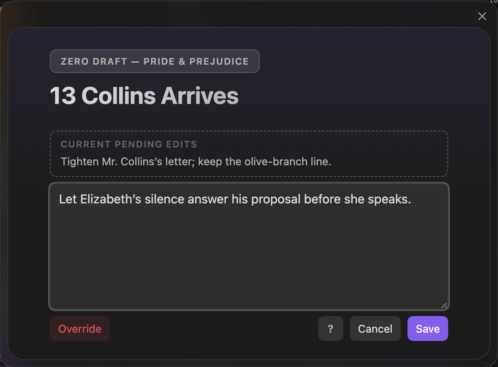

**Keyboard Shortcut**: `1`

Progress Mode gives each subplot a ring and colors scenes by writing status and revision stage.

## Key Features

*   **Thread Separation**: Every subplot renders in its own ring, with the main plot emphasized and other threads muted, so each arc is easy to follow.
*   **Act Structure**: Like Narrative Mode, scenes are distributed across your configured act count (default 3). Each act spans an equal segment of the 360° circle.

## Status & Progress Stage

Scene colors show your workflow status:

1.  **Author Status**:
    *   **Todo**: Solid light pink.
    *   **Working**: Pink, with an optional Hero Patterns plaid motif overlaid on top. Choose a **Working pattern** in Settings → Core, or add a custom pattern from [Hero Patterns](https://heropatterns.com).
    *   **Overdue**: Red.
    *   **Complete**: Inherits the color of the scene Progress Stage.

2.  **Progress Stage Colors**:
    *   Once a scene is "Complete", it displays the color of its current stage (Zero Draft, Author's Draft, House Edit, Press Ready).
    *   These colors can be customized in [Progress stage colors](Settings-Core#progress-stage-colors).

Together, status and progress stage answer two questions:

*   **Status**: what is happening with this scene right now?
*   **Progress stage**: which draft or editing stage has this scene reached?

Together they turn the radial view into a project-management dashboard, highlighting what needs to be written, what is overdue, and what is ready for the next stage of editing.

## Zero Draft Mode

**Zero Draft Mode** opens **Pending Edits** when you click a scene with **Publish Stage = Zero** and **Status = Complete**. Capture revision ideas there while you finish the first draft. The scene's current Pending Edits show above the field; what you type is added after them when you click **Save**, so earlier ideas are kept. Enable it in [Settings → Core](Settings-Core).

Zero Draft Mode — capture ideas for the next revision

