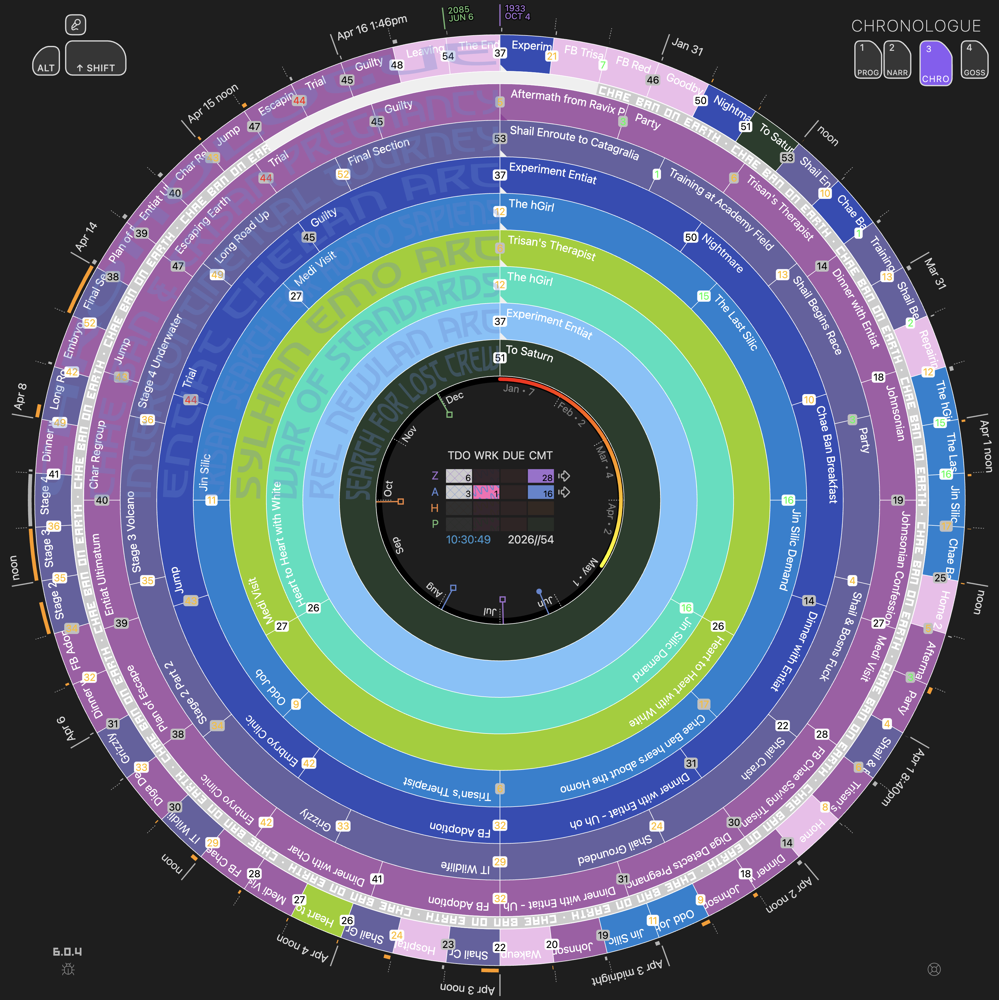
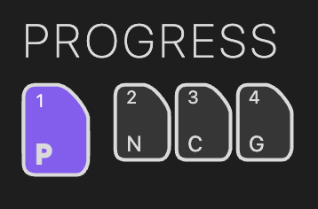
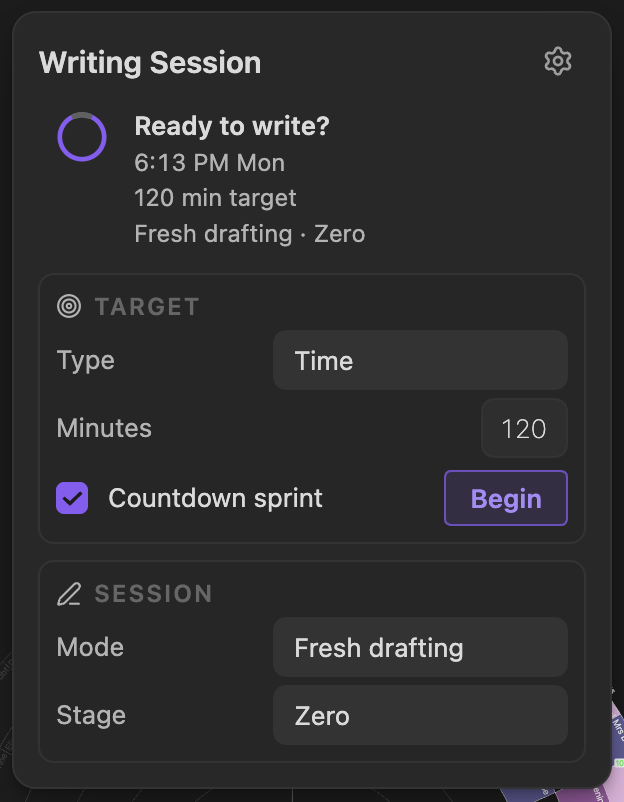
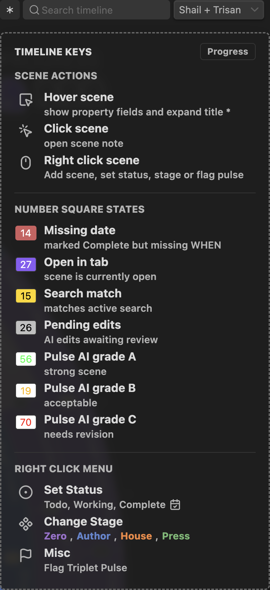

The Radial Timeline View is the main workspace: you work with scenes, subplots, chronology, beats, and scene-level AI feedback directly on the wheel.

Radial Timeline View — shown in Chronologue mode

**Open**: Command palette → **`Radial timeline: Open`**, or click the Radial Timeline logo icon in the ribbon.

## Overview

A radial manuscript workspace with four modes:

| Mode | Key | Focus |
| :--- | :--- | :--- |
| **[Progress](Progress-Mode)** | `1` | Writing status and revision stages |
| **[Narrative](Narrative-Mode)** | `2` | Manuscript order and subplot structure |
| **[Chronologue](Chronologue-Mode)** | `3` | Story-world chronology and duration |
| **[Gossamer](Gossamer-Mode)** | `4` | Beat-level scoring and comparison |

Mode buttons — Progress, Narrative, Chronologue, and Gossamer

## What You Can Do

*   write, add, or reorganize scenes
*   switch between books or view an entire Saga from the title-bar book selector
*   open a writing session from the title-bar count/session button
*   use the timeline legend to read scene actions and mode-specific controls
*   compare subplot balance and structure
*   check chronology and elapsed time
*   score beats and compare Gossamer traces
*   review scene-level AI feedback via [AI Pulse Triplet Analysis](AI-Pulse-Analysis)

## Book Selector

The tab title bar includes a book selector. Choose an individual Book Manager profile to focus the timeline on one manuscript, or choose **Saga** to view all configured books together in Narrative Mode.

Tab title bar actions — book selector, mode controls, and quick view actions

See [Narrative Mode](Narrative-Mode#book-and-saga-scope) for Saga behavior and limits.

### In a narrow pane

The title bar fits the pane you give it. When the right side needs room, the mode buttons slide left to make it. In a narrower pane the command, print, bug, and settings icons fold into one menu button, then the search field and book selector get shorter. Only in the narrowest panes do the inactive modes shrink to their number, such as **1 2 Narrative 3 4**.

## Getting Help

**GET HELP** in the corner of the timeline opens the Community help page: how-to answers, the Guide, private requests to the Radial Timeline team, and known issues, all in one place.

## Bug Reports

The title bar bug icon opens the built-in bug report workflow. You can describe the issue, capture or attach a screenshot, and paste an image from the clipboard. **Report a bug** opens the GitHub bug form with your plugin version, Obsidian version, platform, and current view already filled in. If you do not have a GitHub account, use the email option in the same dialog.

## Writing Session Control

The title bar also includes the compact count/session button used for Sessions.

*   Click it to open the **Writing Session** panel.
*   Start an open-ended session or a countdown sprint.
*   Pause, resume, save, stop, or discard the current session from the panel.
*   If you have [Desk Lamps](Desk-Lamps), tick the friends who should see this session under **Desk Lamps** before you press **Begin Session**. While you write, the panel shows who your lamp is lit for.
*   Use the settings icon in that panel to jump straight to **Settings → Core → Sessions**.

Writing Session panel — timer, daily goal context, and session controls

## Community Mailbox

On a vault connected to the Community, at any sharing level (Private included), a **Mailbox** button (a mail icon and the word Mailbox) sits just right of the writing-session control. It works like your account menu on the Community website, in the same colours:

*   **A gold number** counts conversations with new replies (your requests the team has answered, plus your questions someone has replied to) and [Desk Lamp](Desk-Lamps) invites waiting for you.
*   **Click it** to open a menu like the website's: **Requests**, **New replies** (while there are some; it opens your newest question with a reply), and **Desk Lamp invites** (while some wait; it opens My Share's Desk Lamps section), each with its own count. Pick one to read or answer it on the Community; that clears its number the next time the plugin checks.
*   The plugin checks about once an hour while a timeline is open, and again when you come back to Obsidian. It never marks anything as read.
*   If a check fails, its icon dims and its tooltip says why.

The Mailbox does not appear on a vault that is not connected. To hide it on a connected vault, turn off **Show Community mailbox** in **Settings → Advanced**.

## Desk Lamps

Once you have a Desk Lamp or an invite waiting, a ceiling-lamp icon sits just right of the Mailbox. Its number counts the friends at their desks, and clicking it lists each one with their city, the kind of writing, and how long they've been at it. See [Desk Lamps](Desk-Lamps) for adding friends and lighting your own lamp for a session.

## Timeline Legend

The legend is a quick visual guide for the current mode.

*   It explains basic scene actions such as **Hover**, **Click**, and **Right click**.
*   It includes mode-specific help for **Narrative**, **Progress**, and **Chronologue**.
*   The right-click guidance includes **Add scene** alongside status, stage, and Pulse actions.

Timeline legend — scene actions and mode-specific controls

## Timetable

The [Timetable](Timetable) opens beside the wheel from its title-bar table button. It follows the active book or saga and links scene rows to the wheel’s hover highlight.
