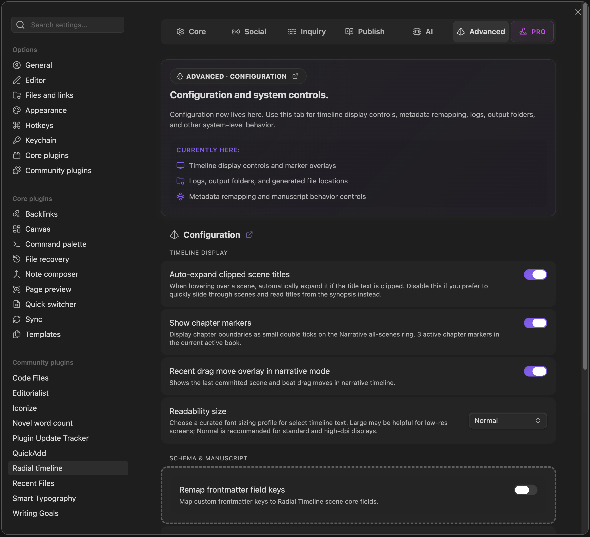

Timeline display options, frontmatter key remapping, ripple rename, and log locations.

Settings → Advanced

## Configuration

### Timeline display

*   **Auto-expand clipped scene titles**: Automatically expands truncated scene titles on hover.
*   **Show part and chapter markers**: Displays part and chapter boundaries on the Narrative all-scenes ring and reports how many active chapter markers exist in the current book.
*   **Recent drag move overlay in narrative mode**: Shows the last committed scene and beat drag moves.
*   **Readability size**: Switches curated timeline text sizing between `Normal` and `Large`.
*   **Show time notation bar in scene notes**: In scene notes, a vertical bar beside the text marks each time phrase in editing and Reading view. Other notes never show it. Turn it off to hide the bar; the time summary in the note's title bar stays visible. See [Scene Time](Scene-Time).
*   **Show community mailbox**: On a vault connected to the Community, shows the **Mailbox** button beside the writing-session control that marks new replies to your requests and questions, and Desk Lamp invites waiting for you. On by default. Turning it off also stops its hourly check. See [Radial Timeline View](Radial-Timeline-View#community-mailbox).
*   **Show desk lamps**: On a vault connected to the Community, shows the lamp beside the Mailbox with your Desk Lamps at their desks, and lets the session panel share a session with them. On by default. Turning it off hides both and keeps your own lamp off. See [Desk Lamps](Desk-Lamps).

### Schema & Manuscript

*   **Remap frontmatter field keys**: Map custom frontmatter keys to Radial Timeline scene core fields.
*   **Manuscript ripple rename**: Normalizes scene and active-beat filename prefixes after drag reorder. Scenes stay integer-numbered; beats use decimal minors. On in new vaults.
*   **Renumber now**: Gives the same renumber at any time, for example after **Add scene** left a note numbered 4.5. The button says how many notes need renaming, or **Already in order**. It lists each rename (4.5 Evening Conversations → 5 Evening Conversations) and starts when you choose **Begin**. It works whether or not ripple rename is on. The same renumber is in the command palette (**Book renumber scene and beat notes**) and in the export window, where a book with decimal scene numbers shows a **Renumber now** link. If other notes link to a renamed note, Obsidian may ask whether to update those links, as it does for any rename.

### Logs

*   **Logs**: Readout of the main Radial Timeline logs location.
*   **Export folder**: Destination for manuscript, outline, and cue-card exports. Editable — type or pick any folder inside your vault; the chip beside the field reveals it in the file explorer.
*   **Enable AI content logs**: Saves full prompts, submitted material, and API responses in your vault for reviewing AI runs, including failed runs. Credentials are redacted. Your vault's sync and backup settings apply to these files. Off in new vaults.
