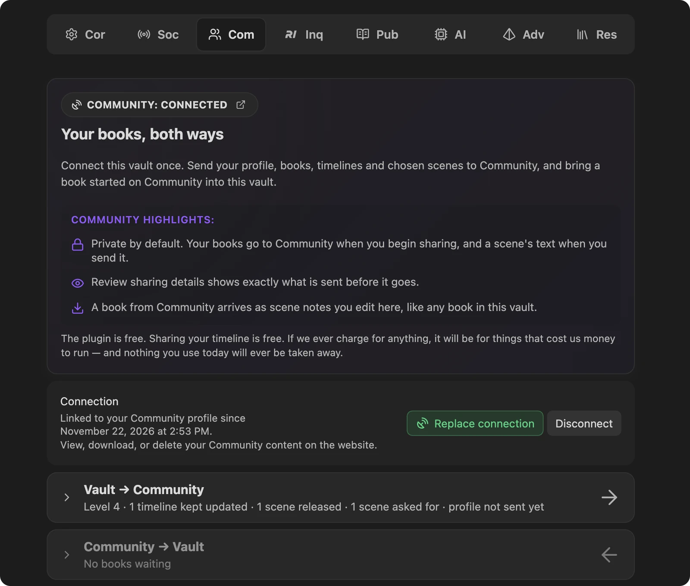
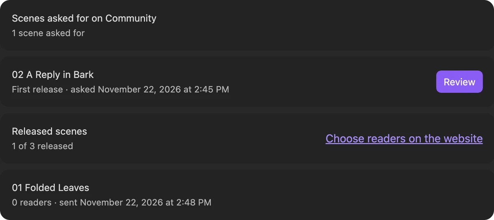
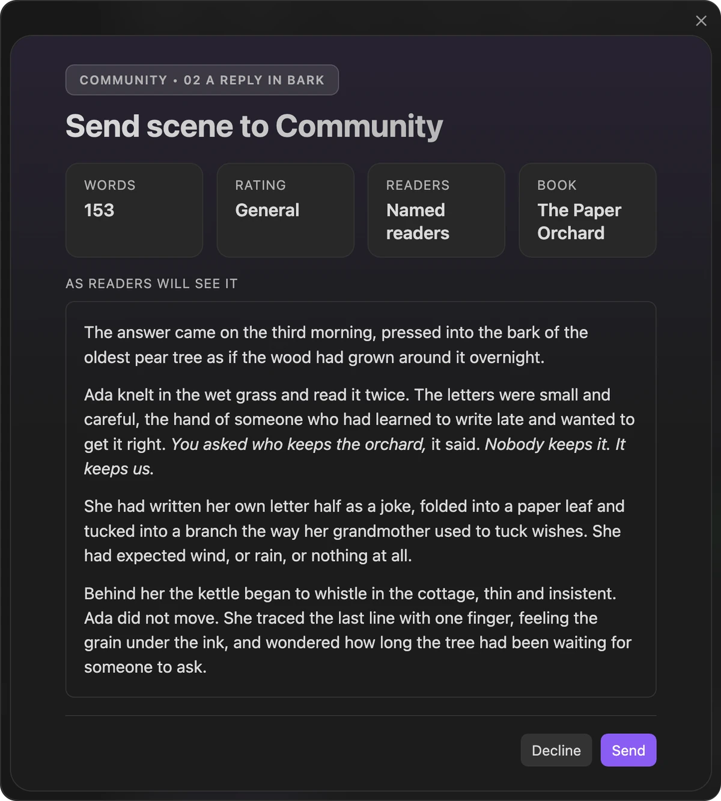
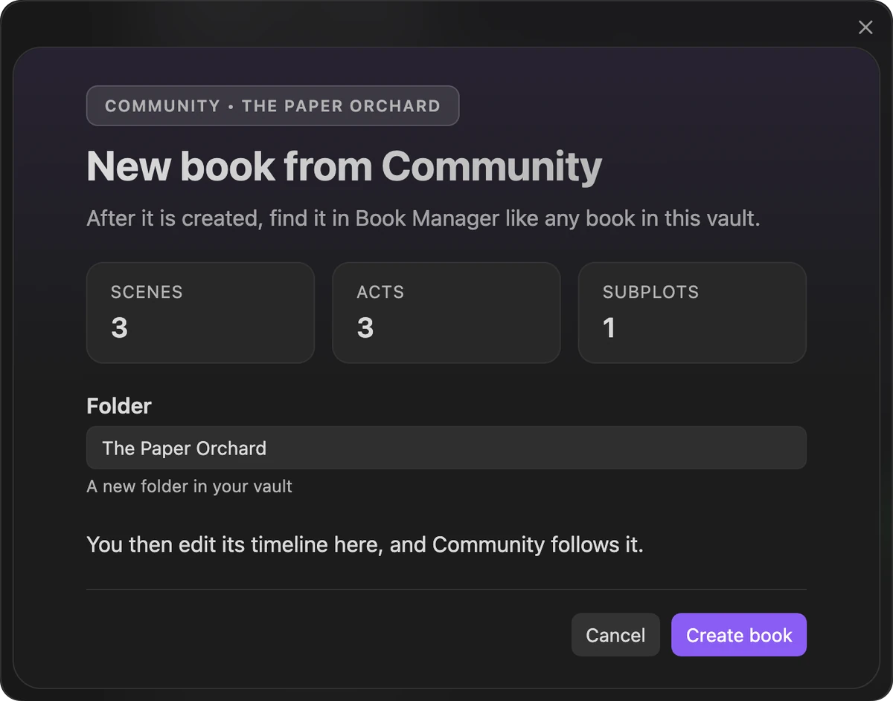
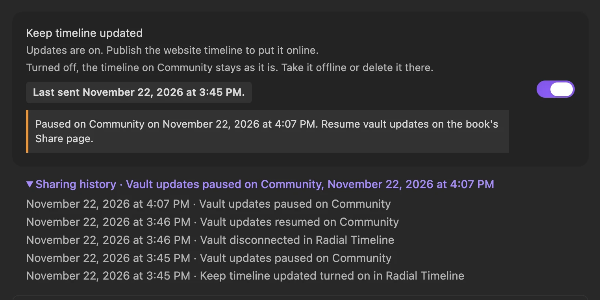

The Community tab connects Radial Timeline to the Community area of the Radial Timeline website. It works in two directions: **Vault → Community** shares your profile, books, timelines and the scenes you send, and **Community → Vault** brings a book you started on Community into this vault.

Community Share is opt-in. Your profile and book list go up when you connect, choose a sharing level and press **Begin sharing**. A book's timeline goes up when you turn on **Keep timeline updated**, and a scene's text when you press **Send** for it.

## The Tab At A Glance

*   **Connection.** When this vault is linked, one row shows since when, with **Replace connection** and **Disconnect** side by side. Before it is linked, paste the connection code from the website here.
*   **Vault → Community.** Closed, its line sums up what is on Community: your level, timelines kept updated, scenes released, scenes asked for, and whether your profile has been sent. Open, it holds the sharing level, **Review sharing details**, **Begin sharing** (or **Pause** / **Resume**), and the block for the active book.
*   **Community → Vault.** Closed, it says how many books are waiting. Open, it lists each book with **Review**.

A row opens by itself when it needs you: Vault → Community while sharing has not started or is paused, or when a scene is asked for; Community → Vault when a book is waiting. Otherwise both start closed.

## Basic Setup

1. On the website, sign in, then open **My Share** and generate a one-time connection code.
2. In Obsidian, open **Settings → Community Plugins → Radial Timeline → Community**.
3. Paste the code into **Connection code** and choose **Connect**.
4. Open **Vault → Community** and choose a **Sharing level**.
5. Open **Review sharing details** to see what goes up.
6. Choose **Begin sharing**.

Connecting lists each of your Book Manager books on your **private** My Share page as a project shell: the book's public label (or its working title), logline, stage target dates and order. Shells stay private until you switch a project on from My Share. Choosing **Level 1 — Private** stops this sync.

A writing session you post goes under the book you were writing in, when that book is public on Community. Other progress posts go to one book you choose on the website with **Post to another book…**.

## Sharing Levels

*   **Level 1 — Private** — your profile and activity stay in this vault, and your book list stops syncing to My Share. The [Mailbox](Radial-Timeline-View#community-mailbox) and [Desk Lamps](Desk-Lamps) still work.
*   **Level 2 — Profile, books + APR** — your public profile and project shells, plus a campaign's visual progress report for one selected book if you send one.
*   **Level 3 — Profile, books + writing activity** — Level 2 plus two activity feeds: a daily feed (writing days, rounded minutes and word totals, and a coarse mode mix) and the **Working Clock** rollup, your writing minutes over the last 28 days by the hour you started each session and by mode.
*   **Level 4 — Everything above, plus scene text you send** — Level 3 plus the text of each scene you send when Community asks for it. See [Scenes Asked For On Community](#scenes-asked-for-on-community). The first time you choose Level 4, Radial Timeline shows the release terms once.

The profile and book list go up when you press **Begin sharing**, and then stay current. The Vault → Community row says "Profile and book list: not sent yet" until you do. Changing between Level 3 and Level 4 changes nothing your profile sends.

## Review Sharing Details

**Review sharing details**, under the sharing level, shows what goes up at your level: the profile and book details from the website, the activity from this vault, and what stays here. It refreshes when you change the level.

What stays in this vault: scene text, until you send a scene Community asked for; scene, note and vault paths; file and folder names; raw writing sessions; exact session timestamps; and API keys, license keys and plugin secrets.

**[Desk Lamps](Desk-Lamps)** is separate from the sharing level and works at every level, Private included. For a session you choose to share, it sends the friends you select only that your lamp is on, the kind of writing, and how long, in five-minute steps. Nothing is kept after the session ends.

## Your Book's Timeline

Inside Vault → Community, the active book has its own block, headed with its name. Turn on **Keep timeline updated** to send its timeline to your Community account. A new timeline arrives private: **Open preview** opens it on the website, where you reveal scenes and choose when it goes live.

Radial Timeline sends scene order, acts, subplots, status and publish stage. Titles, synopses, cast, narration and story dates are stored privately until you reveal a scene. Under **Details readers can see on a revealed scene**, choose which of those a reader sees. **Generic ring names** shows Subplot 1, Subplot 2 instead of your subplot names.

A timeline needs a sharing level above Private and a source folder for the book in Book Manager. With no book yet, the block says: "Add a book in Book Manager to share its timeline."

## Scenes Asked For On Community

At **Level 4**, the text of a scene goes up in two steps, and only from Radial Timeline:

1. **On Community**, open the scene on its book's Share page, choose its rating and readers, and choose **Ask Radial Timeline for this scene** (or **Ask for an update** on a released scene).
2. **In Radial Timeline**, the Vault → Community row shows "1 scene asked for" and opens by itself. Under **Scenes asked for on Community**, choose **Review** beside the scene.

**Send scene to Community** shows the scene's word count, the rating and readers chosen on Community, the book, and the text as readers will see it: the scene's prose, with its properties, comments, callouts, link syntax and block IDs removed. Choose **Send** to release it, or **Decline** to answer the request without sending. If the note changes while the dialog is open, the dialog shows the new text for another look before anything goes up.

An update replaces the released text for every reader; feedback on the earlier version stays, marked with its version.

**Released scenes**, under the requests, lists each released scene with its readers and when it was sent. When your vault's text differs from what was released, it says **Changed since release**: ask for an update on Community, then send it here. Radial Timeline works this out in your vault, with nothing sent. **Choose readers on the website** opens the page where you name readers. Take a scene down on the website.

On Community, **Open in Obsidian** beside a waiting scene opens its **Send scene to Community** dialog in the vault connected to that book. The link format is `obsidian://radial-timeline-release?book=<Community book id>&scene=<scene ID>&request=<request id>`.

A scene needs a scene ID and must be on the book's shared timeline, so turn on **Keep timeline updated** first. A scene can be up to 10,000 words. Pausing Community sharing pauses scene text too.

On the Community website, your scene text goes to an AI provider only when you ask for a feedback summary. Nothing is filtered before it goes up. A reader can report a scene for someone's private information, or for material that isn't yours to share; a person reviews each report, and the scene stays up while it waits. These are the release terms (version 2026-11-22) Radial Timeline shows the first time you choose Level 4.

## A Book From Community

A book you started on the Community website can become a book in this vault, and from then on you edit it in Obsidian.

1. **On Community**, on the book's Share page, choose **Add to my vault**. Select **Include released text** to bring your released scenes' text into their notes.
2. **In Radial Timeline**, the Community → Vault row says "1 book waiting" and opens by itself. Choose **Review**. On the website, **Open in Obsidian** opens the same preview.
3. **New book from Community** shows the book's scenes, acts and subplots, and the folder Radial Timeline creates. Rename the folder if you like; it must be a new folder, clear of your other books. Choose **Create book**.

Radial Timeline writes one scene note per scene, named with its scene number and title. Each note's properties hold the scene's act, story date, synopsis, subplots, cast, narration, publish stage, status and scene ID, under your own property names; the rest of your scene template is added empty. Released text becomes the note's body. The folder joins Book Manager with **Keep timeline updated** on, and Community follows the timeline as you edit it. Readers, released scenes, questions and answers stay with their scenes, because each note keeps its scene ID.

**Cancel** in the preview closes it, and the book keeps waiting. To withdraw the book, choose **Cancel** on its Share page on Community; the row then says "No books waiting". Community holds a waiting book for 24 hours.

If Obsidian closes partway, the book's row shows **Continue**, and Radial Timeline picks up where it stopped without writing any note twice. If the book is canceled on Community first, the notes stay in their folder and the row says where they are.

**Recovery.** Community keeps a copy of the book's timeline from before it came to your vault. To go back to editing it on Community, disconnect the book from the vault on its Share page and restore **Before adding to your vault** under **Recovery**.

What comes down: the book's timeline and, by your choice, its released text. What goes back: the new book's ID and its scene IDs. Nothing is written until you choose **Create book**. See [Privacy and Security](https://github.com/EricRhysTaylor/radial-timeline/blob/main/docs/privacy-and-security.md).

## Pause, Take Offline, Disconnect

*   **Begin sharing / Pause sharing / Resume sharing**, in Vault → Community, puts your level on Community and keeps it current. While paused, only one notice goes up, saying that this vault paused and when; what you already shared stays visible. The row reads "Paused in Radial Timeline on" with the date. Resume tells Community too.
*   **Keep timeline updated**, turned off or on, also tells Community that it changed and when, and nothing else.
*   **Level 1 — Private** takes your current activity share offline. Your profile, books and posts on the website stay as they are; manage them on My Share.
*   **Disconnect**, in the Connection row, stops updates and removes this vault's connection key. Your Community account stays as it is. Reconnecting needs a new one-time code.
*   View, download or delete your Community content on the website.

### Who Paused, And When

Each side says what the other did, with the date:

*   **Paused on Community.** When vault updates for the book are paused on its Share page, the book's block says "Paused on Community on" the date, and how to resume them there. A pause that came from restoring an earlier timeline says so. A held update and a timeline taken offline on Community show their dates the same way.
*   **Disconnected.** When the vault is disconnected on Community, or when another vault connects to the book, the badge reads **Community: Disconnected** and the Connection code row says who disconnected it and when. Paste a new connection code to connect again.
*   **A book disconnected from this vault.** The book's block says it was disconnected on Community, and when. The book stays on Community, edited there; turn **Keep timeline updated** on to send this vault's book as a new one.
*   **Sharing history.** Under the book's block, **Sharing history** lists the latest changes, newest first: who paused or resumed what, disconnects, timelines taken offline or published, and scenes taken down (by title only). It starts folded, on one line naming the newest change.

## New Mac, Reinstall, Or Synced Vault

The connection key is stored in Obsidian's private, per-device secure storage and stays on the device: Obsidian Sync, iCloud, git, a vault copy or a fresh install bring your settings across without it. The Connection row then shows **Reconnect**. To reconnect:

1. On the website, open **My Share** (signed in with the email on your author profile) and generate a new one-time code.
2. In the Connection row, choose **Reconnect**, paste the code into **Connection code**, and choose **Connect**.

Every device you write from needs its own connection, made the same way.

## Sharing An APR

From Level 2 upward, an [Author Progress Report](Author-Progress-Report) campaign can send its graphic to Community, where it arrives privately on My Share. See [Send a campaign to Community](Author-Progress-Report#send-a-campaign-to-community).
