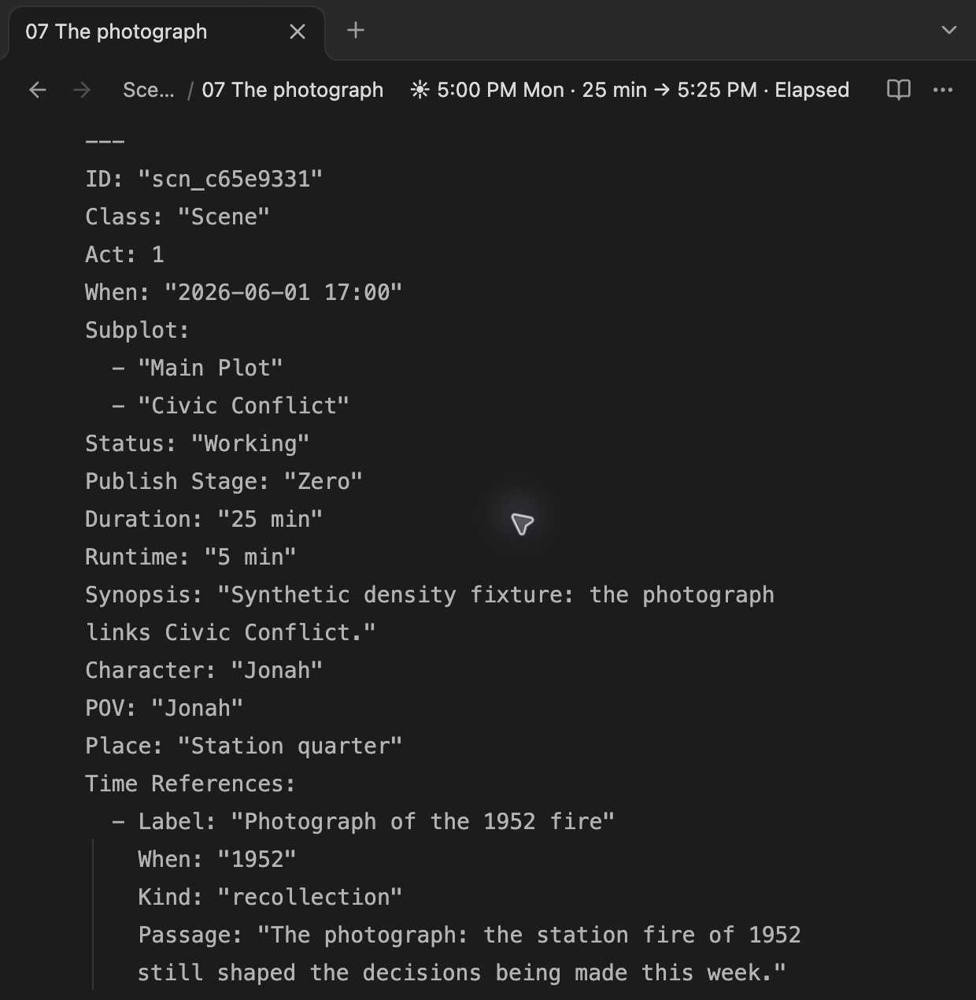
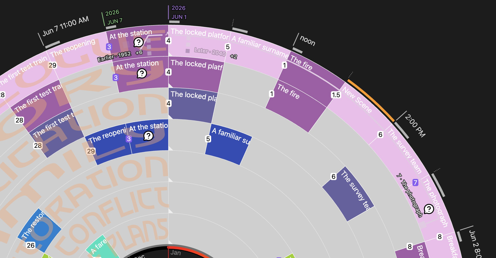
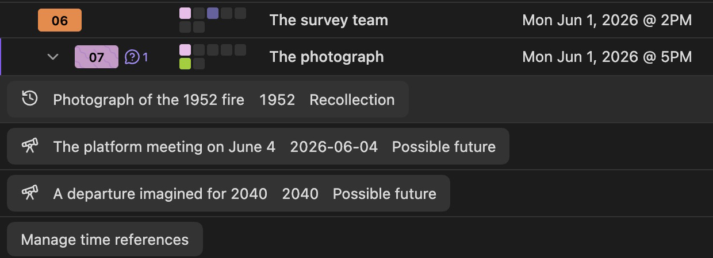

Keep a scene’s `When` as the date when its main action happens. Add **Time References** for other periods inside that scene: a remembered fire, a quoted letter, an enacted flashback, or an imagined future.

> **Available in 7.6.0.** The screenshots use a synthetic study manuscript, **Time Reference Study**.

## Add references to a scene

Right-click a scene note and choose **Time references…**. In the editor, select a passage and choose **Add time reference…** from the context menu to start with that excerpt. On first use, **Enable time reference editing** registers the field in your advanced Scene YAML template. Then enter a label, date, and reference kind and click **Save reference**.

You can also write the list directly in the note’s YAML frontmatter. Quote reference dates, including year-only values:

```yaml
When: "2026-06-01 17:00"
Time References:
  - Label: "Photograph of the 1952 fire"
    When: "1952"
    Kind: recollection
    Passage: "The photograph: the station fire of 1952 still shaped the decisions being made this week."
  - Label: "The platform meeting on June 4"
    When: "2026-06-04"
    Kind: possibility
    Passage: "The platform meeting was planned for June 4."
  - Label: "A departure imagined for 2040"
    When: "2040"
    Kind: possibility
```



| Field | What to enter |
|---|---|
| `Label` | A short name for the reference. Required. |
| `When` | A quoted year, year-month, date, or date and time, such as `"1952"`, `"1986-07"`, `"2026-06-04"`, or `"2026-06-04 14:30"`. Required; the precision you enter is preserved. |
| `End` | An optional final date for a period, on or after its start. Uses the same date formats. |
| `Kind` | `enacted` for action shown in the scene; `recollection` for a memory; `mention` for a passing reference; `possibility` for a possible future. Required. |
| `Passage` | An optional exact excerpt occurring once in the scene. Clicking the reference opens and highlights it. If the text changes or occurs more than once, edit the reference to reattach it. |

References describe passages within their source scene. They do not create new scenes, change scene counts, move the scene’s primary date, or expand the manuscript’s displayed time range.

## Read the timeline

Time-reference marks appear **only in normal Chronologue**, on the outer **All Scenes** ring. They disappear in Shift, Alien Calendar / Planetary Time, and Runtime, and in other timeline modes. Question icons also hide in these Chronologue sub-modes. A source that belongs to several subplots still has only one set of reference marks.



- **Larger square:** the source scene containing the passage. Its caption identifies the scene when a reference is active.
- **Smaller square:** a referenced date. Squares follow the angle of the ring. Hover or focus one to preview its source; click to pin the relationship and open the passage. The selected square grows, and other reference labels recede. Date squares remain fully opaque.
- **Connector:** the active relationship follows an arc inside the ring. It does not mean that intervening scenes mention that date. Clicking empty timeline space clears the pinned relationship.
- **Earlier / Later:** references outside the manuscript’s date range gather on either side of the 12 o’clock seam. The small activity-shaped break marks the discontinuity. Their distance from the seam does not measure elapsed years.
- **Stack and +N:** up to three squares appear at a shared date. `+6` means six additional reference entries beyond the three shown; `+2` means two additional entries. Click the count to choose one of those passages. The count concerns references, not years or scenes.

Several scenes can refer to the same date. Each reference retains its own source: selecting the June 4 passage in **The photograph**, for example, connects that scene to June 4; selecting the corresponding passage in **The council vote** connects that source instead.

## Read and edit references in the Timetable

Click the reference control beside a source scene’s number to expand its child rows. Each child shows the label, date or period, and kind. Click a child to select its relationship and open its passage; **Manage time references** opens the editor.



The child rows stay with their source scene rather than becoming separate manuscript scenes. The Timetable’s reference list remains available in other modes for reading and editing; the wheel’s marks return when you switch back to normal Chronologue. Reference dates remain in the Earth calendar, including when the Timetable follows a planetary calendar.

See [Chronologue Mode](Chronologue-Mode), [Timetable](Timetable), and [Scene properties](YAML-Frontmatter).
