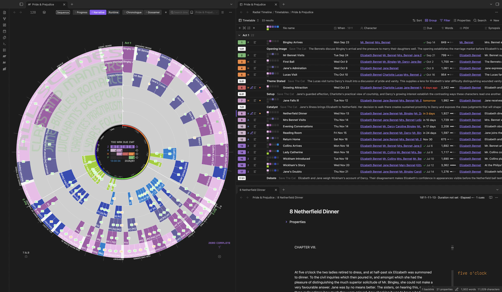
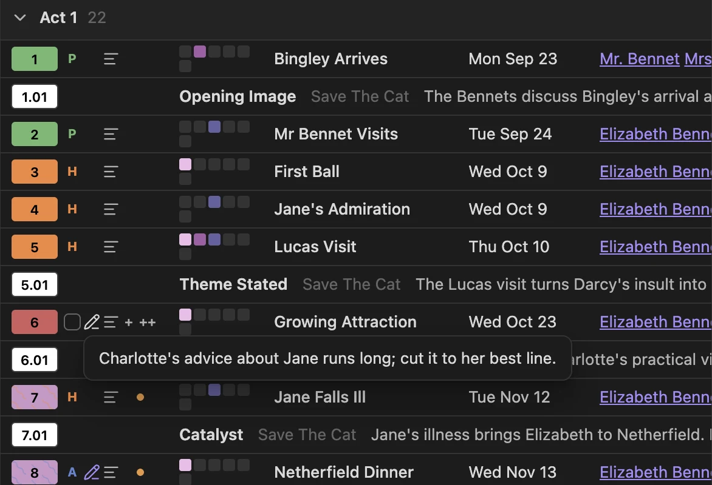

Keep the book’s notes beside the wheel in an Obsidian Bases view. The Timetable shows scenes, story beats, sketches, and other manuscript notes in rows, with scene status, subplot membership, dates, durations, and synopses visible together. Scenes, beats, and sketches appear wherever they sit in the book folder; other notes appear only from the book folder’s top level, so feedback, cuts, and publishing material kept in subfolders stay out of the way. The **Table** view in the same file lists everything.

> [!NOTE]
> Enable **Bases** under **Settings → Core plugins**. The Timetable works with Obsidian 1.13; the Act and Status boards require Obsidian 1.14 or later.

## Open the Timetable

Click the table button in the timeline title bar, or run **Radial timeline: Open timetable**. On first use, confirm creation of the book’s `.base` file in `Radial Timeline/Timetables/`. It opens beside the timeline. Switching books on the timeline switches a following Timetable tab to that book; Saga scope opens a combined table grouped by book and act.

The `.base` file is yours to customize. Change its columns, filters, sorting, or views in Bases. Radial Timeline preserves those choices. When a book’s manuscript folder changes, or a book joins or leaves the saga, it updates only the folder filter it wrote, wherever you have moved it, provided you have not replaced that filter yourself.

## Read the rows

- **Scene number:** the number cell carries writing status and Publish Stage colors. Story beats have their own number treatment; sketches remain distinct from scenes. Click a scene's number cell to set its Status or Publish Stage, or click a Status, Publish Stage, or Act cell for that property's values. Marking a scene Complete sets Due to today, as it does from the wheel.
- **Row controls:** beside each number, each control in its own place so they line up down the table:
  - the stage letter (**Z** Zero, **A** Author, **H** House, **P** Press) in its stage color, or a sketch’s chevron;
  - a pencil while Pending Edits has text: hover it to read them;
  - the Synopsis icon, on every row: hover it to read the Synopsis in full, or hold **Shift** for the Summary. It is fainter when the Synopsis is empty;
  - a dot when Due is late (red) or within a week (amber). On hover, **+** and **++** take its place and advance Due by a day or a week until the scene is complete. A late Due moves at once, counting from today; a Due that isn’t late, or a missing one, asks first and names the new date. Each click builds on the last. Sketches and notes with no Class show Promote in this place.
- **Rings:** colored squares show subplot membership in the wheel’s ring order. Hover for the subplot names. Outlined squares can show a subplot planned for a sketch before it appears on the wheel. **Rings per line** controls wrapping.
- **Properties:** columns come from your scene property templates and respect your field-name mappings. Template columns carry an icon in their header, and a column narrower than its name shows only the icon, with the name on hover. Use **Properties** to show or hide columns; see [Columns](#columns) for their order, widths, and reset.
- **When:** a short date and time, such as *Fri Apr 6 · 7PM*. When every row shares a year, the year moves to the column header. While the Duration column is hidden, the duration sits beside the date (*2h*). Hover for the full date and the duration as written. The Alt calendar shows its planetary dates.
- **Due:** relative time near today: red *4 days ago* when the scene isn’t complete, amber *tomorrow* or *in 3 days* within a week, plain text further out, and the short date beyond 30 days. A complete scene shows a check and its date. Hover for the full date.
- **Words:** the count with a small bar. Its tick marks the median scene of that scene’s book, and a full bar is twice the median. Hover for the ratio, such as *2,140 words · 1.3× the median (1,650)*.
- **Runtime and Iteration:** shown as badges with a timer and a repeat mark.
- **Open queries:** a marker identifies unresolved author queries in a note; hover to read them. On the wheel, the same scene shows a question bubble in each of its cells.

Row controls — hover the pencil to read Pending Edits; + and ++ advance Due

The **✱** button in the table’s corner opens the Timetable keys: what the row marks mean (including the row controls, **+** and **++**, and the Words bar), what each click does, and the corner buttons. A badge names the mode the table follows, and a section on top explains what that mode changes (Chronologue’s date dividers and its Gap or Running time column, Progress’s act totals and overdue dates, Gossamer’s beats and scores). The timeline’s own **✱** key covers the wheel, including the open-query mark and the clicks that link to a Timetable.

Hover a scene row to highlight it on the wheel and give its row a solid leading accent and a muted color wash. The color follows the rendered scene: subplot color in Narrative and Chronologue, status or Publish Stage color in Progress, or the active column coloring. Hover a scene on the wheel to reveal its row in that specific cell’s color. Click a scene row to open its note; **Shift-click** brings the timeline forward and highlights that scene. Right-click a scene row for the timeline’s scene menu.

Hold **Shift** while hovering a cell its column cuts off, such as a long Synopsis, a list of characters, or a beat’s purpose, to read its full text in a panel under the cell. Letting go of Shift, leaving the cell, or scrolling puts it away.

The table and the wheel point at each other. The note open in an editor is marked in the table. Clicking an act label on the wheel (a book label in Saga scope) shows that act in the table, expanding it if collapsed. Spotlighting a ring in the subplot key fades the rows outside that ring.

### Columns

A new Timetable lists **When**, **Character**, **Place**, **Due**, and **Words** after the name, then the rest of your scene template in its order, with **Synopsis** last. **Duration**, **Chapter**, **Runtime**, and **Iteration** start hidden; When shows the duration. Once a book has five scenes, a column that fewer than half of them fill starts hidden too, though When and Synopsis always show. Every hidden column is one click away in **Properties**.

- **Fit to content:** right-click a column header and choose **Fit to content**, or **Fit every column**. Double-click a column’s resize handle to fit that column. Fitted widths stay between 48 and 300 px and are saved like a dragged width.
- **Automatic fit:** a column you haven’t sized fits its header and cells while the table is open. It grows as you edit but shrinks only when the table reopens, and it isn’t saved to the `.base` file.
- **Long text:** Synopsis, Summary, and Pending Edits keep their width and never fit automatically.
- **Reset columns to recommended:** in the column header menu, or run **Radial timeline: Reset timetable columns to recommended**. After you confirm, that Timetable view gets the recommended columns for its scenes and loses its saved widths. Filters, sorts, grouping, and the file’s other views stay as they are.

### Time references within a scene

Expand the reference control beside a scene number to see its dated passages, then click a child row to open the passage or **Manage time references** to edit the list. See [Time references](Time-References) for the YAML format and how child rows connect to the Chronologue wheel.

### Follow the timeline’s mode

The Timetable draws itself in the timeline’s mode, and the mode button in its corner shows which. Click it to pin a mode instead. A sort set in the Bases toolbar still wins over the mode’s order.

| Timeline mode | What the table shows |
|---|---|
| **Narrative** | Rows in manuscript order. The **Runtime** view adds a **Running time** column: the runtime through each scene in reading order. |
| **Chronologue** | Rows in story order with a divider for each day; beats are left out, as on the wheel. **Shift** adds a **Gap** column (time since the previous dated row), and the Alt calendar shows dates, days, and gaps in the planetary calendar. |
| **Progress** | Each heading counts complete scenes, words, and overdue scenes; overdue Due cells stand out. |
| **Gossamer** | Beats come forward with their latest score for the selected signal, its change since the previous run, the expected range (flagged when a score is outside it), and the justification. Other rows recede. |

### Light up the table on the timeline

Turn on the lens in the Timetable’s corner, or as a view option saved in the `.base` file. The table’s scenes stay lit on the wheel and the rest recedes, as in Chronologue’s Shift mode: scenes outside the table, their numbers and titles, void cells and spokes fade, and the subplot ring titles hide. Hovering a receded scene still shows it. A pill names the view, with a button that turns the lens off. Any Bases filter becomes a pattern on the wheel, so a saved view is a saved lens.

A view with a filter of its own (**This view** in the Filter menu) turns the lens on by itself. Turning the lens off holds for that filter; a new or changed filter lights it again, and removing the filter returns the lens to its toggle. A new filter takes the lens from any other table.

### Color the timeline by a column

Right-click a stored scene-property column header to color the timeline’s scenes by values such as Character, Place, POV, Type, or your own categories. Every list member is available, including a character never listed first. Unfilled template fields such as `{{Character}}` count as no value.

Up to eight categories can be colored at once. A column with more categories opens a searchable chooser; pick the categories you want, then **Apply**. Other scenes stay muted. **Edit key** changes those choices later. The key shows each category’s scene count and states when only part of the column is colored.

Click category chips to narrow the timeline and fade nonmatching Timetable rows. List properties default to **Contains all selected**: picking two characters shows scenes containing both, anywhere in their lists. Scalar properties default to **Contains any selected**. Change that rule in **Edit key**. A scene uses the color of the first matching category in its own list. **Clear selection** restores all categories in the chosen palette without turning coloring off.

**When** starts with month groups, coloring the eight with the most scenes; pick months in **Edit key** to choose your own. **Edit key** also offers day, year, and a custom date range with inclusive start/end days and separate before/after groups. **Due** groups scenes into Overdue, Today, Next 7 days, Later, Completed, and Not set. **Edit key** lists every Due and range group, empty ones included, and each kept group colors as scenes reach it: a scene that turns overdue tomorrow takes the Overdue color, and every group keeps its own color. A completed scene’s Due is its completion date, so it belongs in Completed rather than Overdue. Invalid dates are shown separately. Date groups always use **Contains any selected**, so choosing April and June includes scenes in either month. Date-compatible custom properties can use the same grouping options.

**Stop coloring**, in the header menu or the key’s close button, restores the status and subplot colors and clears the selection. Palette choices, date groups, and selections are saved with the Timetable view. **Cancel** in the chooser leaves the saved view unchanged. One table colors the timeline at a time.

### Edit many rows at once

Each scene, sketch, and not-yet-promoted row has a checkbox, which takes the stage letter’s place on hover. Once a row is picked, every row shows its checkbox until the selection clears. **Shift** picks a range and **Esc** clears the selection. While rows are picked, a bar under the table sets Status, Stage, or Act on all of them, adds them to a ring or removes them from one, or promotes the ones that aren’t scenes yet. Status and Stage follow the wheel menu’s rules, so Complete sets Due. Ring changes come with one notice and one **Undo** for every note changed.

### The reading pane

Notes you open from the Timetable appear in a pane below the table, so the wheel, the table and one note sit side by side. While a Timetable is showing, scenes clicked on the wheel open there too, and their row is marked in the table.

- The first note splits the table downward. Each later note replaces the one in the pane, and the pane’s back and forward buttons step through the scenes you visited. Drag the divider to give the table or the note more room; you can also drag the pane above the table.
- A note that is already open somewhere is shown where it is, not opened twice.
- **Cmd-click** (Ctrl-click on Windows and Linux) opens a new tab instead.
- Pin the note in the pane to keep it: the next note opens in a tab beside it.
- The reading pane is used only while a Timetable is showing.

## Bring ideas from Canvas

Open an Obsidian Canvas and run **Turn Canvas cards into sketches** from the command palette. You can also find the action in the active Canvas file’s menu. Choose the text cards, the book and an optional act, then select **Create sketches**. Each selected card becomes a Markdown sketch in the book folder; its text stays in the note body, and its Canvas card becomes a link to the same note. Its position, color and connections stay in place. Existing file cards are left alone.

The first line suggests the sketch’s title. Sketches without an act appear unassigned in the Timetable. Canvas positions and arrows do not set manuscript order or dates. Review a sketch’s placement when you promote it to a scene. If the Canvas changes during conversion, the action stops instead of overwriting the map. Any sketches already created remain in the book folder. Canvas undo restores the text card but does not delete the sketch note; converting it again creates another note.

## Write sketches beside scenes

Use **New sketch**, or the **+** beside an act heading, to create a sketch in the book’s manuscript folder. A sketch has `Class: Sketch` and appears in the Timetable, keeping a place for an idea without putting it on the wheel yet. In Saga scope, use a book heading’s **+** to choose the book.

Click a sketch row or its drawer control to open it. The drawer starts with a **Title** field: press Enter or leave the field to rename the note through Obsidian, so links to it follow. A number prefix stays, characters a file name can’t hold become spaces, and a name already taken gets a number (` 2`). **New sketch** starts with the cursor in Title, and Enter moves on to the text.

Write directly in the drawer and edit its Act and When there. The text is saved in the note body. If the note changes elsewhere while you type, the drawer asks which text to keep before overwriting anything. **Open every sketch** expands the sketch drawers together.

## Promote a note to a scene

Use **Promote to scene** on a sketch or a note with no Class. Review the proposed properties and placement, then promote it. Promoted on its own, a note that still has a placeholder name (**Untitled sketch**, or Obsidian’s **Untitled**) asks for a **Scene title** first and promotes once it has one; in the **Position** menu, **Don’t number it** keeps the new title without a number prefix. Existing property values and body text are preserved; missing scene-template properties are added. A note already classified as a scene, beat, or another kind of note is not reclassified by this action.

You can also run **Radial timeline: Promote note to scene** or use the file-explorer context menu, including a folder’s direct children or a multi-selection. Notes must be inside a registered book’s manuscript folder; notes outside every book are explained and skipped. The scene then appears on the wheel and in the Timetable.

To go the other way, right-click a scene and choose **Remove from timeline**. Only its `Class` is removed: the note stays where it is, keeps its ID, act, subplots and text, and stays in its row here as a note with no Class, wherever it sits in the book folder. Promote it to bring the same scene back.

## Other views in the same file

| View | What it provides |
|---|---|
| **Timetable** | The compact book view with status numbers, Rings, and sketch drawers |
| **Table** | Obsidian’s editable property table for spreadsheet-style changes |
| **Not on the timeline** | Notes without a Class, ready to review or promote |
| **Act board** | A board grouped by Act, on Obsidian 1.14 or later |
| **Status board** | A board grouped by Todo, Working, and Complete, on Obsidian 1.14 or later |

The Saga file provides Timetable and Table views. To change scene order or subplot membership on the wheel, see [How to](How-to). For story-time placement, see [Chronologue Mode](Chronologue-Mode#drag-a-scene-to-change-its-date).
