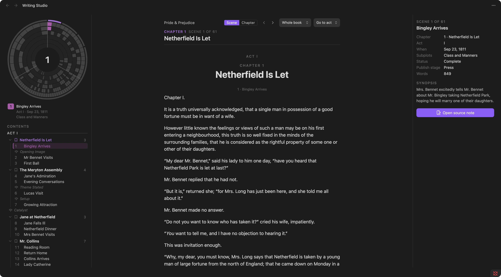

**Writing Studio** shows your book as one continuous text, every scene in order, so you can read it the way a reader will. A small wheel, the book's contents and the details of the scene you are reading sit beside the text.

## Open it

- Click the open-book button at the start of the timeline's title bar.
- Or right-click a scene on the timeline and choose **Read in Writing Studio**. The studio opens at that scene.
- Or click **Read chapter** on a chapter heading in the [Timetable](Timetable#chapters). The studio opens at the chapter's first scene.
- Or run the command **Writing Studio open**.

Writing Studio shows the active book. Choose another book in the timeline, and the studio follows.

## Find your way

- **The wheel** lights the scene you are reading. The other scenes stay gray. Click a scene on the wheel to go to it.
- **Contents** lists the book in outline form: acts, then chapters with their scene counts, then scenes and beats. Click a scene to go to it. Click a chapter's arrow to fold it.
- **Scene details**, on the right, show the scene's chapter, act, date, subplots, status, publish stage, word count and synopsis.

As you scroll, the wheel, the contents and the details all move to the scene you are reading.

## Choose how much to read

The bar above the text has these controls:

- **Scene** or **Chapter** sets what the arrows step by.
- The arrows go to the previous or next scene or chapter.
- **Show** chooses **Whole book**, **This chapter** or **This scene**.
- **Go to act** jumps to the start of an act. It appears when the book has more than one act.

## Edit while you read

Click **Open source note** in the scene details. The scene's note opens beside the studio, ready to edit.

The note then follows your reading. When you scroll to another scene and stop, the note switches to it. Picking a scene in the contents or pressing the arrows does the same. While you type in the note, it stays on its scene. Once you read on, it follows again.

Your edits show in the studio as you make them. Close the note to stop it following.

To open a note that stays put, Cmd-click **Open source note** (Ctrl-click on Windows and Linux). It opens in a new tab.

## In a narrow pane

- The scene details move behind the **Scene details** button in the bar. Click it to see them. Click the **×**, click anywhere else, or press Escape to put them away.
- In a very narrow pane, the wheel and contents move into a strip above the text. Click **Timeline** on the strip to open them, and **Close** to put them away.

## Chapters

Writing Studio shows the chapters you set for the book. They come from the **Chapter** property on your scenes, or from folders, as you choose in **Settings → Advanced → Chapter source**. See [Settings → Advanced](Settings-Advanced#timeline-display).
