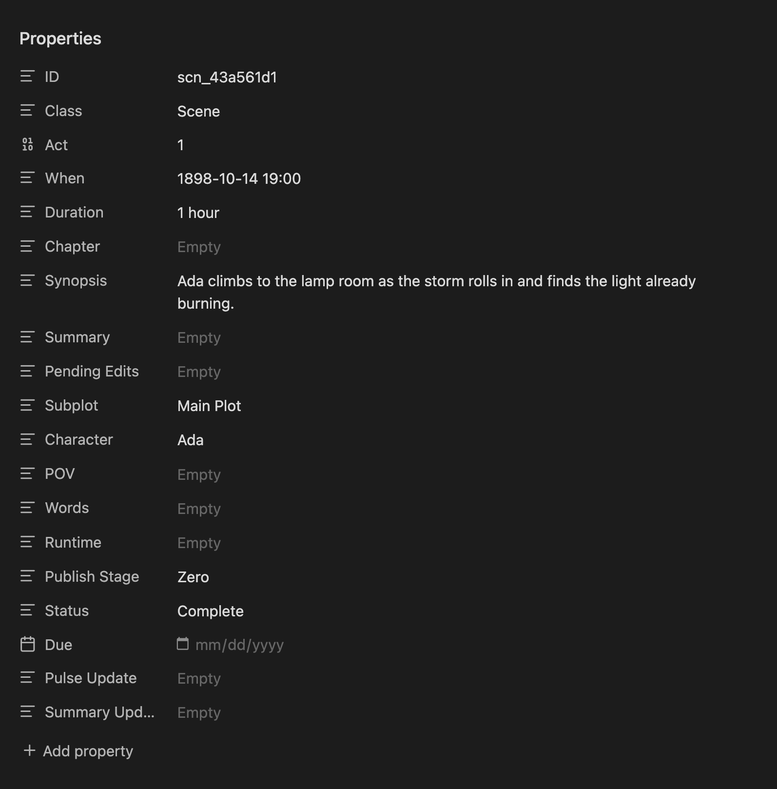

Radial Timeline reads scene, beat, and backdrop metadata from **Obsidian properties** at the top of each note. Start with the core properties and add fields as your project develops.

## Time references

The optional **Time References** list records other dates or periods mentioned within a scene. See [Time references](Time-References) for the required fields, a quoted YAML example, and screenshots of the timeline and Timetable. The scene’s primary `When` stays unchanged.

## Core Scene Scaffold

```yaml
ID: scn_00000000          # Auto-generated stable scene reference
Class: Scene              # Type: Scene
Act: 1                    # Act number within your configured act count
When:                     # Optional story chronology date (YYYY-MM-DD, optionally 12:34pm; add BCE for dates before the common era)
Duration:                 # How long the scene lasts (e.g., "45 seconds", "45s", "45sec", "2 hours", "3days")
Part:                     # Optional part marker — `true` for numeral only, or a title
Chapter:                  # Optional chapter marker for publishing and perimeter placards
Synopsis:                 # Concise present-tense snapshot for hovers/outlines (1-3 sentences)
Summary:                  # Extended scene expansion (events, emotional turns, subtext, outcome)
Pending Edits:            # Notes for next revision (especially for zero draft mode)
Subplot: Main Plot        # Single subplot (or use array format below for multiple)
Character:                # Characters in the scene; the first name is the POV character
Narration:                # Leave empty to follow the book's narration; see Narration Keywords
Words:                    # Optional word count/statistics
Total Time:               # Hours on this scene, added from writing sessions you approve
Runtime:                  # Optional runtime estimate or override
Publish Stage: Zero       # Progress stage (Zero/Author/House/Press)
Status: Todo              # Scene status (Todo/Working/Complete)
Due:                      # Target completion date (YYYY-MM-DD). Marking a scene Complete from the wheel or the Timetable sets it to that day
Pulse Update:             # AI-generated scene pulse analysis flag
Summary Update:           # Summary scene refresh flag
```

Book Designer and Note create generate the core scaffold above. `ID` is inserted automatically for stable scene citations, and the advanced properties editor can maintain the current core and advanced field order.

<p align="center"></p>
<p align="center"><sub>A scene’s core properties as Obsidian shows them at the top of the note</sub></p>

**For multiple subplots or characters, use YAML list format:**
```yaml
Subplot:
  - Main Plot
  - Subplot 1
Character:
  - "Protagonist"
  - "Mentor"
  - "Child One"
Place:
  - "Castle"
  - "Forest"
  - "Planet Nine"
```

Obsidian links are supported in properties. Use the double-bracket wikilink format inside quotes if you want a field to link to a note.

<a name="narration-keywords"></a>
## Narration Keywords

Each book sets how it is narrated in its book details (**Settings → Core → Books**, the tag button on the book's card). The POV character is always the first name in `Character`. A scene narrated differently from its book says so in its `Narration` property:

```yaml
Character:
  - "Watson"
  - "Holmes"
Narration: omni           # This scene only: an omniscient narrator
```

*   `Narration: first` — the first listed character gets a `¹` marker.
*   `Narration: second` / `Narration: you` — inserts `You²` ahead of the cast.
*   `Narration: third` — the first listed character gets a `³` marker.
*   `Narration: omni` — shows `Omni³` to signal an omniscient narrator.
*   `Narration: objective` — shows `Narrator°` for camera-eye scenes.
*   `Narration: two`, `Narration: 4`, `Narration: count`, `Narration: all` — marks that many names at the start of `Character`, for a scene several characters carry, with the book's narration marker.

Descriptions built from these words, such as `third person limited` or `close third`, work too. The scene properties check in **Settings → Core** lists any scene whose `Narration` holds something else, such as a character's name, with its value, so you can open the scene and choose a narration or clear the field; until then the scene follows its book.

New scenes get an empty `Narration` property; a scene that follows its book leaves it empty, or without the property at all. Scenes written before Radial Timeline 8 may carry the field under its earlier name, `POV`. Radial Timeline reads it the same way until you apply **Scene field POV is now Narration** at the top of **Settings → Core**, which renames `POV` to `Narration` and keeps its value. See [Narration](Settings-Core#narration).

<a name="advanced-scene-template"></a>
## Advanced Scene Properties

Advanced scene properties add optional fields for deeper workflows (Dramatica, custom analysis, and more). This profile is **customizable**.

```yaml
ID: scn_00000000
Class: Scene
Act: 1
When: 2085-01-01 1:30pm
Duration: 6 hours
Chapter:
Synopsis: What happens in a few lines.
Summary: The longer scene summary.
Pending Edits:
Subplot:
  - Subplot 1
  - Subplot 2
Character:
  - "Character 1"
Place:
  - "Earth"
Publish Stage: Zero
Status: Todo
Due:
Pulse Update: No
Summary Update:
Words:
Runtime:
Iteration:                            # Edit iteration count (deprecated: was "Revision")
Type:                                 # Optional scene role or classification
Shift:                                # Optional value shift or polarity change
Questions:                            # Analysis Block
Reader Emotion:
Internal: How do the characters change?
```

<a name="advanced-yaml-editor"></a>
### Advanced Properties Editor

The advanced properties editor lets you tailor the advanced scene properties while keeping required base keys intact. Add, remove, or reorder optional fields to match your workflow.

*   Open **Settings → Core → Scene properties** and choose **Show advanced properties editor**.
*   Required base keys stay locked and auto-included in order.
*   Optional keys can be drag-reordered, renamed, deleted, or added.
*   Radial Timeline-managed maintenance only governs the core and current advanced scene-property fields.
*   Scene-property maintenance preserves custom fields and fields from other plugins.
*   Reordering keeps custom fields beside the managed property directly above them.
*   Use the restore icon to revert to the shipped defaults.

## Sketch Notes (YAML)

`Class: Sketch` keeps a planning note in the [Timetable](Timetable), off the wheel until you promote it to a scene. Write the sketch in the note body; Act, Subplot, and When can record its intended placement. The drawer edits these author-facing properties and the body directly.

```yaml
Class: Sketch
Act: 1
Subplot:
When:
```

Use **Promote to scene** when it is ready; existing values and prose are preserved. See [Promoting notes](Timetable#promote-a-note-to-a-scene).

A sketch created from an outline document records where it came from, a link you see in Properties and Backlinks:

```yaml
Source: "[[Story Outline]]"       # only for sketches created from an outline document
```

Where a sketch sits among the scenes, the scene it follows and its order there, is not a property. Radial Timeline keeps it in `Radial Timeline/Sketch Placement/placements.json`, which syncs with your vault, and follows the sketch when you rename or move it. Dragging a sketch in the Timetable, **Move up** and **Move down** when converting Canvas cards, and placing ideas from an outline all set it there. A sketch with no place after a scene sits at the end of its act. See [Place scenes and sketches from the table](Timetable#place-scenes-and-sketches-from-the-table).

Earlier versions wrote this as `Place after scene` and `Sketch order` in the sketch note. The first time Radial Timeline 8 opens your vault, it copies those values into the placement file, so every sketch keeps its place. The lines stay in your notes as you have them, and Radial Timeline no longer reads them after that copy; you can delete them whenever you like.

## Outline Notes (YAML)

`Class: Outline` marks a planning document in a book folder, such as a chapter outline or a synopsis. The Timetable’s **Outline** layout lists it under **Outline documents** without attaching it by hand, and **Create sketches from this document** turns its headings into sketches. See [Outline](Timetable#outline).

```yaml
Class: Outline
```

## Images for Timetable Panels

**Panels** and Canvas cards show an image on each card. An image file named after a character or place, such as `Elizabeth Bennet.webp`, is found anywhere in the vault; numbered copies such as `Elizabeth Bennet 2.webp` are further portraits of the same character, and each scene keeps the one it was given. To choose the image yourself, name it in an `Image` property, such as `Image: Elizabeth Bennet.png`; it takes the place of the match by name. The cards read these properties:

| Property | On | Shows |
|---|---|---|
| `Image` | a character note | the portrait to use for that character, instead of the image found by name |
| `Image` | a Place note | the place, for the first place in a scene’s **Place** list, instead of the image found by name |
| `Place image` | a scene or sketch | the place art for that note only, instead of the Place note’s image |
| `Scene image` | a scene | artwork for the scene itself |

Each value names an image in the vault, such as `Elizabeth Bennet.png` or `"[[Longbourn.webp]]"`. PNG, JPEG, GIF, WebP and AVIF work. See [Panels](Timetable#panels).

## Beat Notes (YAML)

```yaml
ID:                           # Auto-inserted unique id
Class: Beat                   # Formerly Plot, Deprecated
Beat Model: Save The Cat
Act: 1
Purpose: Why this beat exists in the structure (1-2 sentences, avoid retelling scene events).
In This Book:                 # What this beat is in your novel; leads the beat hover when filled
Range: 0-20
Chapter:
Gossamer1: 12                 # First trace (oldest) - Up to 30 saved traces
Gossamer1 Justification:
Gossamer2: 21                 # Second trace (most recent in this example)
Gossamer2 Justification:
```

> **Beat order** follows `Act` and the filename prefix (`sceneInteger.minor`, for example `7.01`).

**In This Book** says what a beat is in your novel, where `Purpose` says what the beat does in any story. When it's filled, the beat hover opens with your line and shows the generic `Purpose` beneath it in smaller, dimmer text, and timeline search finds the beat by its words. Unfilled beats show `Purpose` alone. In Narrative mode, hold **Shift** to swap the beat labels around the outer ring to their In This Book names (a long line is cut short on the ring; the hover keeps all of it). New beat notes include the field; to add it to existing beat notes, run **Insert missing fields** from the beat properties audit in **Settings → Core → Story beats system**.

Beat notes have their own **Beat properties editor** in **Settings → Core → Story beats system**. Use it to add custom keys and choose which fields appear in beat hovers. Beat properties are stored per beat system.

## Backdrop Notes (YAML)

```yaml
Class: Backdrop                   # Used for special context events that move the plot. Appears as a dedicated ring in Chronologue mode. See also micro-backdrop rings for lighter-weight context.
When:                             # Start Date time (YYYY-MM-DD HH:MM)
End:                              # End Date time (YYYY-MM-DD HH:MM)
Context: Static world context this backdrop represents (no scene-level unfolding).
```

Backdrop notes can be extended using the **Backdrop properties editor** in Settings.

## YAML Managers in Settings

*   **Advanced properties editor**: In **Settings → Core → Scene properties**, choose **Show advanced properties editor** to customize advanced scene properties and hover metadata.
*   **Beat properties editor**: Customize beat note fields and beat hover metadata.
*   **Remap frontmatter field keys**: In **Settings -> Advanced -> Configuration**, map your existing keys to Radial Timeline keys without rewriting your files.

See [Scene properties](Settings-Core#scene-properties), [Configuration](Settings-Advanced#configuration), and [Story beats system](Settings-Core#story-beats-system) for configuration details.

## Remap Frontmatter Field Keys

If your vault already uses different property names for scene notes, you can map them to Radial Timeline's system keys in **Settings -> Advanced -> Configuration** with **Remap frontmatter field keys**.

Example: If you use `Timeline: 2024-01-01` instead of `When: 2024-01-01`, create a mapping from `Timeline` to `When`.

## Backwards Compatibility

The plugin also recognizes these legacy field names:

| Current Name | Legacy Names (still work) |
|--------------|---------------------------|
| `Iteration:` | `Revision:`, `Iterations:` |
| `Purpose:` | `Description:` |
| `Context:` | `Synopsis:` (Backdrop only) |

Use fixed-width decimal minors for beat filenames (`1.01`, `1.02`, ...).

Existing notes with old field names will continue to work. Only new notes created from the built-in property profiles will use the current field names.
